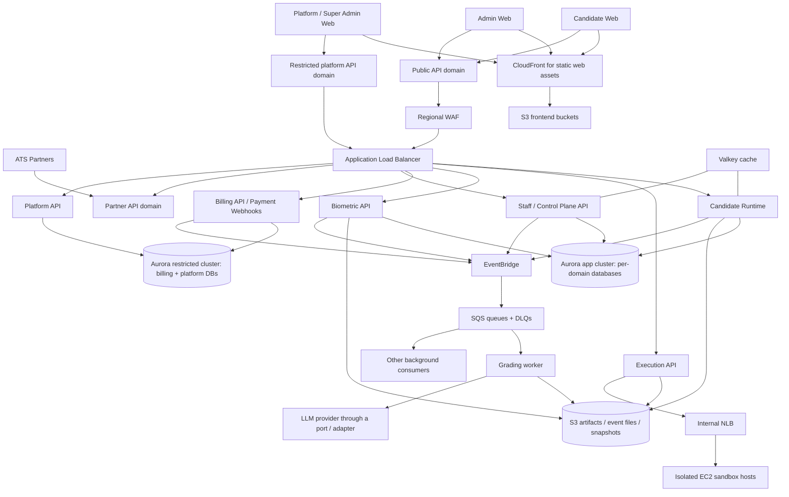

# CD-Recruit / Proctora — Final AWS Architecture Explained End to End

**Purpose:** Explain the 12 October 2026 cost-optimized infrastructure proposal in plain technical language: what runs, how components communicate, what data is captured and stored, how Candidate/Admin/Super Admin journeys work, what the plan costs, and what must be resolved before implementation.

**How to read this:**
- **In the proposal** means it appears in the attached infrastructure plan.
- **Recommendation / needs validation** means it is a review conclusion, not a settled deployment fact.
- Cost figures are planning estimates from the proposal's US East basis, not an AWS quote for Mumbai.

---

## 1. The one-minute mental model

Think of Proctora as a secure examination centre running in AWS.

- The **web apps** are the candidate, recruiter/admin and platform/super-admin screens.
- The **edge layer** is the reception/security desk: it serves the web apps, checks incoming requests and directs each request to the right application process.
- **ECS Fargate** runs the regular backend processes without the team managing virtual machines.
- A separate **EC2 sandbox pool** runs candidate-submitted code in a restricted environment.
- **Aurora PostgreSQL** stores structured business records: users, drives, sessions, billing records and scores.
- **S3** stores files and large data: web builds, content snapshots, submissions, reports, telemetry and biometric evidence.
- **EventBridge and SQS** let one part of the platform tell another part that work is ready without requiring both sides to be available at the same instant.
- **Valkey** stores short-lived coordination/cache data, not the authoritative financial ledger.
- **KMS, IAM roles, Secrets Manager, backups and monitoring** protect the data, control permissions and help the team recover.

A request usually follows this path:

`Browser → DNS / HTTPS → ALB + WAF → the correct ECS service → database / S3 / another service → response`

Some data does not follow the whole path. Static frontend assets are served from CloudFront and S3; large biometric evidence files can be uploaded directly to S3 using a short-lived presigned URL. Background grading follows a queue, rather than making the candidate wait for the AI model to finish.

## 2. The final logical architecture

The diagram is conceptual. Exact private routes, which calls use HTTP versus another protocol, service discovery, and whether browser code can call the Execution API directly still need to be frozen in the API contract and deployment configuration.

## 3. Top to bottom: each AWS layer in plain language

### 3.1 Region, Availability Zones and AWS accounts

**Region:** The proposal uses Mumbai (`ap-south-1`) as the primary region and Hyderabad (`ap-south-2`) for selected restricted-data backup copies. A region is a geographic AWS location. Region failover is not automatic active-active in this design; the proposal expects roughly 24–48 hours for a regional recovery.

**Availability Zones (AZs):** These are separate groups of data centres within one region. The production network uses two AZs so the load balancer, application tasks and database failover target can survive some individual-AZ failures. Two AZs do not mean every component is automatically highly available: one running ECS task can still be a single serving instance until the service scales out.

**Four account proposal:**

| Account | Layman's purpose |
|---|---|
| `cdr-mgmt` | The management/control account: billing consolidation, central access and organisation-wide guardrails. No application workloads. |
| `cdr-prod` | The real customer system and production data. |
| `cdr-nonprod` | Staging/integration/testing with synthetic data only. No production customer records. |
| `cdr-vault` | Backup and audit storage protected from routine production-account permissions. |

An AWS account is a strong administrative/security boundary. It is not the same thing as a database or a microservice. Account creation, organisation policies, IAM Identity Center and cross-account backup wiring should be owned by the deployment team.

### 3.2 DNS and web frontends: Route 53, CloudFront and S3

- **Route 53** translates hostnames such as `app.example.com`, `admin.example.com`, `platform.example.com` and `api.example.com` into the relevant AWS endpoint.
- **S3 frontend buckets** hold the compiled React SPA files: HTML, JavaScript, CSS, fonts and images. These are not the live candidate records or business database.
- **CloudFront** caches and serves those static files from edge locations closer to users. This reduces repeated asset downloads from the application servers.
- The current proposal uses a Pro flat-rate plan for the candidate SPA and Free plans for the admin and platform SPAs. Flat-rate allowances are not hard usage caps and there are no overage charges, but sustained excess use may result in delivery-performance adjustments; the right tier depends on usage and required features. AWS documents the current plan details here: https://docs.aws.amazon.com/AmazonCloudFront/latest/DeveloperGuide/flat-rate-pricing-plan.html.

The design deliberately sends the noisy APIs and WebSocket traffic directly to the application load balancer rather than routing all of it through CloudFront. That means the frontend pages can be cached, but each live API action still reaches the backend.

### 3.3 WAF and Application Load Balancer (ALB)

- **AWS WAF** is a web request filter. It can block known bad traffic and enforce rate limits before traffic is passed into the application.
- **ALB** is the traffic director. It receives HTTPS requests and uses the requested hostname/path to decide which backend target group should handle them.
- The candidate API, staff/admin API, platform API, partner API, biometric API, execution API and payment webhook path have different routes.
- The ALB can also support WebSocket connections for live assessment updates.

Important distinction: WAF does not replace app-level authorization. A request passing WAF still needs a valid session/token, correct tenant access, valid request structure and the relevant rate limits. Candidate campuses may send thousands of candidates behind a few public IPs, so aggressive per-IP limits on candidate actions can block legitimate users. Candidate/session limits must also exist in the app.

The proposal excludes some request-body managed rules from code/SQL submission paths to avoid rejecting legitimate candidate code. That is reasonable only if the application has strong size limits, schema validation, authentication, execution quotas and abuse detection, followed by WAF testing against real sample traffic.

### 3.4 VPC, subnets, security groups and NAT

A **VPC** is the private network built for this deployment. Subnets divide that network into areas with different routes and security settings.

- **Public subnets:** host the internet-facing ALB and NAT gateways.
- **Private app subnets:** host Fargate application tasks. Users cannot connect straight to their private IPs; traffic comes through the permitted load-balancer routes.
- **Private database subnets:** host Aurora and the cache endpoints. They do not receive direct internet traffic.
- **Isolated sandbox subnets:** host untrusted-code execution machines. The proposal gives them no NAT route or general internet route.

A **security group** is a virtual network firewall attached to a resource. For example, the database security group should accept PostgreSQL connections only from approved application roles, not from the public internet or every ECS task.

A **NAT gateway** gives private application tasks outbound internet access without making those tasks inbound-public. In the plan, outbound calls to an external LLM/payment provider can use that path, while an S3 gateway endpoint lets supported S3 traffic avoid NAT processing charges. NAT itself has hourly and data-processing charges, so sending large files through it can raise costs.

The plan suggests two production NAT gateways, one per AZ, for egress resilience. This is a deployment-team choice with a concrete cost trade-off: one saves money but may prevent task replacement or scale-out if the only NAT's AZ fails.

### 3.5 ECS Fargate: where normal backend code runs

**ECS** schedules and replaces application containers. **Fargate** supplies the underlying compute capacity so the team does not manage the host operating system for each normal service.

A **container** is the packaged application plus its runtime and dependencies. A **task** is a running instance of that container definition. An **ECS service** maintains the desired number of tasks and can increase or replace them.

The proposal uses ARM64 (AWS Graviton) for normal Fargate services where all dependencies work on ARM64. Before adopting it, test ONNX Runtime, Prisma/native modules and every relevant base image/driver. Execution sandbox hosts are separately specified as x86 because that runtime stack may have different requirements.

The starting task sizes are deliberately small. Each application can have its own scaling policy rather than scaling every backend at the same rate:

| ECS service definition | What it runs | Why it exists |
|---|---|---|
| `candidate` | Candidate API, WebSocket, telemetry ingestion and outbox relay | The live assessment path; scales with active candidates/connections. |
| `execution-api` | Validates execution jobs and coordinates sandbox hosts | Isolates the sensitive code-run control path from ordinary session processing. |
| `billing-api` | Credit acquisition, payments, webhooks and ledger reads | Protects the financial invariant and keeps candidate-facing services away from the finance database. |
| `biometric-api` | Face/liveness logic, evidence ticket issuance and evidence access | Handles sensitive identity data and ONNX workloads. |
| `grading-api` | Status/detail and regrade endpoints | Exposes scoring operations to authorised internal callers. |
| `grading-worker` | Consumes grading jobs and runs scoring/LLM logic | Can scale from zero when no grading jobs are queued. |
| `staff-api` | Recruiter/admin Control Plane modules: IAM, Hiring, Content and Insights | Keeps these lower-volume modules in one business deployable initially. |
| `partner-api` | ATS partner endpoints | Separate task role and public exposure rules. |
| `platform-api` | Super-admin/platform endpoints | Separate role and restricted-data access from ordinary staff APIs. |

This is **nine ECS service definitions**, not only six. The six logical business groups are Candidate Runtime, Execution, Billing, Biometric, Grading and Control Plane. Grading has separate API/worker deployments; Control Plane has staff, partner and platform task deployments. At idle the table budgets eight active tasks because `grading-worker` is set to zero. Those counts are starting settings, not proven capacity.

Some service definitions may use the same source image but different task roles. A separate task role can reduce credentials available to one process, but separate roles do not magically make code within the same running process unable to access every credential that process has been granted.

### 3.6 EC2 Auto Scaling Group: isolated code execution

Candidate-submitted code is untrusted. It must never run on a normal API server or on the machine/container that has direct production database credentials.

The design therefore has two pieces:

1. **Execution API on Fargate:** authenticates/validates the run request, selects the right test configuration, routes the job and handles the result.
2. **Sandbox hosts on EC2:** execute the submitted code inside limited sandbox containers. The proposal uses an Auto Scaling Group, an internal Network Load Balancer, no instance-role permissions, restricted egress, IMDSv2, read-only filesystem/job limits and a gVisor-related isolation setup to verify.

For each run, CPU, memory, runtime, process count and output size should be limited. Jobs should not be able to contact the public internet, production databases, metadata credentials or neighbouring jobs. Sandbox images should be built from a controlled pipeline and replaced after updates rather than manually patched in place.

The proposal uses On-Demand capacity for a small warm base and Spot for some burst capacity. Spot is cheaper but can be interrupted; execution must be safe to retry and should not treat an interrupted run as a candidate's wrong answer.

The draft contains an important unresolved detail: one route table allows the browser to call `/exec/*` directly through the ALB, while the earlier migration plan describes Runtime calling Execution internally. Freeze this before building. **My recommendation is Browser → Runtime → private Execution API → sandbox.** If a direct browser-to-execution route is retained, it needs equivalent server-side session, tenant, invite, snapshot, attempt, rate and output authorization—not just a valid generic JWT.

### 3.7 Aurora PostgreSQL: the structured database

The proposal has **two production Aurora clusters**:

- `cdr-app`: logical databases for `iam`, `hiring`, `content`, `runtime`, `biometric`, `grading` and `insights`.
- `cdr-restricted`: logical databases for `billing` and `platform` (super-admin/tenant registry data).

The non-production environment uses one cluster containing the nine logical databases with synthetic data and a proposed auto-pause configuration.

A **cluster** is the managed database infrastructure. A **database** inside a cluster is a separate logical database. A **role** is a database identity with permission to do specific operations. The plan calls for different application, migration and read-only dump roles per database.

This is a cost compromise. A database-per-service design means services own different tables, migrations and credentials, but when several databases share one Aurora cluster they still share cluster capacity, the failure domain and the cluster-level restore process. A busy grading or runtime database can still compete with another database on the same cluster. It is not equivalent to ten physically independent databases.

The restricted cluster helps isolate finance/platform data from recruiter-facing services. It does not isolate `billing` from `platform` at the physical cluster/KMS-key level in this draft; both are on the restricted cluster and use the restricted-tier key. Separation is enforced by database roles, task roles, subnet/security-group rules and separate backup paths.

Aurora Serverless v2 adjusts database compute capacity, measured in ACUs. AWS documents that the minimum/maximum range is set at cluster level and applies to each Serverless writer/reader; promotion tier then affects whether a reader follows writer capacity or scales independently. See https://docs.aws.amazon.com/AmazonRDS/latest/AuroraUserGuide/aurora-serverless-v2.how-it-works.html.

**Correction before IaC:** the plan's table lists different *configured min/max ranges* for the writer and reader inside a cluster. That is not a valid per-instance configuration description for Serverless v2. Choose the correct shared cluster range, then model each writer/reader's expected actual capacity, promotion tier and cost. The idle estimates should be recalculated after this is fixed.

### 3.8 S3: files, not relational business records

S3 is object/file storage. The proposed buckets include:

| Bucket/category | What it stores | Access boundary / lifecycle idea |
|---|---|---|
| Web bundles | Candidate/admin/platform SPA files | CloudFront-only access; rebuildable from CI; old versions expire. |
| `artifacts` | Submission bundles, code snapshots, content's public snapshots and reports | Versioning; restricted by service and prefix permissions. |
| `content-scoring` | Hidden tests, answer keys, rubrics and scoring snapshot data | A separate bucket/key so candidate-facing roles cannot read it. Execution and grading get access only as required. |
| `events` | Compressed telemetry chunks and compacted session event logs | Chunks expire quickly after compaction; compacted data has a longer bounded retention. |
| `biometric` | Selfies, ID photos and evidence clips | Short-lived presigned access; no versioning/replication/backup by design in this proposal; purge policy is particularly sensitive. |
| `ledger-worm` | Nightly ledger/finance evidence exports | S3 Object Lock/WORM and cross-account copy; retention/legal review required. |
| Logs | ALB access logs and security/audit logs as configured | Expiry/retention policies, not unlimited storage by accident. |

**Presigned URL:** a temporary, scoped link authorising a specific S3 action. This lets the browser upload a large evidence file directly to S3 without sending its full bytes through the application server. The application first decides whether to issue the link and with what constraints.

The proposal gives biometric evidence no versioning or backup because it prioritises deletion at the end of a retention/appeal window. That is a deliberate trade-off: if a clip is deleted or otherwise lost, it may not be recoverable. Legal/privacy owners must sign off on that policy and its lifecycle backstop.

### 3.9 EventBridge, SQS, DLQs and Scheduler

These four concepts do different jobs:

- **EventBridge:** routes a statement that something happened, such as `session.submitted` or `organization.created`, to interested consumers.
- **SQS:** holds a work item until a consumer successfully processes it. For example, a grading request waits in `grading-jobs` while worker capacity is unavailable.
- **DLQ (dead-letter queue):** holds a message that exceeded its retry policy so it can be investigated/redriven instead of retrying forever.
- **EventBridge Scheduler:** runs a task at a specified time, such as capacity pre-warming, nightly billing reconciliation or biometric retention purging.

The event payload should usually contain identifiers and a file pointer rather than a complete submission, full candidate record or video clip. Large objects belong in S3; this is often called the **claim-check pattern**.

Standard SQS queues provide at-least-once delivery: duplicate messages can occur and ordering is not guaranteed. Consumers must be idempotent and tolerate duplicates/out-of-order events. This is especially important for grading and anything that can create or alter financial records. AWS documents these delivery properties at https://docs.aws.amazon.com/AWSSimpleQueueService/latest/SQSDeveloperGuide/standard-queues.html.

### 3.10 Valkey: fast temporary state

Valkey (Redis-compatible cache) holds short-lived or rebuildable information: rate-limit counters, WebSocket coordination and other cache entries. It is not the permanent record of a payment, credit balance, session or score. If Valkey disappears, the application may temporarily lose cache/coordination performance; it must be able to reconstruct important state from the authoritative databases/events.

### 3.11 KMS, Secrets Manager, IAM task roles and GuardDuty

- **KMS keys** encrypt supported data and can provide separate access boundaries. Encryption at rest does not replace application authorization; the role still has to be authorised to use the key.
- **Secrets Manager** keeps database passwords, payment secrets and any external LLM key out of source code and ordinary image files.
- **IAM task roles** grant each running workload only the AWS access it needs. For example, the grading worker can call the LLM; the partner task should not read hidden tests; the candidate task should not read scoring answer keys; the staff tasks cannot reach the restricted cluster.
- **GuardDuty** detects selected suspicious AWS-account activity. It is a detection tool, not a substitute for correct permissions, patching or incident response.
- **CloudTrail** records account/API activity. **CloudWatch** stores logs/metrics and raises alarms.

The infrastructure draft omits full distributed tracing at launch to reduce cost, relying first on structured logs and correlation IDs. That is a reasonable starting point if the team can follow one request across services and alarms cover queue age, error rates, database pressure, failed backups and cost.

---

## 4. What data is captured, and where does it go?

| Data | Captured from | Primary storage | Who should access it |
|---|---|---|---|
| Staff login/session and permissions | Admin/platform login flows | Identity provider and IAM tables/claims (identity-provider choice remains open) | Relevant auth process; API services validate tokens/claims. |
| Organization/tenant identifiers and settings | Platform and admin workflows | `platform` / `iam` logical databases as defined by ownership | Platform/admin services according to permissions; no broad candidate PII in platform registry. |
| Drives, schedule, invitations, candidate roster | Recruiter setup, ATS integrations | `hiring` database | Staff/partner API; Runtime gets a minimum invite projection, not unrestricted Hiring database access. |
| Assessment question bank and templates | Admin authoring | `content` database | Staff/Content module. |
| Frozen drive content | Content snapshot publishing | S3 public snapshot and scoring snapshot objects | Runtime reads candidate-visible content; Execution/Grading read scoring data as authorised. Candidate service must not read hidden tests/answer keys. |
| Candidate session/timer/responses/autosave | Candidate browser actions and Runtime | `runtime` database; large bundle/submission objects in S3 | Runtime and authorised review/grading access. |
| Code/SQL/NoSQL execution request and results | Candidate's Run/Test action | Execution logs/operational state; final submission in artifact bundle | Execution service and candidate-safe result path; sandbox cannot access production business DBs. |
| Telemetry: edit/keystroke changes, focus, paste, tab/window events, run/submit markers | Browser event collector/proctoring instrumentation | Compressed chunks and compacted log in S3; small flags/session state in DB | Runtime/Integrity and authorised reviewer workflows; highly sensitive because source code or behaviour can be present. |
| Selfie/ID photo and evidence clip | Candidate camera/identity flow and flagged events | Biometric S3 bucket; verification/consent/status metadata in `biometric` DB | Biometric service; a reviewer gets a short-lived URL only after authorisation/MFA as specified. |
| Integrity flag and its evidence references | Proctoring signals and analysis | Integrity data/module or current draft's `runtime` database mapping | Integrity/review access; must be handled as a finding requiring review, not automatic proof of misconduct. |
| Raw answers, code diffs, submission bundle | Candidate submits final assessment | S3 bundle, `runtime` session state and related metadata | Grading, Runtime and authorised reviewer. |
| Deterministic scores, AI rubric evaluation, confidence, Say-Do correlation and provenance | Grading worker | `grading` database and S3 report/artifact outputs as appropriate | Grading, authorised staff/Insights and audit. Placeholder Say-Do output must never appear as a real score. |
| Reviewer decision, note, report read model | Recruiter/reviewer actions | `insights` database | Recruiter with the right organisation/role; exports follow the same controls. |
| Credits, reservations, payments, ledger, plans and reconciliation | Drive launch, session authorization and payment gateway events | `billing` database in restricted cluster; WORM ledger export in S3 | Billing/platform authorised roles, not candidate-facing DB access. |
| Queued task/event metadata | Outbox/event publisher and AWS routing | EventBridge/SQS, mostly IDs/pointers and limited metadata | Consumer task roles. Do not put full PII or large payloads in event messages. |
| Logs, alarms, audit trails | Application/AWS activity | CloudWatch/CloudTrail and configured log buckets | Operations and restricted audit roles; retain for a defined period. |

### Telemetry flow, step by step

The infrastructure draft proposes the following:

1. The browser batches events approximately every three seconds and assigns each batch a sequence number.
2. The browser retains unacknowledged batches in IndexedDB until the server reports that the data is durably stored.
3. Runtime authenticates the session, checks and de-duplicates batches, and buffers events.
4. Approximately every 45 seconds or 256 KB, Runtime compresses the buffer and writes a chunk to S3.
5. Small session state/autosave and integrity flags can still go into PostgreSQL; raw event batches do not.
6. At submission, the chunks are compacted into a session event log and referenced from the submission bundle.

This reduces database load but it does **not** mean telemetry avoids the ALB entirely. In this proposed path, the browser POSTs to the API through the ALB; the application-to-S3 write then uses an S3 gateway endpoint. Only a separate direct presigned upload, such as a biometric clip, bypasses the application-server data path.

**Math check:** if 2,000 candidates each send one telemetry batch every three seconds for a full three-hour assessment, the upper-bound arithmetic is about **7.2 million POSTs** (2,000 × 3,600 seconds ÷ 3). The cost draft references about 4.8 million requests, which corresponds to roughly two hours at that rate. Confirm actual active time, event batching and request counts in load tests before accepting the WAF/ALB/network cost estimate.

---

## 5. End-to-end user journeys

## 5.1 Super Admin: onboarding a customer organisation

1. The super admin opens the Platform Web app. Its static files come from CloudFront/S3.
2. The login flow issues a token through the chosen identity approach. **The infrastructure plan leaves Cognito versus self-issued JWT open**, so do not assume this decision is final.
3. Platform API receives platform-only actions through its separate API route and task role. Access should be restricted and MFA-protected; the draft proposes an IP allowlist for the platform API and a separate task role.
4. The Platform API creates/updates the platform tenant registry in the `platform` database in the restricted cluster.
5. For application-level organisation/user setup, Platform API calls the Staff API rather than taking a broad IAM database credential itself. Staff/IAM creates the application-side organisation/roles and emits an `organization.created` event.
6. Billing consumes the event idempotently and creates the billing account, organisation mapping and any approved trial grant. The exact trial allowance is a product decision; the earlier migration document cites 25 credits, but confirm that against the current pricing specification.
7. Events/metrics can update admin dashboards without giving the platform registry unrestricted access to candidate records.

**Why this matters:** the platform admin can manage customers, plans and platform-wide controls, but the ordinary recruiter API should not have credentials for the restricted database. The role boundaries are part of the design, not just hidden buttons in the UI.

## 5.2 Admin / recruiter: create and launch an assessment drive

1. Recruiter signs into Admin Web and selects an organisation. Every server request must validate the organisation/tenant and the user's role; a frontend filter is not an access control.
2. Staff/Control Plane handles the drive creation flow. Hiring data includes the drive configuration, candidate roster, invitations, schedule and partner mapping. Content data includes questions, templates, versions and rubrics.
3. The recruiter authors/questions-selects and configures an assessment. Those draft steps are free under the current product design.
4. When the recruiter chooses **Review & Launch**, the launch workflow checks the roster/configuration, persists launch state and asks Content to publish an immutable snapshot. The snapshot contains a **public** part (question text, options, visible examples, timers and module configuration) and a **scoring** part (answer keys, hidden tests and rubrics) with different storage permissions.
5. Hiring requests funding from Billing. Depending on the configured business offering, this may be a Drive Pass checkout, approved reserve, PO or wallet. For a payment checkout, the payment gateway later calls the payment webhook endpoint.
6. Billing verifies the gateway signature, stores the webhook event idempotently and grants credits only after a verified captured-payment event. It publishes a billing event. The launch workflow must not schedule a funded drive until both funding and snapshot prerequisites are satisfied.
7. Hiring marks the drive scheduled, allocates candidate slots, creates invites and publishes events such as `drive.scheduled` and `invite.upserted`.
8. Runtime consumes invite events to build a local invite projection (token hash, schedule, expiry, allowed candidate snapshot and timing policy). This means a candidate can redeem an already-published invite even if the staff/Hiring API is temporarily unavailable.
9. Capacity preparation uses the drive schedule/expected attendance to raise database capacity and minimum task counts ahead of the window. The simplest first implementation can be a human-run `prewarm` script; automate a capacity planner when drive frequency makes it worth the complexity.
10. **Email caveat:** the infrastructure draft explicitly says SES is not created and email is on hold. Therefore invite emails are not part of that draft's provisioned solution. If actual email delivery is required for a complete product, add the chosen mail service, DNS authentication, delivery/bounce handling, retries and cost before go-live; until then, the product needs a reliable manual-link fallback.

## 5.3 Candidate: open and authenticate the assessment

1. Candidate opens the invitation link. The browser downloads the app's static files from CloudFront/S3.
2. The dynamic link/API request goes through DNS, WAF and ALB to Candidate Runtime.
3. Runtime verifies the invite token against its local projection, applies the server-side time gate (too early, allowed buffer/grace, expired), creates a session and freezes the relevant drive configuration/snapshot reference.
4. Runtime issues the short-lived candidate session token/JWT. Later service calls must validate the token, session status, time window, candidate and organisation scope. The browser never becomes authoritative for the assessment timer.
5. The SPA performs browser/device diagnostics and asks for explicit camera/identity consent where required.
6. The browser asks Biometric API for a narrowly scoped presigned upload URL, then uploads the photo/video directly to the Biometric S3 bucket. Biometric processes the evidence (including the ONNX-based check if configured), and stores result/consent metadata in the biometric database. The migration plan proposes that temporary biometric unavailability can put the identity state into `identity_pending` for review rather than automatically discard the whole session; product/security owners must approve this behaviour.
7. Proctoring/session lifecycle events can publish `session.created` so other services update their minimal views asynchronously.

## 5.4 Candidate: begin the test, answer questions, run code

1. At the agreed start milestone, Runtime asks Billing to authorize the session. The API must have a stable, idempotent contract and a clear failure response. If Billing returns a hold/failure, the candidate is told that the timer has not started; the session remains safe to retry.
2. Runtime loads candidate-visible question data from the immutable **public** snapshot in S3, not from a live Content query each time. This prevents question edits or a Content outage from changing an assessment already in progress.
3. Runtime delivers MCQ, written/prompt and simulation content. Timers and state are server-authoritative; the web app can reconnect and resync through the API/WebSocket.
4. If the candidate presses Run/Test, Runtime validates session state and attempt limits and the private Execution API arranges the code/SQL/NoSQL job. The sandbox gets only the inputs it needs and returns candidate-safe output. Hidden tests/answer keys must never be sent to the browser.
5. The browser sends autosaves and telemetry in batches. Runtime stores small session updates transactionally and larger event data as compressed S3 chunks.
6. Integrity logic correlates allowed signals such as tab/window changes, paste/focus events or other agreed proctoring signals. A flag is a review signal, not an automatic conclusion. If a clip is needed, Integrity asks Biometric for a temporary upload ticket; the browser uploads the clip directly to S3.
7. The session's most important state (started/submitted/expired, responses/attempt metadata, snapshot ID, timing configuration) remains in the runtime database. Valkey can accelerate coordination but cannot be the only source of truth.

### Billing conflict to resolve before development

The infrastructure document's service-call table says `candidate → billing-api: Acquire credit at session start`, but the product/migration contract says the assessment is charged only after the candidate has been verified present and the first real question has rendered. These are not automatically the same event.

**Recommended contract:** reserve/authorize before the timer begins; consume the credit only when the agreed chargeable milestone is durably proven; release expired/unused reservations; reconcile sessions/reservations/ledger idempotently. The final state machine, not only the diagram, must define what happens after timeouts, retries, disconnects or a Billing outage.

## 5.5 Candidate: submit and finish

1. Runtime validates the session state and ensures the outstanding telemetry sequence has reached the agreed durable point.
2. Runtime writes a submission bundle into S3. The bundle can reference responses, code diffs, event-log objects, content snapshot ID and integrity/session metadata, and include a content hash/checksum.
3. In a database transaction, Runtime marks the session submitted and records an outbox event. The outbox avoids the dangerous case where the database changes successfully but the event is never published.
4. Runtime returns the thank-you/finished screen without waiting for AI scoring to complete.
5. An outbox publisher sends a small `session.submitted` event through EventBridge. A grading command/job reaches SQS and can wait there until worker capacity exists.

## 5.6 Grading: how scores are generated

1. The grading worker receives a job from the grading queue. Queue messages should carry session/job IDs and the S3 bundle pointer, not the entire large submission.
2. It loads the submission bundle and the matching scoring snapshot from S3. The exact snapshot ensures that grading uses the answer key and rubric that belonged to that drive.
3. Deterministic tasks such as MCQ and test-case scoring run in normal code. AI rubric evaluation calls the selected model provider through an adapter/port and enforces per-session token/cost ceilings. The final infrastructure draft leaves the precise LLM/provider choice to configuration; the earlier migration draft recommends Bedrock behind an `LlmPort`.
4. The Say-Do correlation engine compares evidence such as code/solution changes against written claims/replies, and returns the score/provenance/confidence data. This logic must be real and tested: the earlier migration document explicitly says placeholder provenance must not be presented as a computed score.
5. Grading stores the result and emits `grading.score.completed`. If the model provider is down, the queue retains work and grading is delayed rather than losing the submission.
6. Workers scale based on queue backlog and can use Spot where interruption is safe. A failed/retried job must not create duplicate scores, bills or reviewer notifications.

## 5.7 Recruiter: review, decide and export

1. Admin Web loads dashboards and reports from the staff/Insights routes. Insights maintains read-oriented views so dashboards do not need to run heavy multi-domain joins on the hot candidate database.
2. When the recruiter opens a detailed report, the API can fetch detail from Runtime/Grading/Biometric and the integrity record through authorised service calls. Most summaries can be read from the Insights read model.
3. If identity evidence is required, Biometric verifies that the staff user has the right role and MFA/reviewer permission and returns a short-lived signed URL. The UI should never store a permanent public URL to evidence.
4. Sessions with low AI confidence or integrity flags go into the proposed Needs Review process. The reviewer records a decision and note; the read model updates and emits a decision event.
5. ATS partners can poll the partner API for results in v1, as the earlier migration document proposes. That API uses partner-specific authentication and rate limits, and returns only the fields agreed in the partner contract. Add signed outgoing webhooks if/when partner integration requires them.

## 5.8 ATS partner and payment gateway calls

**ATS partner:** ATS system → Partner API hostname → WAF/ALB → `partner-api` task → Hiring/partner mapping data → response. The separate task role is meant to prevent external partner routes from reading scoring internals, hidden tests or platform keys. WAF limits are not authentication; partner key validation/rotation and request authorization remain application responsibilities.

**Payment gateway:** gateway → `hooks` host → WAF/ALB → Billing webhook handler. Billing verifies the provider's signature, writes the provider event ID idempotently, persists it, and returns quickly. The financial state change/event is handled safely after verification; a retry of the same webhook must not grant credits twice.

---

## 6. Which calls are synchronous and which are asynchronous?

**Synchronous means the caller waits for an immediate answer.** Use it when the user is waiting or the next step cannot safely start without the answer.

| Call | Why it waits | Failure behaviour required |
|---|---|---|
| Browser → Candidate Runtime | Open link, save answer, check session, start/submit | Clear error/retry; never rely on browser-only timer/state. |
| Runtime → Billing | Authorize/reserve funds at assessment start | Fail closed for new starts; existing active sessions continue. Contract must clarify reserve vs consume. |
| Runtime → Execution API (recommended private call) | Get result for Run/Test | Deadline, resource limits, retry-safe execution; infrastructure failure must not be scored as a candidate error. |
| Runtime → Biometric API | Obtain evidence upload ticket/status | Mark identity/evidence pending/unavailable according to approved policy; do not leak a permanent URL. |
| Staff API → Billing | Drive funding/checkout/balance | Keep drive as draft/launch-pending if funding cannot be established. |
| Staff API → Content | Publish immutable snapshot | Do not launch a drive without a valid frozen snapshot. |
| Platform API → Staff API | Create tenant-side application records | Idempotent request; avoid granting broad IAM DB credentials to platform role. |
| Insights/Staff → other services | Fetch reviewer detail | Detail panel can show a specific data source as unavailable; do not take down the entire dashboard. |

**Asynchronous means the sender records a task/event and does not wait for all downstream work to finish.** Examples: `organization.created` creates the billing account/trial; a submitted session starts grading; grading completion refreshes Insights; drive scheduling updates Runtime's invite projection and starts capacity pre-warming; retention tasks purge eligible evidence.

Every event consumer should record processed event IDs (inbox/deduplication), use version/sequence checks where state order matters, and be safe when AWS delivers a message more than once. Use an outbox on the producer side so database state and “event needs publishing” are committed together.

---

## 7. What the deployment actually costs

The final plan's estimates (USD, indicative US East basis) are:

| Scenario | Estimate | What it includes / excludes |
|---|---:|---|
| Production idle floor | About $610/month | Proposed normal service tasks, database writers/readers, two NAT gateways, ALB/NLB, one warm sandbox host, frontend edge plans, WAF, logs, cache, keys/secrets and other basics. |
| Scheduled non-prod | About $100/month | Synthetic data, scheduled capacity and database auto-pause assumptions; about $250 if left on 24/7. |
| Backup vault/account | About $4/month | Proposal's pilot-volume backup assumptions; verify actual stored GB, copy/retention charges and API usage. |
| Base total | About $715/month | Rounded combination of prod, non-prod and vault. |
| Each 2,000-candidate drive | +$20–35 infrastructure | Temporary task/database/sandbox/network/WAF/S3 load, as estimated. Must be load-tested. |
| LLM grading per 2,000 sessions | +$60–160 | Separate from infrastructure; model, token count, retries and prompts drive it. |

The same document estimates four drives at about $825/month infrastructure, and twelve drives at about $1,045/month infrastructure, both excluding AI cost. Add $240–640 for four drives' LLM estimate, or $720–1,920 for twelve drives, if every drive contains 2,000 assessments and those per-session estimates are accurate.

### What primarily drives the bill?

1. **Aurora:** database capacity and the extra reader/failover instance. It is a persistent cost even when there are no assessments.
2. **Fargate tasks:** services kept alive while idle. Task count, vCPU and memory all matter.
3. **Network path:** NAT gateway hours and processed bytes, plus ALB/NLB capacity.
4. **Execution hosts:** the small warm host costs money even when it runs no candidate job; additional compute during large code-run spikes is usage-based.
5. **LLM grading:** often the most important per-assessment variable. Tokens, prompt size, model choice and retry logic can matter more than small AWS request fees.
6. **Logs/S3/WAF/data transfer:** typically smaller individually, but a telemetry storm or overly verbose logs can move them materially.

### Important price-model cautions

- The quoted production figure is not the complete company bill: it excludes LLM usage and may not include every operational charge, support/tax, all outbound transfer or a fully tested peak-day resource configuration.
- The proposal is priced on US East assumptions; re-price all resources in Mumbai.
- The telemetry draft mentions about 4.8M requests for the drive scenario. If 2,000 users send a batch every 3 seconds for a full 3 hours, that would be 7.2M requests. Confirm the actual assessment duration, batch frequency, retries and WAF request count.
- The app database's writer/reader min/max configuration needs to be corrected to Aurora's cluster-level Serverless v2 range model before trusting the detailed ACU number.
- No email service is provisioned in this draft because SES is on hold. If candidate invitations/results must be mailed, model that work and cost before calling the architecture complete.

---

## 8. Backups, reliability and what failures mean

### 8.1 Recovery model in the proposal

- Aurora point-in-time recovery (PITR) is intended to recover from an accidental or corrupt database change.
- AWS Backup copies are sent to a vault account whose permissions are more restrictive than normal production permissions.
- Logical database dumps provide another restoration route, including for the recovery of a single logical database from a shared cluster.
- A separate S3 Object Lock/WORM export preserves billing evidence against alteration/deletion within its retention settings.
- S3 versioning protects relevant artifacts/content snapshots from accidental overwrites/deletions, subject to each bucket's lifecycle design.
- Backup restoration must be practised. The proposal calls for monthly restricted dump restore checks, quarterly PITR drills and periodic vault restore drills.

### 8.2 Stated reliability targets

The final infrastructure draft calls its targets **pilot targets, not an SLA**:

- Tier-0 candidate path during drive windows: 99.5% target.
- Staff/super-admin surfaces: best effort, around 99%.
- Grading: delayed but not lost; normal results within about one hour.
- App data RPO: up to 5 minutes target; RTO up to 2 hours.
- Restricted finance/platform data RPO: up to 5 minutes target; logical-corruption restore RTO up to one hour.
- Region-outage target: 24–48 hours to recover, with up to 24 hours data-loss window for the stated copied data.

An RPO is the maximum acceptable amount of data loss measured in time. An RTO is the target time to restore the service. They are goals that require a successful test, not guarantees created by writing them in a document.

### 8.3 Key failure behaviours

| Failure | Intended response |
|---|---|
| One app task crashes | ECS replaces it; ALB stops routing to unhealthy targets. During idle with only one task, interruption may be visible. |
| One AZ fails | Traffic/tasks and Aurora use remaining AZ capacity; performance may degrade while replacement tasks start. Two NATs protect egress in each AZ. |
| Bad deployment | Health checks/circuit breaker trigger rollback; schema changes must use expand/contract so old code is not immediately broken. |
| Billing unavailable | New funded starts go on hold. An already-running candidate session should not be abruptly terminated. |
| LLM provider unavailable | Grading queue accumulates and retries; candidate submission is already safely stored. |
| Duplicate SQS/event message | Consumer deduplication/idempotency prevents duplicate scoring/payment effects. |
| Valkey lost | Rebuild cache/coordination state; permanent business records remain in PostgreSQL/S3. |
| Biometric evidence deleted/lost | The proposal intentionally cannot restore it. Metadata may survive but the clip may not. |
| Production account compromised | Use the vault account and IaC to rebuild/restore, with break-glass and incident runbooks. |
| Region outage | Restore in Hyderabad from IaC and eligible backup copies; this is a recovery procedure, not instantaneous failover. |

---

## 9. What I would resolve before approving build

These are the most important unresolved or conflicting items in the two documents.

1. **Billing milestone:** the infrastructure sheet says `Acquire` at session start; the product rule says charge only after verified presence and first real question renders. Define reserve, consume, expiry/release, retry and reconciliation semantics in one contract.
2. **Execution ingress:** freeze whether the browser can call Execution API directly. Recommended default is Runtime → private Execution API. If direct browser access stays, independently enforce all session/attempt/content/tenant limits there.
3. **Aurora Serverless v2 settings:** correct the writer/reader range notation; a cluster's min/max ACU range applies to all Serverless instances in that cluster. Recalculate the actual idle and peak capacity costs.
4. **Service-boundary mismatch:** six logical service groups versus nine ECS service definitions must be documented clearly. Integrity is folded into Candidate in the infrastructure approach, and IAM/Hiring/Content/Insights remain in Staff/Control Plane; do not implement the ten-service contract catalogue uncritically if those services are not deployed yet.
5. **Identity provider:** Cognito versus self-issued JWT remains open. Whichever is selected, define issuer/audience, key rotation, token expiry, staff MFA, candidate-token scope and tenant authorization. Authentication is not the same as authorization.
6. **Email:** SES is not provisioned in the infra plan. Decide whether production email is required and add it explicitly; the earlier migration journey assumes invitation emails or a manual fallback.
7. **Telemetry request and volume estimates:** measure actual events per candidate, bytes per batch, retries, total ALB/WAF requests and S3 chunk sizes at 2,000-candidate load.
8. **Database isolation:** per-service databases/roles inside one Aurora cluster are logical separation, not independently scalable/independently restorable database infrastructure. This trade-off should be accepted explicitly.
9. **Recovery policy:** align regional RPO/RTO claims with the actual frequency of cross-region copies, and test restoration. Legal/privacy owners must approve biometric and candidate-record retention/erasure rules.
10. **Queue correctness:** outbox/inbox, consumer deduplication, event-version handling and DLQs/redrive runbooks are mandatory, not optional refinements.
11. **Peak scaling values:** task counts, 300 concurrent WebSockets per Runtime task, biometric throughput, sandbox vCPU per active candidate and Aurora ACU floors are assumptions until proven by load testing.
12. **Non-production public-subnet shortcut:** the infrastructure draft says staging can run tasks in public subnets with public IPs because it has no NAT, while restricting the ALB to the team's IPs. That shortcut can expose backend task IPs unless their security groups explicitly prevent direct inbound access. Prefer private task subnets; choose a minimal NAT/endpoints strategy or accept a small non-prod egress cost rather than unintentionally bypassing the ALB/WAF.
13. **Queue ordering contract:** the earlier migration plan mentions a FIFO grading path, while the infrastructure draft describes standard SQS queues. Standard queues may duplicate and reorder messages; decide whether per-session grading requires FIFO ordering or whether idempotency plus version/state checks are sufficient.
14. **Deployment decisions:** account creation, region, subnet routes, NAT/endpoints, exact instance sizes, WAF rules, CloudFront plan tiers, backup vault and key policies should be validated by the deployment team with the actual AWS account, quota and pricing calculator.

## 10. Who owns which decisions?

### Engineering should own

- Bounded contexts, database/table ownership, schemas and migration patterns.
- API contracts, event schemas and event compatibility.
- Candidate/billing state machine, idempotency, transactional outbox and reconciliation.
- Execution authorization and sandbox security limits.
- Data captured, data minimisation, evidence metadata, privacy semantics and retention requirements (with legal/product sign-off).
- Expected load model: simultaneous sessions, run submissions, telemetry rate/bytes, evidence uploads and grading job duration.
- Service-level objectives, health checks, failure handling, test suite and runbooks.

### Deployment/Platform team should own

- AWS account hierarchy, SCPs, IAM Identity Center and production access process.
- Region, AZ and network layout, IP allocation, subnets, NAT/endpoints and routing.
- ECS/ALB/WAF/CloudFront/Route 53 configuration and quotas.
- Aurora class/capacity/reader topology and concrete capacity budgets.
- EC2 instance families, Spot/On-Demand settings and sandbox network policy.
- KMS key policies, Secrets Manager configuration, CloudTrail/GuardDuty/CloudWatch.
- Backup plans/vault permissions, cross-region copies and restore test implementation.
- The final region-specific cost sheet and AWS budgets/alerts.

### Joint sign-off

- Credit consumption milestone and financial correctness.
- Biometric capture, consent, retention, appeals and no-backup decision.
- RPO/RTO and the amount of downtime/data loss acceptable for a pilot.
- Required email/ATS features and external LLM provider/cost ceilings.
- Production go-live acceptance after the 2,000-candidate load test and recovery drill.

---

## 11. Recommended implementation sequence

1. **Audit the current repository read-only:** Prisma/schema relationships, transaction boundaries, background jobs, session lifecycle, WebSocket ownership, billing begin code, run-local execution fallback, third-party licences and tests.
2. **Write the contracts first:** billing reserve/consume/release semantics, session events, public/scoring snapshot schemas, candidate token claims, event envelope and idempotency requirements.
3. **Deploy the unchanged monolith to staging:** prove AWS networking, secrets, health checks, CI deploy and rollback before a distributed rewrite begins.
4. **Build the Execution security boundary:** isolate code execution; prove denial of outbound internet and access to production data. Do not carry over a host-execution fallback into production.
5. **Build Billing in shadow/reconciliation mode:** compare the proposed billing effects against current behaviour over controlled synthetic cases; only enforce after the reconciliation gate passes.
6. **Extract Candidate Runtime and Biometric:** migrate sessions, invitation projection, session tokens, snapshots, telemetry and evidence flows. Verify a complete synthetic candidate session.
7. **Extract Grading and its queue:** process submissions asynchronously with idempotent results, cost limits, provenance and review gating.
8. **Run realistic load and failure tests:** 2,000 users, simultaneous starts, telemetry, code-run bursts, database connections, Spot interruption, LLM outage, duplicate event delivery and a backup restore.
9. **Only then automate pre-warming and optimise capacity:** start with a manual prewarm script if drives are rare. Adjust task counts/ACUs from measurements, not estimates.
10. **Extract Control Plane domains only when evidence demands it:** a release bottleneck, independent scale requirement, security boundary or database noisy-neighbour issue should trigger the next extraction—not a desire to make a diagram contain more services.

## 12. Bottom line

The finished direction is much more cost-conscious than the original ten-service proposal. It preserves the important boundaries—untrusted code execution, financial ledger, sensitive biometric data, asynchronous AI grading—while consolidating lower-volume business domains and shared infrastructure.

It is a credible **proposed architecture**, but not yet a build-ready specification. Fix the billing milestone, execution ingress, Aurora range settings, email scope and telemetry assumptions first. Then have the deployment team price the actual Mumbai resources and prove the system through a realistic load test and restore drill.

The goal is not to maximise the count of microservices. It is to ensure each boundary makes the product safer, independently scalable where necessary, recoverable and economically sustainable.
