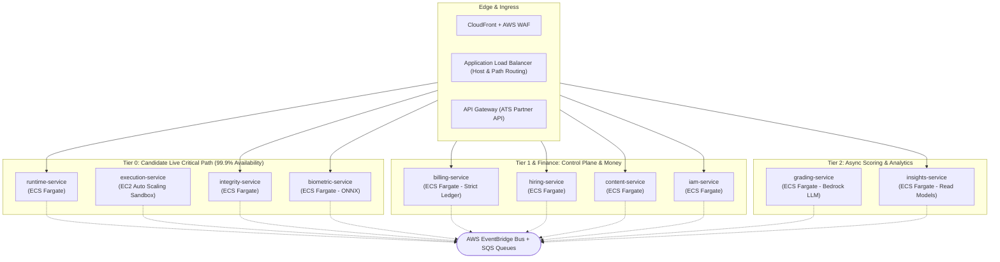
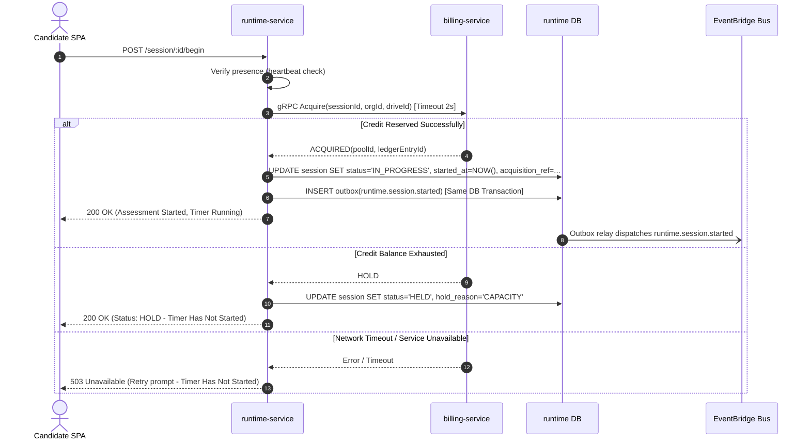

# CD-Recruit — Monolith to Microservices Architecture Blueprint

> **Status:** Architecture Blueprint & Phased Execution Guide  
> **Target System:** CD-Recruit (Assessment & Candidate Integrity Platform)  
> **Source Baseline:** NestJS Monolith (`backend/api/src/app.module.ts` — 44 module registrations)  
> **Governing Standards:** The 4 Core Microservices Rules · AWS-First Cloud Infrastructure · Contract-First Engineering · Strangler Fig Migration Pattern

---

## 1. Architectural Foundations: The 4 Microservices Rules

A true microservices architecture differs fundamentally from a distributed monolith. Every architectural choice in this blueprint is strictly validated against the four fundamental rules of microservices:

```
┌──────────────────────────────────────────────────────────────────────────────────┐
│                             THE 4 GOVERNING RULES                                │
├──────────────────────────┬───────────────────────────────────────────────────────┤
│ 1. Independent Process   │ One deployment unit, pipeline, and container per      │
│    & Lifecycle           │ service. A service must boot when its peers are down. │
├──────────────────────────┼───────────────────────────────────────────────────────┤
│ 2. Strict Encapsulation  │ Private DB & role per service. Zero cross-service     │
│    over DB & Schema      │ SQL joins, foreign keys, or shared table access.      │
├──────────────────────────┼───────────────────────────────────────────────────────┤
│ 3. Network-Only          │ Exactly 6 synchronous gRPC edges. Everything else is  │
│    Communication         │ async domain events (EventBridge → SQS) or S3 claims. │
├──────────────────────────┼───────────────────────────────────────────────────────┤
│ 4. Independent           │ Autoscaling per bounded context (e.g., candidate load │
│    Scalability           │ does not scale admin CRUD; untrusted code on EC2).    │
└──────────────────────────┴───────────────────────────────────────────────────────┘
```

### Rule 1: Independent Process & Lifecycle
* **Independent Deployability:** Each service has its own Dockerfile, CI/CD pipeline, and AWS ECS Fargate task definition (or EC2 Auto Scaling group).
* **Zero Co-Deployment Requirements:** Database migrations follow the **expand/contract** pattern so rollbacks never force companion rollbacks of peer services.
* **Boot Isolation:** If all peer services are stopped, a service must still boot successfully, pass its container readiness probe, and serve degraded functionality rather than crashing.

### Rule 2: Strict Encapsulation over DB & Schema
* **Physical/Logical Separation:** Each service connects exclusively to its own dedicated database using a role with `REVOKE CONNECT ON DATABASE ... FROM PUBLIC`.
* **No Cross-Domain Joins:** All relational foreign keys across service boundaries are severed and replaced with plain UUID references (e.g., `candidate_id` instead of a foreign key join to the `Candidate` table).
* **Enforcement:** Enforced in CI via Prisma multi-schema validation and Nx dependency-cruiser boundary rules.

### Rule 3: Communication Strictly over the Network
* **Synchronous (gRPC / HTTP/2):** Restricted exclusively to operations that cannot proceed asynchronously where a human is actively waiting (< 2 seconds).
* **Asynchronous (EventBridge → SQS):** All notifications, state updates, audit logging, and workflow triggers are published as strongly-typed domain events.
* **Large Payloads (S3 Claim-Check):** Any payload exceeding 256 KB (such as candidate code submissions or test bundles) is uploaded to S3, passing an immutable pointer and SHA-256 hash in the message.
* **High-Rate Telemetry:** Batched directly by clients to the receiving service's private store; raw keystrokes and proctoring frames never flood the event bus.

### Rule 4: Independent Scalability
* Each service autoscales on its own critical operational metric (e.g., `runtime-service` on active WebSocket connections and request rate; `execution-service` on job queue depth and CPU; `grading-service` on SQS backlog).
* Pre-scaling is scheduled automatically prior to high-volume hiring drives, eliminating startup latency spikes.

---

## 2. Bounded Context Analysis & Service Catalog

### 2.1 The Split Test
A module is not extracted simply because it exists as a directory. A bounded context justifies becoming an independent service only when **at least two** of the following criteria hold:
1. **Different scaling shape:** Traffic patterns diverge (e.g., spiky drive starts vs. flat admin usage).
2. **Distinct trust/security boundary:** Handles sensitive PII, finances, or untrusted code execution.
3. **Different runtime/host requirements:** Requires specialized host privileges or heavy CPU.
4. **Independent release cadence:** Owned by separate engineering workflows.
5. **High survivability requirement:** Must remain operational even if other parts of the platform fail.

### 2.2 Target Service Catalog



| Service | Tier | Bounded Context Responsibility | Data Store / Owned State | Compute Engine | Primary Scaling Metric |
|---|:---:|---|---|---|---|
| **`runtime-service`** | 0 | Candidate session lifecycle, token redemption, time gates, WebSocket autosave, module delivery, submission packaging. | `runtime` DB (Aurora), S3 `artifacts` | ECS Fargate | WebSocket connections + RPS; Scheduled drive pre-scale |
| **`execution-service`** | 0 | Untrusted code compilation/execution (Piston), sandboxed candidate SQL and NoSQL execution. | Sandbox Postgres DB (Isolated RDS, non-business data) | EC2 Auto Scaling (Privileged cgroups) | Queue depth + CPU; Warm instance pool |
| **`integrity-service`** | 0 | Proctoring telemetry ingestion, clipboard tracking, tab switch correlation, anomaly scoring. | `integrity` DB (Aurora) | ECS Fargate | Ingest RPS |
| **`biometric-service`** | 0/1 | Facial identity verification (ONNX model), webcam snapshots, signed evidence video clip upload tickets. | `biometric` DB (Metadata only), S3 `biometric` (KMS encrypted) | ECS Fargate (Compute-optimized) | CPU utilization (ONNX inference) |
| **`grading-service`** | 2 | Async rubric grading, Say-Do Correlation Engine, deterministic MCQ checks, Bedrock LLM evaluations. | `grading` DB (Aurora) | ECS Fargate Workers (Spot eligible) | SQS message backlog |
| **`billing-service`** | 0/1 | Double-entry ledger, credit pools, Drive Pass vouchers, payment webhooks, financial reconciliation. | `billing` DB (Dedicated Aurora cluster), S3 `ledger-worm` | ECS Fargate | RPS on `Acquire`; Worker queue depth |
| **`hiring-service`** | 1 | Drive orchestration, candidate roster management, invite distribution, ATS partner integrations. | `hiring` DB (Aurora) | ECS Fargate | Request burst on invite dispatches |
| **`content-service`** | 1 | Versioned question bank, role templates, scenario definitions, immutable drive content snapshots. | `content` DB (Aurora), S3 `content-snapshots` | ECS Fargate | Admin read/write volume |
| **`iam-service`** | 1 | Staff identity, tenant organizations, permission policies, super-admin platform controls, audit trail sink. | `iam` DB (Aurora) | ECS Fargate | Staff authentication volume |
| **`insights-service`** | 2 | Denormalized read-models for dashboards, reviewer scoring interfaces, ATS result delivery. | `insights` DB (Aurora) | ECS Fargate | Dashboard read RPS |

---

### 2.3 Comprehensive Mapping of Monolith Modules (All 44 Registrations)

Based on the [app.module.ts](file:///d:/Projects/cd-recruit/codebase/backend/api/src/app.module.ts) inspection:

| # | Monolith Module | Destination Architecture | Justification & Refactoring Action |
|:---:|---|---|---|
| 1 | `ConfigModule` | `@cd-recruit/kit-config` (Shared Kit) | Replace the multi-level relative `.env` walk with strict Zod-validated environment configurations per service. |
| 2 | `PrismaModule` | Dedicated Prisma Client per Service | Each service maintains its own isolated Prisma schema and independent migration history. |
| 3 | `ThrottlerModule` | AWS WAF + Redis/Valkey Per-Service Guard | In-memory counters fail when scaling across multiple tasks; move rate limiting to WAF and shared Valkey store. |
| 4 | `BullModule` | **Retired in Production** $\rightarrow$ SQS + EventBridge | In-memory/BullMQ queues are replaced with managed SQS queues in prod, retaining in-memory adapters for local dev. |
| 5 | `HealthModule` | `@cd-recruit/kit-health` (Shared Kit) | Standardized `/health/liveness` and `/health/readiness` endpoints for ECS and ALB target health checks. |
| 6 | `AuthModule` | `iam-service` | Dedicated to recruiter and tenant staff authentication; candidates never interact with this service. |
| 7 | `AdminModule` | **Dismantled & Distributed** | User management moves to `iam`; drive management to `hiring`; reporting aggregates to `insights`. |
| 8 | `DriveModule` | `hiring-service` | Owns drive scheduling, capacity reservation, and slot management. |
| 9 | `QuestionModule` | `content-service` | Versioned question authoring; compiled into immutable drive snapshots. |
| 10 | `SettingsModule` | `iam-service` | Tenant settings; published as `iam.settings.updated` events for peer services to cache. |
| 11 | `MinioModule` | `@cd-recruit/kit-storage` (S3 Adapter) | Abstracted behind `ObjectStoragePort`: S3 in AWS production, SeaweedFS for local development. |
| 12 | `CandidateModule` | **Split:** `hiring-service` & `runtime-service` | Roster and candidate PII stay in `hiring`; runtime session state and delivery logic move to `runtime`. |
| 13 | `SessionModule` | `runtime-service` | Heart of candidate test-taking, state progression, and autosave. |
| 14 | `QueueModule` | `@cd-recruit/kit-messaging` (Shared Kit) | Absorbed into standard event bus and queue publisher/consumer adapters. |
| 15 | `CodingModule` | **Split:** `runtime-service` & `execution-service` | Code editor state in `runtime`; compilation and execution delegated to sandboxed `execution-service`. |
| 16 | `SqlModule` | **Split:** `runtime-service` & `execution-service` | Query delivery in `runtime`; query execution runs against an isolated, throwaway RDS sandbox database. |
| 17 | `NosqlModule` | **Split:** `runtime-service` & `execution-service` | Candidate NoSQL query sandboxing isolated from production databases. |
| 18 | `ProctoringModule` | `integrity-service` | Real-time signal collection and correlation; video clip metadata delegated to `biometric-service`. |
| 19 | `AiEvaluationModule` | `grading-service` | Rubric scoring and LLM prompt execution running behind Bedrock with strict IAM access. |
| 20 | `SimulationModule` | **Three-Way Split:** `runtime`, `content`, `grading` | In-session messaging/rules in `runtime`; scenario definitions in `content`; Say-Do scoring in `grading`. |
| 21 | `AiPromptingModule` | **Split:** `runtime-service` & `grading-service` | Interactive chat delivery in `runtime`; evaluation and scoring in `grading`. |
| 22 | `McqModule` | **Split:** `runtime-service` & `grading-service` | Delivery in `runtime`; answer keys and automated scoring live exclusively in `grading`. |
| 23 | `RoleTemplateModule`| `content-service` | Question mappings and role scoring weights published inside immutable content snapshots. |
| 24 | `RedisModule` | `@cd-recruit/kit-cache` (Shared Kit) | Managed ElastiCache for Valkey; each service gets a distinct keyspace prefix; no shared keys. |
| 25 | `PartnerModule` | `hiring-service` | External ATS integration adapter; runs behind API Gateway with dedicated usage plans. |
| 26 | `TestScenariosModule`| `content-service` | Scenario templates authored in `content`; fixtures utilized by development test suites. |
| 27 | `FaceVerifyModule` | `biometric-service` | Camera verification coordination and reviewer signed URLs. |
| 28 | `FaceVerifyOnnxModule`| `biometric-service` | ONNX runtime inference for facial embedding comparison; CPU-isolated. |
| 29 | `AssessmentModule` | `runtime-service` | Coordinates module transitions and timer checks within active candidate sessions. |
| 30 | `PlatformModule` | `iam-service` | Super-admin tenant provisioning and platform settings. |
| 31 | `BillingModule` | `billing-service` | Root umbrella domain for all credit and financial calculations. |
| 32 | `PlatformAuthModule`| `iam-service` | High-privilege authentication realm with forced MFA and IP whitelisting. |
| 33 | `PlatformAuditModule`| `iam-service` | Central audit sink consuming `*.audit.recorded` events from all services. |
| 34 | `LedgerModule` | `billing-service` | Immutable double-entry financial transaction ledger. |
| 35 | `BillingAccountModule`| `billing-service`| Organization billing profile and billing contact mapping. |
| 36 | `CreditPoolModule` | `billing-service` | Atomic credit reserve and balance management. |
| 37 | `TrialGrantModule` | `billing-service` | Automated credit grants triggered by `iam.organization.created` events. |
| 38 | `ManualBillingRequestModule`| `billing-service`| Maker-checker approval workflow for manual credit allocations. |
| 39 | `PriceBookModule` | `billing-service` | Rate tables for assessment tiers and drive pass purchases. |
| 40 | `PaymentModule` | `billing-service` | Payment gateway checkout integration and tokenization. |
| 41 | `PaymentWebhookModule`| `billing-service`| Public webhook ingress with signature validation and async event publishing. |
| 42 | `ReconciliationModule`| `billing-service`| Nightly automated financial audit matching session acquisitions to ledger balances. |
| 43 | `FinanceMetricsModule`| `billing-service`| Revenue and credit burn aggregations for executive dashboards. |
| 44 | `PlatformBillingModule`| `billing-service`| Super-admin financial control endpoints. |

---

### 2.4 Shared Code Architecture (`@cd-recruit/contracts` vs `@cd-recruit/kit-*`)
To prevent building a distributed monolith through shared libraries:
1. **`@cd-recruit/contracts`:** Contains only `.proto` service definitions, Zod event schemas, generated TypeScript stubs, route manifests, and mock fixtures. **Zero business logic.**
2. **`@cd-recruit/kit-*`:** Thin, domain-agnostic infrastructure adapters (logging, OTel tracing, JWT guards, outbox relays, S3 ports). **Forbidden from importing any domain types** (e.g., if a kit file references `Session`, `Drive`, or `Score`, the CI build fails).

---

## 3. Communication Architecture & Protocol Selection

### 3.1 Protocol Decision Framework

```
                          ┌─────────────────────────┐
                          │ Human is waiting on UI  │──YES──> [ gRPC (Sync) ]
                          │ and needs result < 2s?  │         Keep call chain ≤ 2
                          └─────────────────────────┘
                                       │ NO
                          ┌─────────────────────────┐
                          │ Fact that occurred in   │──YES──> [ EventBridge Bus ]
                          │ the system?             │         Publish once, fan-out
                          └─────────────────────────┘
                                       │ NO
                          ┌─────────────────────────┐
                          │ Work intended for one   │──YES──> [ SQS Queue ]
                          │ specific consumer?      │         At-least-once delivery
                          └─────────────────────────┘
                                       │ NO
                          ┌─────────────────────────┐
                          │ Payload size > 256 KB   │──YES──> [ S3 Claim-Check ]
                          │ (Code bundle / Media)?  │         Send pointer + SHA-256
                          └─────────────────────────┘
```

---

### 3.2 The 6 Internal Synchronous Edges (gRPC)

Synchronous communication is strictly limited to 6 operations across the entire architecture. Every edge requires an explicit timeout deadline, idempotency key, circuit breaker, and a defined degradation path:

| ID | Originating Edge | RPC Method | Justification | Timeout | Fallback Behavior if Callee Fails |
|---|---|---|---|:---:|---|
| **SY-1** | `runtime` $\rightarrow$ `billing` | `Acquire(sessionId, orgId, driveId)` | Candidate waiting at "Begin Assessment"; session start must atomically verify credit funding. | 2.0 s | Session enters `HOLD` state; timer **does not start**; candidate shown friendly retry message. |
| **SY-2** | `runtime` $\rightarrow$ `execution` | `RunCode(sessionId, code, language)` | Candidate clicks "Run Code" in IDE and expects execution output within seconds. | 15.0 s | UI returns system execution failure notice; does not count against candidate attempts. |
| **SY-3** | `integrity` $\rightarrow$ `biometric` | `IssueEvidenceUpload(flagId, sessionId)` | Proctoring anomaly detected; browser needs immediate presigned URL to push video buffer. | 1.0 s | Flag recorded without clip (`clip_unavailable`); session continues unimpeded. |
| **SY-4** | `hiring` $\rightarrow$ `billing` | `ReserveFromTalentReserve(driveId)` | Recruiter clicking "Launch Drive" with pre-purchased credits. | 5.0 s | Drive launch disabled with actionable billing alert; draft drive preserved. |
| **SY-5** | `hiring` $\rightarrow$ `content` | `PublishSnapshot(driveId, templateId)` | Drive launch must permanently freeze immutable question versions and test cases. | 10.0 s | Drive remains in `DRAFT`; retry prompt shown to recruiter. |
| **SY-6** | `insights` $\rightarrow$ `grading` / `integrity` / `biometric` | `GetDetail(sessionId)` | Recruiter opens candidate report popup; aggregates composed on-demand. | 2.0 s (parallel) | Partial panels render gracefully with a "detail unavailable" indicator. |

---

### 3.3 Asynchronous Event Catalog (AWS EventBridge $\rightarrow$ SQS)

All other inter-service operations are governed by domain events conforming to the standard CloudEvents specification:

```json
{
  "specversion": "1.0",
  "id": "01J9X2V3M4N5P6Q7R8S9T0U1V2",
  "type": "runtime.session.submitted",
  "source": "cdr/runtime-service",
  "time": "2026-10-07T14:30:00.000Z",
  "subject": "session/0b3f9c1e-8a2d-4f1b-9c3e-7a5d1b3e9f0a",
  "dataschema": "contracts/runtime/session-submitted/v1",
  "tenantid": "org_7f2a1b3c-4d5e-6f7a-8b9c-0d1e2f3a4b5c",
  "correlationid": "corr_1a2b3c4d-5e6f-7a8b-9c0d-1e2f3a4b5c6d",
  "data": {
    "sessionId": "0b3f9c1e-8a2d-4f1b-9c3e-7a5d1b3e9f0a",
    "bundleRef": "s3://cdr-artifacts-prod/sessions/0b3f.../bundle.json",
    "bundleSha256": "9a7c3b2e1f4a5b6c7d8e9f0a1b2c3d4e5f6a7b8c9d0e1f2a3b4c5d6e7f8a9b0c",
    "snapshotId": "snap_c41d2e3f-4a5b-6c7d-8e9f-0a1b2c3d4e5f"
  }
}
```

#### Key Event Mappings
* `iam.organization.created` $\rightarrow$ Consumed by `billing` (automatically provisions `BillingAccount` and assigns trial credits).
* `hiring.drive.scheduled` $\rightarrow$ Consumed by `runtime` (builds invite projection), `infrastructure` (pre-scales Fargate/EC2 clusters).
* `hiring.invite.upserted` $\rightarrow$ Consumed by `runtime` (updates local token hash projection so link clicks work if `hiring` is down).
* `runtime.session.submitted` $\rightarrow$ Consumed by `grading` (triggers background FIFO queue grading task), `insights` (updates live funnel).
* `grading.score.completed` $\rightarrow$ Consumed by `insights` (assembles completed scorecard with `sayDoProvenance` check).
* `hiring.candidate.erasure_requested` $\rightarrow$ Broadcast to all services for GDPR/privacy compliance data scrubbing.

---

### 3.4 Decoupling Session Start ⇄ Billing (Solving the #1 Architectural Bottleneck)

In the monolith, `billing_begin()` is a single PostgreSQL transaction that updates `session`, reads `organization`, and decrements `credit_pool` simultaneously. In microservices, this is separated into an **atomic acquire with local state transition**:



**Key Advantages:**
1. Candidate timer is calculated with `clock_timestamp()` **after** billing acknowledges, ensuring candidates never lose time to billing latency.
2. If the candidate drops off after credit acquisition, the system automatically triggers an automated credit reversal.
3. Billing-blindness is enforced: the candidate API listener on the load balancer has no physical network path to the billing database or service.

---

## 4. Hosting Architecture: AWS Target vs Local Development

### 4.1 AWS Production Topology

```
                                  [ Internet Users / SPAs ]
                                              │
                                   [ Route 53 DNS + WAF ]
                                              │
                                    [ CloudFront CDN ]
                                              │
                    ┌─────────────────────────┴─────────────────────────┐
                    │                                                   │
          [ Application Load Balancer ]                        [ API Gateway ]
          (Host & Path Ingress Routing)                     (ATS Partner Integration)
                    │                                                   │
     ┌──────────────┴─────────────────────────────────┐                 │
     │ Private App Subnets (VPC, Multi-AZ)            │                 │
     │                                                ▼                 ▼
     │ ┌──────────────────────────────────────────────────────────────────────┐
     │ │                          ECS FARGATE TASKS                           │
     │ │  runtime-service   integrity-service   biometric-service   billing   │
     │ │  grading-service   hiring-service      content-service     iam-srv   │
     │ │  insights-service  execution-api                                     │
     │ └──────────────────────────────────────────────────────────────────────┘
     │        │                                        │
     │        │ gRPC                                   ▼
     │        │                        ┌──────────────────────────────────────┐
     │        ▼                        │   AWS Managed Platform Services      │
     │ ┌─────────────────────────────┐ │   • EventBridge Custom Bus & Archive │
     │ │ Isolated Sandbox Subnets    │ │   • SQS Queues & Dead Letter Queues  │
     │ │ (No NAT / Deny-All Egress)  │ │   • S3 Buckets (Artifacts & Biometrics)
     │ │                             │ │   • AWS KMS (Per-domain CMKs)        │
     │ │ ┌─────────────────────────┐ │ │   • Amazon Bedrock (Claude LLM)      │
     │ │ │ EC2 ASG: Piston Sandbox │ │ │   • Amazon Cognito (Staff Auth)      │
     │ │ └─────────────────────────┘ │ │   • Amazon SES (Transactional Mail)  │
     │ │ ┌─────────────────────────┐ │ └──────────────────────────────────────┘
     │ │ │ RDS Sandbox (SQL Tests) │ │
     │ │ └─────────────────────────┘ │
     │ └─────────────────────────────┘
     │        │
     │        ▼
     │ ┌──────────────────────────────────────────────────────────────────────┐
     │ │ Private Data Subnets: Aurora PostgreSQL & Caching                    │
     │ │ • Cluster 1 (Core): iam, hiring, content, insights, integrity, bio   │
     │ │ • Cluster 2 (Runtime): Dedicated candidate hot write cluster         │
     │ │ • Cluster 3 (Billing): Dedicated ledger & financial audit cluster    │
     │ │ • ElastiCache Valkey: Multi-AZ Redis-compatible cache & WS adapter   │
     │ └──────────────────────────────────────────────────────────────────────┘
     └────────────────────────────────────────────────────────────────────────
```

#### Compute Decision: Why ECS Fargate + EC2 ASG?
* **Stateless Microservices:** Run on **AWS ECS Fargate**. Zero EC2 instances to patch, granular CPU/memory allocation per service, native IAM task execution roles, and independent autoscaling.
* **Code Sandbox (`execution-service`):** Must run on a dedicated **EC2 Auto Scaling Group**. **AWS Fargate does not permit privileged container execution (`--privileged`)**, which is required by isolation engines (Piston) for cgroup and namespace isolation. Sandbox instances run in an isolated subnet with **deny-all outbound internet access**.

---

### 4.2 Local Development Alternatives (Fast Inner Loop)

To prevent developers from needing to run 10 heavyweight microservices simultaneously on their laptops, development is organized into 3 tiers:

| AWS Production Service | Local Development Alternative | Local Driver Key | Fidelity & Development Notes |
|---|---|---|---|
| **Aurora PostgreSQL** | PostgreSQL 16 Docker Container | `DATABASE_URL` | Multi-tenant initialization script sets up 10 isolated databases and separate user roles on the local instance. |
| **ElastiCache Valkey** | Valkey OSS Container | `REDIS_URL` | Protocol-compatible drop-in replacement (BSD-3 licensed). |
| **Amazon S3** | **SeaweedFS** Container | `STORAGE_DRIVER=s3` | S3 API-compatible; avoids archived/AGPL MinIO issues. |
| **Amazon SQS** | **ElasticMQ** Container | `MESSAGING_DRIVER=elasticmq` | Java-based SQS-compatible queue supporting standard and FIFO queues with zero AWS configuration. |
| **AWS EventBridge** | Embedded `dev-bus` (~150 LOC) | `EVENT_DRIVER=devbus` | Lightweight in-memory routing utility that reads the project's `subscriptions.ts` manifest and routes events directly to ElasticMQ queues. |
| **Amazon SES** | **Mailpit** Container | `MAIL_DRIVER=smtp` | Captures outbound invitation emails locally with a built-in web inspection UI. |
| **Amazon Cognito** | Built-in Dev-JWT Issuer | `AUTH_DRIVER=dev` | Mints RS256 JWT tokens containing exact Cognito claim structures for staff roles without cloud latency. |
| **Amazon Bedrock** | Mock LLM Adapter | `LLM_DRIVER=mock` | Returns deterministic, instant rubric evaluation fixtures for unit and integration testing. |
| **Application Load Balancer** | **Traefik** Reverse Proxy | Traefik Container | Routes local traffic from `localhost:8080` using the exact same path and host rules configured in production CDK. |

#### Developer Inner Loop
```bash
# 1. Start core backing infrastructure
docker compose --profile core up -d

# 2. Run only the service you are actively modifying on your host machine
pnpm --filter runtime-service dev

# 3. Simulate dependent peer services via generated mock stubs
pnpm mock:billing
```

---

## 5. Engineering Plan for Two Developers

### 5.1 Responsibility Split & Plane Ownership

```
┌──────────────────────────────────────────────┬──────────────────────────────────────────────┐
│       DEV A: Runtime & Assurance Plane       │        DEV B: Control & Money Plane          │
├──────────────────────────────────────────────┼──────────────────────────────────────────────┤
│ • Services:                                  │ • Services:                                  │
│   - runtime-service                          │   - billing-service                          │
│   - execution-service                        │   - hiring-service                           │
│   - integrity-service                        │   - content-service                          │
│   - biometric-service                        │   - iam-service                              │
│   - grading-service                          │   - insights-service                         │
│ • Frontends:                                 │ • Frontends:                                 │
│   - candidate-web                            │   - admin-web, platform-web                  │
│ • Foundations:                               │ • Foundations:                               │
│   - @cd-recruit/kit-messaging                │   - @cd-recruit/kit-auth & kit-config        │
│   - @cd-recruit/kit-otel                     │   - AWS CDK Baseline (VPC, ALB, ECS, DBs)    │
│   - Piston Sandbox Image & EC2 Config        │   - CI/CD Pipelines & GitHub Actions OIDC    │
└──────────────────────────────────────────────┴──────────────────────────────────────────────┘
```

---

### 5.2 Seams, Contracts, and Handoff Protocols

To allow both engineers to build simultaneously without code conflicts:
1. **Contract-First Workflow:** Every inter-service change begins with a pull request to `libs/contracts` modifying `.proto` definitions or Zod event schemas.
2. **Mandatory Dual Approval:** The `contracts/` directory is guarded by GitHub `CODEOWNERS` requiring approval from both Dev A and Dev B before any contract modification can merge.
3. **Automated Stub Generation:** Merging a contract immediately updates TypeScript types and mock servers, allowing one developer to build against a mock while the other implements the producer.

---

### 5.3 Migration Execution Waves (Strangler Fig Pattern)

The monolith is dismantled in **6 controlled waves**. The original monolith runs in production throughout, acting as the fallback for any unmigrated domains:

```
[ Wave 0: Foundations ] ──> [ Wave 1: High Isolation ] ──> [ Wave 2: Live Candidate Path ]
                               (Sandbox & Billing)              (Runtime, Integrity, Bio)
                                                                            │
[ Wave 5: Hardening ]   <── [ Wave 4: Control Plane ]   <── [ Wave 3: Scoring & AI ]
 (Chaos & Load Testing)         (Optional Admin Split)          (Grading Worker & Bedrock)
```

| Wave | Estimated Duration | Dev A Deliverables | Dev B Deliverables | Exit Criteria |
|:---:|:---:|---|---|---|
| **Wave 0: Foundations** | 3–4 weeks | Audit module joins; set up Nx monorepo boundary linter; partition `schema.prisma` into isolated domains. | Set up AWS CDK; build CI/CD pipelines; deploy unchanged monolith to staging ECS Fargate; **finalize `billing.proto`**. | Monolith boots in ECS staging; boundary lint active in CI; shared `contracts` package initialized. |
| **Wave 1: Isolation** | 3–5 weeks | Build **`execution-service`** with Piston on EC2; eliminate `runLocalFallback` backdoor. | Build **`billing-service`** with dedicated Aurora cluster; run billing in **shadow mode** alongside monolith. | Code execution runs only on EC2 sandbox; billing shadow reconciliation reaches 100% agreement. |
| **Wave 2: Candidate Path** | 4–6 weeks | Extract **`runtime-service`**, **`integrity-service`**, and **`biometric-service`**; configure WebSocket Valkey cluster. | Configure ALB path routing for candidate ingress; configure monolith hiring module to publish domain events. | Candidate completes a full assessment session against new runtime services with zero monolithic session writes. |
| **Wave 3: Scoring & AI** | 4–6 weeks | Extract **`grading-service`**; wire Amazon Bedrock evaluation; wire Say-Do Correlation Engine. | Extract **`insights-service`**; construct event-driven reporting read-models; build recruiter review popup. | End-to-end flow operational: Submission $\rightarrow$ SQS $\rightarrow$ Bedrock Scoring $\rightarrow$ Insights Dashboard. |
| **Wave 4: Control Plane *(Optional)*** | 4–6 weeks | Support system integration testing and regression analysis. | Extract `iam`, `hiring`, and `content` into independent microservices; decommission remaining monolith code. | Monolith codebase fully retired and archived. |
| **Wave 5: Hardening** | 2–3 weeks | Run distributed k6 stress tests simulating 2,000 concurrent drive starts; execute sandbox soak tests. | Disaster recovery drills (database restore rehearsal); AWS cost optimization; CloudWatch alarm thresholds. | System meets all latency and throughput SLOs under peak drive loads. |

> **Strategic Hedge:** You can safely halt migration after **Wave 1, 2, or 3** and run a hybrid architecture in production indefinitely without operational degradation.

---

## 6. Tools, Technology & Licensing Register

### 6.1 Keep / Switch / Add / Retire Decisions

| Area | Current Baseline | Target Selection | Scalability & Performance Impact | License | Justification |
|---|---|---|---|---|---|
| **Backend Framework** | NestJS | **NestJS (1 app/service)** | Unchanged; per-service bundles compile and start significantly faster. | MIT | Keep team familiarity while enforcing boundaries. |
| **ORM / Data Access** | Prisma (1 schema) | **Prisma (Per-service schema)** | Multiplied connection pools mitigated by RDS Proxy and strict pool limits. | Apache-2.0 | Maintain rapid development while enforcing schema isolation. |
| **Database** | Self-hosted Postgres | **Amazon Aurora PostgreSQL** | Managed Multi-AZ failover, automated point-in-time recovery (PITR). | PostgreSQL License | High availability and automated storage scaling. |
| **Cache & WS Store** | Redis OSS | **ElastiCache for Valkey** | Protocol-compatible with Redis; lower AWS pricing tier. | **BSD-3** | **Critical Switch:** Avoids Redis $\ge$7.4 SSPL/RSALv2 dual-source licensing. |
| **Message Queue** | BullMQ on Redis | **Amazon SQS + FIFO** | Serverless, zero Redis memory tuning, durable at-least-once buffering. | Managed AWS | Production resilience and decoupled scaling. |
| **Event Backbone** | In-Process Events | **AWS EventBridge Bus** | Content-based routing, native event archiving, and historical replay capability. | Managed AWS | Enables asynchronous microservice integration. |
| **RPC Framework** | None (In-process) | **gRPC (`@grpc/grpc-js`)** | 1–3 ms latency over HTTP/2; strongly-typed contracts; compile-time stubs. | Apache-2.0 | Enforces contracts across the 6 internal sync edges. |
| **Object Storage** | MinIO CE | **Amazon S3** (Prod) / **SeaweedFS** (Dev) | 11 nines durability; presigned URLs; lifecycle policies. | Apache-2.0 / Managed | **Critical Switch:** MinIO Community Edition is archived/AGPL. |
| **Code Execution** | Judge0 | **Piston on EC2** | Sandboxed execution using Linux cgroups and isolated namespaces. | **MIT** | Replaces Judge0 GPL-3.0 with an unencumbered MIT engine. |
| **AI LLM Inference** | Anthropic Direct API | **Amazon Bedrock (Claude)** | Private VPC endpoints; consolidated AWS billing; in-country inference. | Managed AWS | Restricts LLM invocation keys strictly to grading workers. |
| **Key Management** | Planned HashiCorp Vault | **AWS KMS + Secrets Mgr** | Native ECS task role integration; automated key rotation. | Managed AWS | Eliminates operating high-availability Vault (BUSL-1.1 license). |
| **Staff Auth** | Dev-JWT / Keycloak | **Amazon Cognito** | Zero operational maintenance; native JWKS endpoint validation. | Managed AWS | Managed service avoiding self-hosted JVM Keycloak instances. |
| **Infrastructure** | Manual Docker Scripts | **AWS CDK (TypeScript)** | Infrastructure as Code defined in the same language as the backend. | Apache-2.0 | Automated, reproducible environment provisioning. |

---

### 6.2 Critical Licensing Risk Watchlist
1. **Facial Recognition ONNX Model Weights:** While ONNX Runtime is MIT-licensed and MediaPipe is Apache-2.0, **pretrained face verification model weights frequently carry non-commercial research licenses** (e.g., InsightFace models). The engineering team must verify the source of the model file loaded by `FaceVerifyOnnxModule` before commercial launch.
2. **Redis License Restrictions:** Redis versions 7.4+ transitioned to RSALv2 and SSPL. CD-Recruit standardizes exclusively on **Valkey** (the Linux Foundation fork under BSD-3).
3. **MinIO Community Edition:** MinIO CE was placed into maintenance mode and archived under AGPL-3.0. Replaced with AWS S3 in production and SeaweedFS (Apache-2.0) locally.

---

## 7. End-to-End System Walkthrough & Operational Dynamics

### 7.1 Candidate Assessment Lifecycle

```
[ 1. Invite Click ] ──> ALB routes to runtime-service
                         • Validates token hash from local projection (Hiring can be down)
                         • Verifies drive schedule time gate (Too Early / Valid / Grace)
                         • Issues candidate JWT (signed via AWS KMS)
                         
[ 2. Biometric Check ] ──> Candidate uploads webcam selfie directly to S3 via presigned URL
                           • biometric-service runs ONNX embedding verification
                           • If biometric fails, session continues with flag for human review
                           
[ 3. Begin Session ] ──> runtime-service calls billing-service via gRPC Acquire
                         • Billing atomically reserves seat from credit pool
                         • Runtime updates session to IN_PROGRESS and starts server timer
                         • (If billing unreachable: status set to HOLD; timer does NOT start)
                         
[ 4. Active Test ] ──> Question content served from immutable S3 snapshot (Anti-tamper)
                       • "Run Code" executes via execution-service on isolated EC2
                       • Proctoring signals batched to integrity-service every 3 seconds
                       • WebSockets stream autosave states to runtime-service
                       
[ 5. Submission ] ──> Candidate clicks Submit
                      • runtime-service packages full state into S3 bundle (SHA-256 hashed)
                      • Atomic DB commit: session status = SUBMITTED + writes Outbox event
                      • EventBridge receives runtime.session.submitted
                      
[ 6. Async Scoring ] ──> grading-service consumes event via SQS FIFO
                         • Evaluates deterministic MCQs
                         • Calls Bedrock LLM with rubrics to evaluate subjective responses
                         • Computes Say-Do Correlation Engine score
                         • Publishes grading.score.completed event
                         
[ 7. Recruiter View ] ──> insights-service updates live review dashboard
                          • Recruiter reviews report; views code diffs and proctoring flags
                          • Evidence video clips streamed via short-lived S3 signed URLs
```

---

### 7.2 System Resilience & Failure Matrix

| Component Outage | Impact on Live Candidate | Impact on Starting Candidate | Impact on Recruiter | Architectural Recovery Mechanism |
|---|---|---|---|---|
| **`billing-service`** Down | **Zero Impact** (Active sessions continue uninterrupted). | Candidate cannot start; placed on **`HOLD`** (Timer does not run). | Cannot purchase credits or view live balances. | Multi-AZ deployment; fail-closed security posture ensures no unbilled sessions run. |
| **`hiring-service`** Down | **Zero Impact** (Runtime uses local invite token projection). | **Zero Impact** (Candidate can still redeem invite and take test). | Cannot create new drives or edit rosters. | Link redemption decoupled from hiring database via event projections. |
| **`content-service`** Down | **Zero Impact** (Questions read from frozen S3 snapshots). | **Zero Impact** (Questions read from frozen S3 snapshots). | Cannot edit or publish new questions. | Content immutability ensures test delivery survives authoring outages. |
| **`execution-service`** Down | "Run Code" button displays temporary retry prompt. | Candidate can still begin and navigate test. | Zero impact. | Isolated EC2 Auto Scaling group automatically replaces unhealthy sandbox instances. |
| **`grading-service`** Down | **Zero Impact** (Candidate finishes test and sees thank-you screen). | Zero impact. | Score report delayed; shows "Grading in Progress". | Submissions wait safely in SQS FIFO queues and process automatically once restored. |
| **EventBridge / SQS** Lag | **Zero Impact** (Candidate continues live test). | Zero impact. | Analytics and dashboard updates delayed. | Transactional outbox pattern buffers all events in local PostgreSQL tables until bus recovers. |

---

### 7.3 Drive Capacity & High-Concurrency Model

**Scenario:** 2,000 candidates joining simultaneously at 10:00 AM for a scheduled hiring drive.

```
       [ 2,000 Candidates Joining at 10:00 AM ]
                          │
                          ▼
           [ Client-Side Random Jitter (0-30s) ]
                          │
                          ▼
       [ ~65-100 Acquire Requests / Second ]
                          │
                          ▼
          [ runtime-service (Auto-Scaled to 10 Tasks) ]
                          │
                          ▼  (gRPC Acquire)
          [ billing-service (Single Aurora Transaction) ]
            • Atomic pool deduction: ~3-5ms lock time
            • Max pool throughput: ~200-300 ops/second
            • Result: Peak handled smoothly with zero hot-row queue saturation
```

1. **Jitter Scaling:** Instead of all 2,000 browsers hitting `/begin` at 10:00:00, the candidate frontend applies random jitter scaled to the expected drive attendance (0–30 seconds), spreading the initial surge to a manageable ~65–100 requests/second.
2. **Scheduled Pre-Scaling:** 15 minutes before the drive window, the system automatically pre-warms ECS Fargate tasks and EC2 sandbox instances based on `hiring.drive.scheduled` attendance metadata, eliminating runtime cold-start delays.
3. **Telemetry Batching:** Keystroke and proctoring telemetry are batched client-side every 3 seconds, converting millions of raw browser events into stable, buffered database writes.

---

## 8. Summary Action Plan & Sign-Off Checklist

Before any service extraction code is written, review and sign off on the following foundational items:

- [ ] **Approval of the 6-Service Target:** Agree to extract `execution`, `billing`, `runtime`, `integrity`, `biometric`, and `grading` first, leaving the 4 admin modules in the control plane until specific scaling triggers occur.
- [ ] **Sign-Off on the Billing Contract (`billing.proto`):** Commit to the decoupled gRPC `Acquire` pattern before writing any additional monolithic billing code.
- [ ] **AWS Infrastructure Budget Authorization:** Approve the estimated ~$1,250 – $2,300/month AWS baseline infrastructure budget.
- [ ] **Facial Recognition Model Verification:** Confirm the commercial licensing status of the ONNX face model weights before deploying the biometric service.
- [ ] **Adoption of Valkey:** Confirm migrating from Redis to Valkey (BSD-3) to ensure full open-source licensing compliance.
