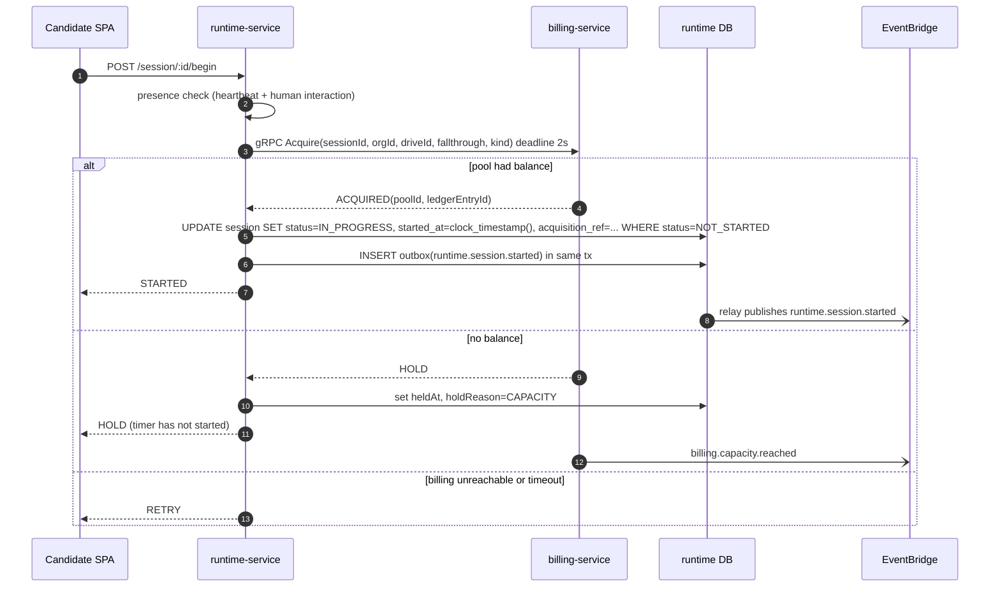
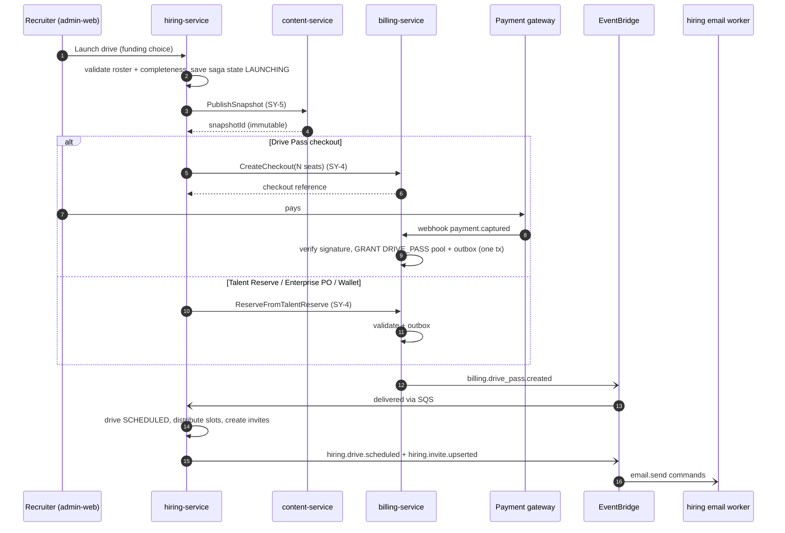
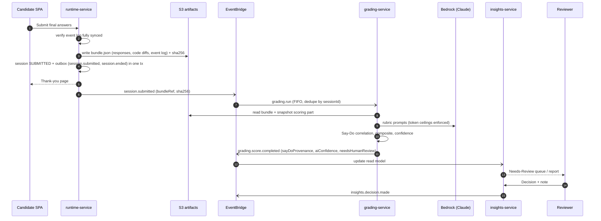
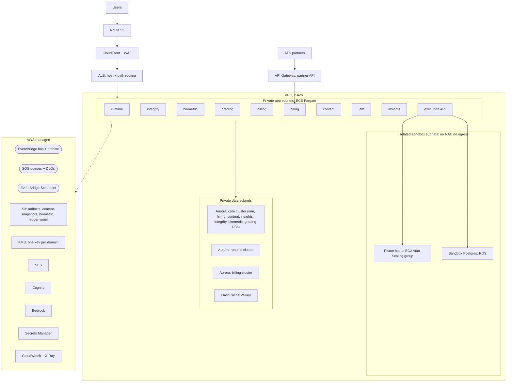
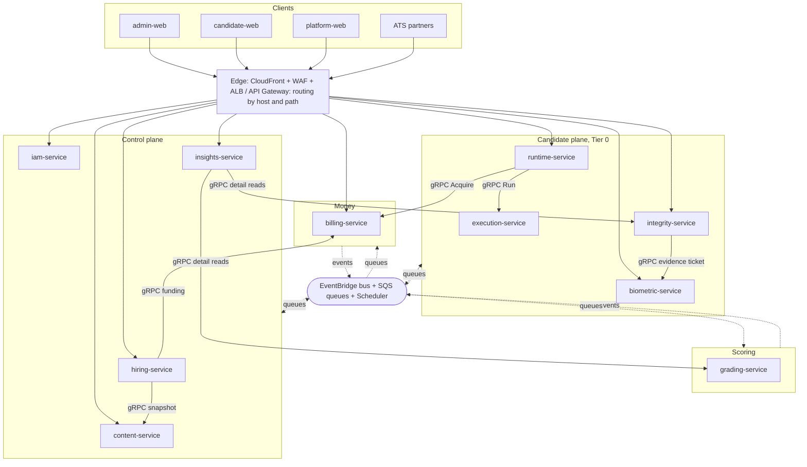

# CD-Recruit — Monolith → Microservices: Architecture, Communication, AWS Hosting, Team Plan & Licensing

> **Status:** Proposed — needs sign-off on the open decisions in §14 before Wave 0 starts.
> **Date:** 7 Oct 2026
> **Companion docs:** Technical Architecture Document · Component Reference & OSS Build Guide · MVP Architecture & Launch Plan · Admin Dashboard IA · Candidate UX Flow · `PRICING_AND_CREDIT_POOL_SPECIFICATION.md` (v3) · Audit Findings & Three-Track Plan
> **Naming:** "Proctora" is the external brand only. Everything in this document — repo, packages, services, AWS resources — keeps the **CD-Recruit** prefix (`cdr-`). **[LOCKED]**

**Evidence base.** `app.module.ts` (44 registrations), the project docs listed above, and the decisions already recorded (Judge0 → Piston, Correlation Engine now in-NestJS TypeScript, `INFRA_MODE=local|full`, locked principles). **Not seen:** `schema.prisma`, module internals, `THIRD_PARTY_INVENTORY.md`. Anything that depends on those is marked **[VERIFY]** and belongs in the Wave 0 read-only audit (Appendix D).

**Decision tags used throughout:** **[LOCKED]** already decided in earlier docs · **[PROPOSED]** my recommendation · **[YOUR CALL]** needs your sign-off.

---

## 0. Executive Summary

### 0.1 What this document decides

| Question you asked | Answer in one line | Section |
|---|---|---|
| Service split | 10 bounded-context services (6 are clearly justified now, 4 are borderline and extracted last) + a thin shared kit | §3 |
| Communication medium per module | REST/WebSocket at the browser edge, **gRPC for 6 synchronous edges only**, **EventBridge → SQS for everything else**, S3 claim-check for big payloads, telemetry kept off the bus | §4 |
| AWS-first hosting + local dev | ECS Fargate (+ EC2 for the sandbox), Aurora PostgreSQL, ElastiCache Valkey, S3, KMS, EventBridge/SQS/Scheduler, SES, Cognito, Bedrock, CDK. Locally: Docker Compose + services on host + ports/adapters | §6, §7 |
| Two-dev refactor split | Dev A = Runtime & Assurance plane, Dev B = Control & Money plane; 6 waves; contracts-first handoffs | §8 |
| Final target architecture | Diagrams + dependency matrix | §10 |
| Tools / tech / libraries | Keep / switch / add / retire register with performance, scalability and licensing columns | §9 |
| How it works | Three end-to-end journeys, a failure matrix, a capacity model | §11, §12 |

### 0.2 Read this before committing (honest pushback)

1. **The earlier recommendation on this project was the opposite.** It was to keep the NestJS monolith because of cross-cutting aggregates, pre-pilot stage and team size. None of those three facts has changed. Microservices will not make the Say-Do engine real, will not fix confidence gating, and will not help the pilot succeed. If the real driver is *learning*, *CEO direction*, or *AWS-native hosting*, that is a legitimate reason — but name it, because it changes how much operational pain is acceptable.
2. **What microservices genuinely buy you here** (and only here): a privileged sandbox host isolated from everything else; a financial ledger that cannot be touched by candidate-facing code; a biometric tier with its own keys; candidate-session scaling during drive-start spikes; and an enforced boundary that makes "no live LLM in a candidate session" a *permissions* fact instead of a *convention*.
3. **What they cost you** (a 2-person team feels this immediately): ~10 pipelines instead of 1, distributed debugging, eventual consistency in places that are currently one SQL join, contract versioning, and an AWS bill roughly **5–8× the 3-VM MVP** (§6.14). Local development gets slower before it gets faster.
4. **The failure mode to fear is the distributed monolith** — 10 deployables sharing one database, one `kit` full of domain types, and synchronous call chains. §2 turns each of the four rules into a check that fails the build instead of a guideline.
5. **How this plan hedges:** every wave ships independently and leaves you better off, so you can stop after any wave. Waves 1–3 extract the six services that pass the split test. Wave 4 (iam / hiring / content / insights) is **trigger-driven, not mandatory** — until then those four live in one `control-plane` deployable with hard module and schema boundaries.
6. **One item is time-critical regardless of whether you split:** the billing begin-engine (`billing_begin`) currently touches the `session`, `organization` and `drive` tables inside one Postgres transaction. Billing is being implemented *now*. If it ships that way, extracting it later means rewriting the most invariant-heavy code in the system. Decide the cross-service contract in §5.1 **before** more billing code lands.

### 0.3 Target in one picture

```mermaid
flowchart LR
  subgraph Clients["Clients"]
    A1["admin-web"]
    A2["candidate-web"]
    A3["platform-web"]
    A4["ATS partners"]
  end
  subgraph Edge["Edge"]
    E1["CloudFront + WAF"]
    E2["ALB (host + path routing)"]
    E3["API Gateway (partner API)"]
  end
  subgraph Services["10 services"]
    S1["runtime"]
    S2["execution"]
    S3["integrity"]
    S4["biometric"]
    S5["grading"]
    S6["billing"]
    S7["hiring"]
    S8["content"]
    S9["iam"]
    S10["insights"]
  end
  BUS(["EventBridge + SQS"])
  Clients --> Edge --> Services
  Services <-.-> BUS
```



---

## 1. Starting Point — What `app.module.ts` Tells Us

### 1.1 Inventory

44 registrations: 41 modules + `ConfigModule`, `ThrottlerModule`, `BullModule`.

| Group | Modules | Count |
|---|---|---|
| Infrastructure | Config, Prisma, Throttler, BullMQ (only when `INFRA_MODE=full`), Redis, Health, Queue, Minio | 8 |
| Identity & admin | Auth, Admin, Settings | 3 |
| Hiring operations | Drive, Candidate, Partner, RoleTemplate, Question, TestScenarios | 6 |
| Candidate runtime & assessment modules | Session, Assessment, Mcq, Coding, Sql, Nosql, AiPrompting, Simulation | 8 |
| Integrity & identity | Proctoring, FaceVerify, FaceVerifyOnnx | 3 |
| AI | AiEvaluation | 1 |
| Platform (super admin) | Platform, PlatformAuth, PlatformAudit | 3 |
| Billing | Billing, Ledger, BillingAccount, CreditPool, TrialGrant, ManualBillingRequest, PriceBook, Payment, PaymentWebhook, Reconciliation, FinanceMetrics, PlatformBilling | 12 |

Billing + Platform = **15 of 41 modules (37%)** and they are the newest, least entangled code — which makes them the cheapest to isolate *now*.

### 1.2 Things the file reveals that matter for the split

| Observation | Why it matters |
|---|---|
| One `PrismaModule`, one DB, one schema | Rule 2 is violated by construction; this is the main refactor |
| `ThrottlerModule` uses in-memory counters (`ttl 60s / limit 100`) and a global `CandidateThrottlerGuard`; the `_config` parameter is unused (limits are hard-coded) | Per-task in-memory counters become wrong the moment there are 2+ tasks. Needs edge limits (WAF) plus a shared store |
| `BullModule` registers only when `INFRA_MODE === "full"` | `local` mode already runs without Redis. This convention is **[LOCKED]** and the new design keeps it |
| `.env` is searched in 5 relative paths including `../../.env` | Monorepo-root env coupling. Each service needs its own validated env contract |
| Two face-verify modules (`FaceVerify`, `FaceVerifyOnnx`) | One boundary (biometric), two adapters |
| `NosqlModule` lives in `modules/nosql`, the rest at top level | Inconsistent; likely added later. Engine unknown — licensing check needed **[VERIFY]** |
| Everything shares one process: any `EventEmitter2`, shared singletons, `@Cron`, in-process method calls between domains silently becomes a network call | The hidden cost of splitting. Appendix D lists what to grep for |

### 1.3 Unknowns to resolve in the Wave 0 audit **[VERIFY]**

`AssessmentModule` (orchestrator or something else?) · `TestScenariosModule` (authoring templates or developer fixtures?) · `CandidateModule` (entity CRUD or candidate-facing API?) · `AdminModule` (aggregator of stats or user management?) · `NosqlModule` engine · `PartnerModule` (inbound only, or outbound webhooks too?) · where WebSocket gateways live · number of cross-domain Prisma `include`/joins · every `$queryRaw`, trigger and PL/pgSQL function · every `@Cron`/scheduled job.

---

## 2. The Four Rules, Turned Into Checks

A rule you cannot test is a wish. Each rule below has a mechanism that fails CI or fails a deployment.

| Rule | What it means in this codebase | How it is enforced (not just intended) | How teams usually fail it |
|---|---|---|---|
| **1. Independent process & lifecycle** | One ECS service, one image, one pipeline, one rollback unit per service. A service must **boot with all its peers stopped** and degrade, not crash | Separate Dockerfile + CDK construct per service · path-filtered CI · "boot alone" smoke test · expand/contract DB migrations so a rollback never needs a peer rollback | "Deploy all together because they share a migration or a library" |
| **2. Strict encapsulation of DB & schema** | Own database + own DB role per service. No cross-service FK, JOIN, view, or credential. Same for Redis keyspaces and S3 prefixes | Postgres `REVOKE CONNECT … FROM PUBLIC` + one role per DB · Secrets Manager secret per service · S3 bucket policies per task role · CI check that fails if a Prisma schema has a relation to a model outside its domain · Nx module-boundary lint | "Separate schemas, same DB user" · "just read the other table for reporting" |
| **3. Communication over the network** | Only three ways to cross a boundary: **gRPC** (sync), **events/commands** (async), **claim-check pointers** (S3). The `contracts` package is the *only* cross-service import | Nx tag rules + dependency-cruiser · no `EventEmitter2` across domains · contract tests in CI | Sync chains A→B→C→D · fine-grained chatty calls · events used as disguised RPC |
| **4. Independent scalability** | Each service has its own scaling signal, min/max, DB sizing and alarms | Per-service autoscaling policy in CDK · per-service load test in Wave 5 | Scaling "the monolith × 10" behind a load balancer, or all services pinned at 2 tasks |

### 2.1 The split test

Do not split because a module *exists*. Split a bounded context out when **at least two** of these hold:

- **(a)** different scaling shape · **(b)** different trust / security boundary · **(c)** different runtime or host requirement · **(d)** different change cadence or owner · **(e)** must keep working when the other part is down.

| Service | a | b | c | d | e | Verdict |
|---|:-:|:-:|:-:|:-:|:-:|---|
| execution | ● | ● | ● | | ● | **Clear** — privileged EC2 hosts, untrusted code |
| billing | | ● | | ● | ● | **Clear** — financial invariants, candidate-blind |
| grading | ● | ● | | ○ | | **Clear** — async, LLM-credentialed |
| runtime | ● | ○ | | | ● | **Clear** — spiky, WebSocket, must survive peers failing |
| integrity | ● | | | | ● | **Clear** — high-rate ingestion |
| biometric | ● | ● | | | | **Clear** — sensitive tier + CPU-heavy ONNX |
| content | | ○ | | ● | | Borderline |
| iam | | ● | | ○ | | Borderline |
| hiring | | | | ○ | ○ | Borderline |
| insights | ○ | | | ○ | | Borderline |

● = holds · ○ = partly. The four borderline services are extracted in **Wave 4, only if a trigger from §13 fires**.

### 2.2 Definition of Done for a service

A service is "done" only when every box is true: own DB + role · own pipeline · boots alone · health/readiness endpoints · structured logs with correlation IDs · OTel traces propagated through gRPC *and* SQS attributes · outbox/inbox in place · all inbound/outbound contracts versioned in `contracts` · DLQ + redrive runbook · autoscaling policy · alarms (error rate, latency, queue age) · least-privilege task role · runbook page. Add it to your existing Definition of Done alongside the security controls already listed in the MVP plan.

---

## 3. Service Split

### 3.1 Target service catalog

| # | Service | Bounded context | Owns (DB / stores) | Runs on | Scales on | Exposure | Tier |
|---|---|---|---|---|---|---|:-:|
| 1 | `runtime-service` | Candidate session lifecycle: redeem link, time-gate, begin, MCQ / AI-Prompting / Simulation delivery, autosave, telemetry append, submission bundle, WebSocket | `runtime` DB (own Aurora cluster), S3 `artifacts` | Fargate | Active WebSocket connections + RPS; **scheduled pre-scale** before drives | Public (candidate) | 0 |
| 2 | `execution-service` | Untrusted execution: code (Piston), SQL, NoSQL sandboxes | Stateless; sandbox Postgres (own tiny RDS, no business data) | **EC2 Auto Scaling group** (privileged); API tier on Fargate | Queue depth + CPU; scheduled warm pool | Private | 0 |
| 3 | `integrity-service` | Proctoring signal ingestion, tab/paste correlation, integrity flags, integrity confidence | `integrity` DB | Fargate | Event ingest rate | Public (candidate, JWT) + private | 0 / 1 |
| 4 | `biometric-service` | Face verification (ONNX), selfie/ID, evidence-clip upload tickets, reviewer signed URLs, purge | `biometric` DB (metadata only), S3 `biometric`, own KMS key | Fargate (CPU-heavy) | CPU | Public (candidate) + private | 0 / 1 |
| 5 | `grading-service` | Async grading, rubric scoring, **Say-Do Correlation Engine**, composite score, AI confidence | `grading` DB | Fargate workers (Spot-eligible) | SQS backlog per task | Private | 2 |
| 6 | `billing-service` | Ledger, credit pools, accounts, trials, maker-checker, price book, payments, webhooks, reconciliation, finance metrics | `billing` DB (own Aurora cluster), S3 `ledger-worm` (Object Lock) | Fargate | RPS on `Acquire`; workers on backlog | Private + public webhook route | 0 (acquire) / 1 |
| 7 | `hiring-service` | Drives, invites, roster, scheduling & slot distribution, partner/ATS API, notification worker | `hiring` DB | Fargate | Low; burst on invite send | Admin + partner | 1 |
| 8 | `content-service` | Question bank (versioned), role templates, scenario templates, **immutable content snapshots**, offline authoring | `content` DB, S3 `content-snapshots` | Fargate | Low | Admin | 1 |
| 9 | `iam-service` | Staff identity & roles, orgs/tenancy, org policy settings, super-admin control plane, audit sink | `iam` DB | Fargate | Low | Admin + platform | 1 |
| 10 | `insights-service` | Read models for dashboard & reports, reviewer decisions, report assembly, ATS result export | `insights` DB | Fargate | Read RPS | Admin | 2 |

**Frontends (not services):** `admin-web`, `candidate-web`, `platform-web` (super admin). Each talks to one origin per audience; the ALB routes by path (§6.3). The SPA never knows services exist.

**Tier meaning.** Tier 0 = on the candidate's critical path during a live session (target 99.9%). Tier 1 = staff-facing. Tier 2 = asynchronous; delay is acceptable, loss is not.

### 3.2 Module → service mapping (all 44 registrations)

| # | Module | Goes to | Notes |
|---|---|---|---|
| 1 | `ConfigModule` | every service (`kit-config`) | Per-service zod-validated env; drop the 5-path `.env` walk |
| 2 | `PrismaModule` | every service | Own schema, own generated client, own migrations |
| 3 | `ThrottlerModule` + `CandidateThrottlerGuard` | WAF + per-service throttler with Valkey store | Candidate guard lives in runtime / integrity / biometric only |
| 4 | `BullModule` (full mode) | **retired in prod** → SQS + Scheduler via `kit-messaging` | `local` mode keeps an in-memory adapter **[LOCKED convention]** |
| 5 | `HealthModule` | every service (`kit-health`) | ALB / ECS health checks |
| 6 | `AuthModule` | iam | Staff auth only; candidates never touch it |
| 7 | `AdminModule` | **dismantled** **[VERIFY]** | User/role → iam · drive/question CRUD → owners · stats → insights |
| 8 | `DriveModule` | hiring | |
| 9 | `QuestionModule` | content | |
| 10 | `SettingsModule` | iam | Published as `iam.settings.updated`; consumers cache |
| 11 | `MinioModule` | `kit-storage` S3 adapter | `ObjectStoragePort` already exists — swap the adapter, not the callers |
| 12 | `CandidateModule` | **split** **[VERIFY]** | Roster/PII → hiring · candidate-facing API → runtime |
| 13 | `SessionModule` | runtime | |
| 14 | `QueueModule` | dissolved into `kit-messaging` | |
| 15 | `CodingModule` | execution (run) + runtime (delivery/submit) | No host-execution fallback — ever **[LOCKED]** |
| 16 | `SqlModule` | execution (run) + runtime (delivery) | Candidate SQL leaves the main DB cluster entirely |
| 17 | `NosqlModule` | execution + runtime | Engine **[VERIFY]** (licensing, §9.4) |
| 18 | `ProctoringModule` | integrity | Clip handling → biometric |
| 19 | `AiEvaluationModule` | grading | `kit-llm` port |
| 20 | `SimulationModule` | **three-way split** | Trigger engine & in-fiction messaging → runtime · `EventGenerationService` (authoring) → content · Say-Do correlation → grading. The hard-coded `85.0` disappears here |
| 21 | `AiPromptingModule` | runtime (delivery) + grading (rubric scoring) | |
| 22 | `McqModule` | runtime (delivery) + grading (deterministic scoring) + content (authoring) | Answer keys never live in the candidate-facing service (§5.3) |
| 23 | `RoleTemplateModule` | content | Weighting preset travels inside the snapshot |
| 24 | `RedisModule` | `kit-cache` | Per-service connection + key prefix; **no shared keyspace** |
| 25 | `PartnerModule` | hiring (partner-api adapter) | Own API Gateway stage, API keys, usage plans |
| 26 | `TestScenariosModule` | content **[VERIFY]** | If it is dev fixtures, it becomes test tooling, not a service |
| 27 | `FaceVerifyModule` | biometric | |
| 28 | `FaceVerifyOnnxModule` | biometric (ONNX adapter) | Model-weight license check, §9.4 |
| 29 | `AssessmentModule` | runtime **[VERIFY]** | |
| 30 | `PlatformModule` | iam (platform control plane) | |
| 31 | `BillingModule` | billing | Umbrella for rows 34–44 |
| 32 | `PlatformAuthModule` | iam | Separate pool/realm from tenant staff |
| 33 | `PlatformAuditModule` | iam (audit sink) | Consumes `*.audit` events from all services |
| 34 | `LedgerModule` | billing | |
| 35 | `BillingAccountModule` | billing | |
| 36 | `CreditPoolModule` | billing | |
| 37 | `TrialGrantModule` | billing | Triggered by `iam.organization.created` |
| 38 | `ManualBillingRequestModule` | billing | Maker-checker stays DB-enforced inside billing |
| 39 | `PriceBookModule` | billing | |
| 40 | `PaymentModule` | billing | |
| 41 | `PaymentWebhookModule` | billing | Public route; verify signature → persist → enqueue → 200 |
| 42 | `ReconciliationModule` | billing | Becomes a scheduled ECS task (no double-run across replicas) |
| 43 | `FinanceMetricsModule` | billing | |
| 44 | `PlatformBillingModule` | billing | Super-admin-facing routes |

### 3.3 Data ownership

| Entity | Owner | Everyone else gets it via |
|---|---|---|
| Organization, staff user, roles, org settings (confidence threshold, retention, appeal window) | iam | JWT claims · `iam.*` events · local cache |
| RoleTemplate, Question (+versions), ScenarioTemplate, **ContentSnapshot** | content | Snapshot pointer (S3) |
| Drive, drive→snapshot binding, Invite, Candidate roster (PII), partner/requisition mapping | hiring | `hiring.*` events · runtime's invite projection |
| Session, ModuleResponse, EventLog (telemetry), workspace state | runtime | Submission bundle (S3 claim-check) |
| IntegrityFlag, proctoring signals, integrity score, flag disposition | integrity | `integrity.*` events |
| Evidence-clip metadata, identity verification result, selfie/ID references | biometric | `biometric.*` events · signed URLs |
| Score, ModuleScore, Say-Do result, grading run, prompt/rubric version | grading | `grading.score.completed` |
| ReviewerDecision (incl. `agreed_with_ai`), report views, dashboard aggregates | insights | API |
| BillingAccount, CreditPool, Ledger, Payment, PriceBook, ManualBillingRequest, BillingAuditEvent, SessionBillingEvidence, TrialGrant | billing | gRPC / `billing.*` events |
| Outbox / Inbox tables | each service | — |

**Relations that must be cut** (replace with a plain UUID column; the ledger already works this way under rule R5):

| Today (one schema) | After |
|---|---|
| `Session → Candidate` | `candidate_ref` UUID + a snapshot of what runtime needs (display name, email for the watermark) from the invite projection |
| `Session → Drive / RoleTemplate` | `drive_id`, `snapshot_id`, plus a frozen drive-config snapshot (schedule, buffer/grace, module config, `fallthrough`) |
| `ModuleResponse → Question` | `question_id` + `snapshot_id`; content is read from the immutable snapshot |
| `DriveQuestion → Question` | hiring stores `snapshot_id` and the question-id list for display |
| `Score → Session`, `IntegrityFlag → Session`, `ReviewerDecision → Session` | `session_id` UUID |
| `EvidenceClip → IntegrityFlag` | `flag_id` UUID (cross-service) |
| `Organization → BillingAccount` (FK, Restrict) | billing-owned mapping table `billing_account_organization(org_id, billing_account_id)` |
| `Invite → Candidate` | stays an FK — both live in hiring |

### 3.4 What deliberately is *not* a service

- **No per-assessment-module services** (MCQ, SQL, Coding, Prompting, Simulation). They share the session context, the timer, the autosave and the WebSocket. Splitting them would create five chatty services for one bounded context. Only the *untrusted execution* part leaves (execution-service).
- **No BFF layer yet.** The ALB routes straight to owning services; `insights-service` is the only place that composes data from several contexts. Add BFFs only if the SPAs start making 3+ calls per screen.
- **No separate `notification-service`.** Email sending is a worker role inside hiring (SQS → SES). In-fiction messages are WebSocket pushes from runtime.
- **Billing is one service, with a planned seam.** `ledger` (hot, frozen invariants) and `payments` (gateway integrations, changes often) can split later; keep them as separate NestJS modules with no shared tables so the seam is already cut.
- **No service mesh.** AWS App Mesh was discontinued on 30 Sep 2026; ECS Service Connect is the AWS-named replacement (§6.4).

### 3.5 Shared code rules

| Package | May contain | Must never contain |
|---|---|---|
| `@cd-recruit/contracts` | `.proto` files, Zod event schemas, generated clients/stubs, event-subscription manifest, route manifest | Business logic |
| `@cd-recruit/kit-*` | config, logging, OTel, health, JWT/service-identity guards, messaging (outbox/inbox/consumer base), storage port, LLM port, cache | **Any domain type** (Session, Drive, Score…). If it knows what a Drive is, it is not kit |

Because kit changes rebuild every service in a monorepo, they must be backward compatible. This is a conscious compromise on rule 1 (§13).


---

## 4. Communication Design

### 4.1 How to choose: synchronous vs event-driven

Ask these four questions in order. The first "yes" decides.

1. Does a **human-facing request** have to finish with this answer, and would the human notice a 1–10 s delay? → **Synchronous (gRPC)**. Keep call-chain depth ≤ 2.
2. Is it a **fact that happened** that other contexts may care about? → **Event** (publish once; don't know who listens).
3. Is it **work for one specific consumer**? → **Command via SQS**.
4. Do I need **another context's data repeatedly**? → **Don't call it. Replicate a read model via events** (invite projection, settings projection).

| Boundary | Protocol | Why | Tech | License |
|---|---|---|---|---|
| Browser ↔ services | HTTPS REST/JSON (OpenAPI) + WebSocket (runtime only) | Browsers cannot speak gRPC without a proxy; ALB handles both natively | NestJS, `@nestjs/swagger`, Socket.IO | MIT |
| ATS partner ↔ hiring | REST/JSON + API keys; polling for v1 **[LOCKED]**, HMAC-signed webhooks later | External, versioned, must stay stable | API Gateway usage plans | Managed |
| Service ↔ service (sync) | **gRPC / Protobuf over HTTP/2** | Strict contracts, generated clients, deadlines, rich status codes (`RESOURCE_EXHAUSTED`, `DEADLINE_EXCEEDED`) | `@grpc/grpc-js`, `@nestjs/microservices`, `buf` | Apache-2.0 / MIT |
| Service → many (facts) | Domain events | Decoupling, replay | **EventBridge custom bus → one SQS queue per consumer** | Managed |
| Service → one (work) | Command / job | At-least-once, retries, back-pressure | SQS standard; **FIFO** where dedupe matters | Managed |
| Time-based | Durable schedules | Replaces in-process cron and BullMQ delayed jobs | EventBridge Scheduler | Managed |
| Large payload | **Claim-check** — payload in S3, pointer + SHA-256 in the message | 256 KB message limit; audit hash | S3 | Managed |
| High-volume telemetry | Batched HTTPS to the owning service → its DB / S3 | Volume and cost; not domain facts | — | — |

**Why gRPC and not REST for the 6 internal sync edges?** Honestly: at this scale (a few hundred calls/second at peak) raw performance is *not* the reason. The reasons are enforced contracts with generated clients, deadlines that propagate, and distinct failure codes. If your team prefers REST + OpenAPI-generated clients, the architecture still holds — the calls sit behind generated client ports either way. **[YOUR CALL]**, default gRPC.

**Sync-call hygiene (all six edges):** a deadline on every call, propagated downstream · an idempotency key on every mutation · a circuit breaker and bulkhead per downstream · retry only on idempotent calls and only for `UNAVAILABLE` / `DEADLINE_EXCEEDED`, with jittered backoff and a retry budget · no cycles · a service must boot and serve reduced functionality with every sync peer down.

### 4.2 Synchronous edge register

| ID | Caller → callee | RPC | Why sync | Deadline | Idempotent via | If the callee is down |
|---|---|---|---|---|---|---|
| **SY-1** | runtime → billing | `Acquire` | Candidate is waiting at "Start"; start must be atomic with funding | 2 s, 1 retry | `acquire:{sessionId}` | Candidate sees RETRY/HOLD; timer never starts; running sessions unaffected |
| **SY-2** | runtime → execution | `RunCode`, `RunSql`, `RunNosql` | Candidate hits Run and expects a 1–5 s answer | 15 s | `run:{sessionId}:{clientSeq}` | UI shows "something went wrong on our end, retrying"; logged as an infra event, never counted against the candidate |
| **SY-3** | integrity → biometric | `IssueEvidenceUpload` | The browser needs a presigned URL while the rolling buffer is still fresh | 1 s | `evidence:{flagId}` | Flag is stored without a clip, marked `clip_unavailable`, reviewer sees an infra note |
| **SY-4** | hiring → billing | `GetFundingOptions`, `CreateCheckout`, `ReserveFromTalentReserve` | Recruiter is on launch step 6 | 5 s | `launch:{driveId}:{attempt}` | Launch disabled with a clear message; draft intact |
| **SY-5** | hiring → content | `PublishSnapshot` | Launch must bind an immutable snapshot | 10 s | `snapshot:{driveId}:{contentHash}` | Same as SY-4 |
| **SY-6** | insights → grading / integrity / biometric / runtime | `Get*Detail` | Reports popup composes detail on demand | 2 s each, in parallel | read-only | That panel shows "unavailable"; the rest renders |

**Deliberately *not* synchronous:**

| Instead of… | We use… | Result |
|---|---|---|
| runtime → hiring (redeem invite) | `hiring.invite.upserted` events build an **invite projection** inside runtime (token *hash*, schedule, buffer/grace, candidate snapshot) | Link click works even if hiring is down |
| runtime → content (load questions) | Immutable S3 snapshot, read directly | Live sessions are immune to authoring-side outages and edits |
| iam → billing (onboarding) | `iam.organization.created` event | Billing account + trial appear within seconds |
| any service → iam (auth) | Local JWT validation via cached JWKS | Auth is not a runtime dependency |

**Upgrade trigger for SY-2:** if p95 queue wait inside execution exceeds ~3 s under load, switch Run to async request-reply (job id returned immediately → `execution.completed` event → WebSocket push).

### 4.3 Event catalog

Naming: `<producer>.<aggregate>.<past-tense-verb>`. Every event carries the envelope in §4.4.

| Event | Producer | Consumers | Key payload |
|---|---|---|---|
| `iam.organization.created` | iam | billing (account + trial grant), hiring, insights | orgId, homeRegion |
| `iam.settings.updated` | iam | grading (confidence threshold), biometric (retention/appeal), runtime | orgId, settingsVersion |
| `content.snapshot.published` | content | hiring, runtime (prefetch), grading, execution | snapshotId, contentHash |
| `hiring.drive.scheduled` | hiring | runtime, integrity, biometric, insights, infra pre-scaler | driveId, window, buffer/grace, snapshotId, expectedAttendance |
| `hiring.drive.closed` | hiring | runtime, insights, billing | driveId |
| `hiring.invite.upserted` (created / extended / revoked / regenerated) | hiring | runtime (projection) | inviteId, tokenHash, scheduledTime, expiry, status, candidate snapshot |
| `hiring.candidate.erasure_requested` | hiring | **all** | candidateId |
| `billing.drive_pass.created` | billing | hiring | driveId, poolId, seats, expiresAt |
| `billing.capacity.reached` / `.restored` | billing | hiring (alert recruiter) / runtime (ReleaseHeld FIFO) | driveId |
| `billing.credit.reversed` | billing | insights, hiring | sessionId, reason |
| `billing.account.restricted` | billing | hiring (block scheduling) | accountId |
| `runtime.session.created` | runtime | integrity, biometric (active-session projections) | sessionId, driveId |
| `runtime.session.started` | runtime | billing (evidence), integrity, insights | sessionId, acquisitionRef, startedAt, cvMode, tutorialMode |
| `runtime.session.held` / `.released` | runtime | hiring, insights | sessionId, reason |
| `runtime.session.submitted` | runtime | grading (via FIFO command), insights, integrity | bundleRef, bundleSha256, snapshotId |
| `runtime.session.ended` | runtime | billing (evidence + T1–T3 reversals), insights | endReason, firstContentRenderedAt, lastHeartbeatAt, eventCount, modulesReached, timePerModule, infraFlags |
| `runtime.invite.redeemed` | runtime | hiring, insights | inviteId, sessionId |
| `integrity.flag.raised` | integrity | insights | flagId, category, severity, confidence |
| `integrity.score.computed` | integrity | insights | sessionId, integrityConfidence, counts |
| `integrity.flag.dispositioned` | integrity | insights | flagId, disposition |
| `biometric.identity.verified` / `.failed` / `.pending` | biometric | insights, runtime | sessionId, tier, result |
| `biometric.evidence.stored` / `.purged` | biometric | integrity, insights | flagId, opaque ref, expiresAt |
| `grading.score.completed` | grading | insights | sessionId, moduleScores, composite, **sayDoProvenance**, aiConfidence, needsHumanReview, rubricVersion |
| `grading.run.failed` | grading | insights, ops alarm | sessionId, attempt, reason |
| `insights.decision.made` | insights | hiring (candidate notice, ATS push), grading (agreement analytics) | sessionId, decision, agreedWithAi, reviewerId |
| `*.audit.recorded` | any | iam (platform audit sink) | actor, action, subject |

**Commands (SQS):** `grading.run` (FIFO, dedupe key = sessionId) · `email.send` and `webhook.deliver` (hiring-internal) · `evidence.purge` (S3 lifecycle does the deletion; a scheduled task audits it).

### 4.4 Envelope and delivery rules

```json
{
  "specversion": "1.0",
  "id": "01JC8Z...ULID",
  "type": "runtime.session.submitted",
  "source": "cdr/runtime-service",
  "time": "2026-10-07T10:02:11.482Z",
  "subject": "session/0b3f9c1e-...",
  "dataschema": "contracts/runtime/session-submitted/v1",
  "tenantid": "org_7f2a...",
  "correlationid": "c-9d1e...",
  "causationid": "e-41aa...",
  "aggregateversion": 7,
  "data": {
    "sessionId": "0b3f9c1e-...",
    "bundleRef": "s3://cdr-artifacts/0b3f.../bundle.json",
    "bundleSha256": "9a7c...",
    "snapshotId": "snap_c41d..."
  }
}
```

| Rule | Detail |
|---|---|
| Outbox | Event row is written **in the same DB transaction** as the state change. A relay (a role of every service process) polls `FOR UPDATE SKIP LOCKED` every ~250 ms and publishes. No dual-write, ever |
| Inbox / idempotency | Consumers record `(consumer, event_id)`; duplicates are acknowledged and skipped. Delivery is at-least-once |
| Ordering | Not guaranteed. Use `aggregateversion`; ignore stale; make state machines tolerate duplicates and reordering. FIFO is used only for grading dedupe |
| No PII | Events carry ids. A consumer that needs a name/email already received a snapshot at invite time |
| Tenant | `tenantid` is mandatory; consumers scope every write by it |
| Size | Under 256 KB. Bigger → claim-check |
| Failures | Per-queue DLQ, `maxReceiveCount` 5, alarm on DLQ depth > 0, redrive runbook |
| Evolution | Additive-only inside a version. Breaking change → `v2`, dual-publish for at least one release. Schemas are Zod in `contracts`, checked in CI |
| Replay | EventBridge **archive** (30–90 days) lets `insights` rebuild read models without touching producers |

### 4.5 Why EventBridge + SQS (and not the alternatives)

| Option | Fit | Ops burden | Cost shape | Local story | License | Verdict |
|---|---|---|---|---|---|---|
| **EventBridge bus → SQS** | Content-based routing, schema registry, archive & replay, Scheduler | None | ~pay per event + SQS requests | Own `dev-bus` driven by the same subscription manifest | Managed | **[PROPOSED]** |
| SNS + SQS | Simplest fan-out; FIFO ordering; lower latency | None | Cheapest | Partial emulators | Managed | Valid fallback if you don't need replay/routing |
| Amazon MSK / Kafka | Very high throughput, long retention, streaming | Brokers, partitions, upgrades; cost floor | High fixed | Kafka/Redpanda containers | Apache-2.0 | Overkill — domain events here are hundreds to low thousands per drive |
| Amazon MQ (RabbitMQ) | Rich routing | Broker management | Fixed instance | RabbitMQ container | MPL-2.0 | No advantage over SQS |
| BullMQ on Valkey | Very easy in Node; delayed jobs | You own Redis durability (`noeviction`, persistence) | Instance | Native | MIT | Fine inside one process; weak as a cross-service backbone |
| Temporal | Long-running stateful workflows | Server + persistence | Instance | Dev server | MIT | **Defer.** Adopt only if ≥3 multi-day sagas appear |

EventBridge delivery is typically sub-second but carries no tight latency guarantee. Anything needing a hard bound under ~100 ms stays synchronous.

### 4.6 Telemetry, real-time and scheduled work

**Telemetry is not a domain event.** Keystroke/edit transactions and proctoring signals are batched by the client every ~3 s (with sequence numbers, buffered in IndexedDB if offline) and sent to the owning service (`runtime` for the event log, `integrity` for signals), which dedupes on `(sessionId, seq)` and appends to its own store. At submit, runtime folds the log into the S3 bundle. Only **summaries and flags** become domain events. Putting raw telemetry on the bus would add cost and noise for no consumer benefit.

**WebSocket (runtime):** Socket.IO with `transports: ['websocket']` (no long-polling, so no sticky sessions needed) + the Valkey adapter for cross-task fan-out · raise ALB idle timeout (e.g. 3600 s) and send an application heartbeat every ~25 s · timer is **server-authoritative** — clients render a server-issued countdown token · graceful shutdown on `SIGTERM`: stop accepting, send a reconnect hint, drain for 30–60 s (set ECS `stopTimeout` accordingly) · on reconnect the client resyncs from server state plus the last autosave.

**Scheduled work (all via EventBridge Scheduler → SQS or ECS RunTask, so exactly one runner by construction):**

| Job | Owner | Replaces |
|---|---|---|
| Nightly 7-point reconciliation + WORM export | billing | `ReconciliationModule` cron |
| Pool expiry sweep · floating-clock outer-bound check | billing | in-process timers |
| Session abandonment finalizer (one-time schedule at resume-window end) | runtime | polling |
| Invite expiry + 24 h reminders | hiring | BullMQ repeatables |
| Review escalation if untouched after 48 h (one-time schedule per flag) | insights | Temporal-style flow, deferred per MVP plan |
| Evidence retention audit (S3 lifecycle performs deletion) | biometric | manual purge scripts |
| Pre-scale before a drive | derived from `hiring.drive.scheduled` | manual capacity guessing |

---

## 5. The Hard Problems (and How Each Is Resolved)

### 5.1 Session start ⇄ billing (the one to decide first)

**Today (Pricing Spec v3):** `billing_begin()` is one PL/pgSQL transaction that (1) flips `session.status` to `IN_PROGRESS`, (2) reads `organization.billing_account_id`, (3) reads `drive.fallthrough` via a sub-select, (4) decrements `credit_pool.cached_remaining`, (5) inserts the ledger row, (6) sets `session.started_at`. A trigger on `session` blocks any other path to `IN_PROGRESS`. This is elegant in a monolith and **impossible under rule 2**: billing would need read/write access to the session, organization and drive tables.

**New design — idempotent acquire, then local transition:**



**What changes in the spec, and what does not:**

| Spec element | Change |
|---|---|
| `billing_begin()` | Loses the session claim, the `started_at` update and the org/drive look-ups. Takes `orgId`, `driveId`, `fallthrough`, `kind`, `mode` as **inputs**; stays a single transaction **inside the billing DB** (pool decrement + ledger insert), still idempotent on `acquire:{sessionId}` |
| Org → BillingAccount FK | Billing-owned mapping table `billing_account_organization`, filled from `iam.organization.created` |
| `Drive.fallthrough` / `expectedAttendance` | Stay in hiring. `fallthrough` is frozen into the session's config snapshot at creation and sent with `Acquire` |
| `guard_session_start` trigger | Becomes a **CHECK constraint on runtime's own `session` table**: a LIVE session in `enforce` mode cannot hold `IN_PROGRESS` without an `acquisition_ref`. The invariant survives, now in the owner's DB |
| Phase-0 "side-door" findings (`proctoring.service.ts:228`, `sql.service.ts:114`) | Still must be fixed *before* extraction. But after the split, integrity and execution have **no write access to session state at all**, so this whole class of bug is impossible by construction |
| Reconciliation #3 (session ⇄ acquisition 1:1) | Re-implemented from events: runtime's `session.started{acquisitionRef}` is compared with the ledger nightly. Rules #1, #2, #4–#7 are unchanged and local to billing |
| `SessionBillingEvidence` | Fed by `session.started` and one summarized `session.ended` (not heartbeats). T1–T3 platform-fault reversals are evaluated in billing from those events |
| R3 (candidate clock) | `started_at` is set by runtime with `clock_timestamp()` **after** billing acknowledges — the candidate never loses time to billing latency or lock waits |
| R5 (no FKs from ledger) | Already microservice-ready. This was a good call |
| R7 (candidate APIs billing-blind) | Now enforced **at the network layer** too: the candidate ALB listener has no route to billing, and billing's security group admits only runtime, hiring, iam and the admin listener. The CI contract test stays |
| Maker-checker, advisory lock, `proctora.request_id` GUC, WORM export | Unchanged — all inside billing |

**Failure analysis:**

| Failure point | State left behind | Recovery |
|---|---|---|
| Runtime crashes after `ACQUIRED`, before the local update | Ledger `CONSUME` exists; session still `NOT_STARTED` | Candidate retries `begin`; `Acquire` returns the **same** entry (idempotent); runtime completes the transition. No double charge |
| Billing answers after runtime's 2 s deadline | Same | Same |
| Credit acquired, candidate never returns | Credit consumed, session never starts | Spec rule T2 (no `firstContentRenderedAt`) → automated `REVERSAL`. Runtime adds a timer: acquired-but-not-started after N minutes → emits `session.ended` so billing can reverse |
| Two tabs / double click | — | `Acquire` is idempotent; the conditional `UPDATE … WHERE status='NOT_STARTED'` lets exactly one transition win; the loser gets `ALREADY_STARTED` |
| Outbox relay delayed | Billing evidence arrives late | Reconciliation compares with a tolerance window |

**[YOUR CALL] Billing unreachable:** default is **fail-closed** — short retry, then `HOLD` ("your timer has not started"), which matches the spec's existing HOLD design and prepaid stance. The alternative is fail-open with a *deferred* idempotent acquisition capped by a circuit breaker. Start closed, run billing multi-AZ, and revisit only with real incident data.

### 5.2 Drive launch saga (funding → snapshot → schedule → invites)



Saga state lives in hiring's DB (`drive_launch(drive_id, state, attempt, snapshot_id, funding_ref)`). Compensations are cheap: a published snapshot is immutable and harmless; if funding fails the drive simply stays `DRAFT`. If payment is captured while hiring is down, the event waits in SQS and hiring completes the transition idempotently when it returns. Do **not** introduce Step Functions or Temporal for this — one saga with one persisted state row does not justify new infrastructure.

### 5.3 Content snapshots (resolves the open question-versioning decision)

At launch, `content-service` compiles everything a drive needs into a **content-addressed, immutable bundle** in S3, split in two parts with separate IAM:

| Part | Contents | Readable by |
|---|---|---|
| `public` | Question text, options, visible test cases, scenario triggers and message templates, module config, timers | runtime, execution (visible cases) |
| `scoring` | Answer keys, **hidden test cases**, rubrics, admin-tagged concern flags, role weighting preset | **grading and execution only** |

Consequences worth having: edits create new question versions and drives bind a snapshot, so past sessions always point at exactly what candidates saw (audit-grade) · live sessions are immune to authoring outages · **the candidate-facing service can never read an answer key**, which also supports the content-protection ("anti-dumps") work · MCQ *scoring* therefore moves to grading (it is deterministic and trivial) while *delivery* stays in runtime.

Binding moment follows the Candidate UX doc: hiring may re-publish the snapshot while the drive's `first_session_started_at` is still null (so a typo fix helps everyone); after the first session starts, the drive's snapshot is frozen.

### 5.4 Submission → grading → review



**Say-Do trust boundary, encoded in the contract.** `grading.score.completed.sayDoProvenance` is `COMPUTED` or `PLACEHOLDER`. The Zod schema refines it: `PLACEHOLDER ⇒ compositeScoreBand = null`. Insights, the ATS export and any candidate-facing view must refuse to publish a placeholder as a score. This turns the locked principle ("never populate from a placeholder") into something a CI contract test can fail.

**Bundle integrity.** The bundle carries a SHA-256 recorded in the event and in grading's DB. Do **not** put Object Lock (compliance mode) on submission bundles: they are personal data and must stay deletable under retention and erasure rules. Use S3 versioning plus the hash chain. Compliance-mode Object Lock belongs on the billing ledger export only.

**LLM placement (locked principle, now a permission).** Only `grading-service` (and, if you ever revive it, offline authoring in `content-service`) holds `bedrock:InvokeModel`. `runtime-service` has no LLM permission and no network route to one — "no live LLM generation in a candidate session" becomes a fact of IAM rather than a convention.

### 5.5 Cross-service reads

`insights-service` owns denormalized read models built from events (`report_view`, funnel counters, score distributions, time-per-module, integrity counts, reviewer agreement). Lists and the Kanban come from there. The candidate popup composes **detail on demand** via SY-6 (code and evidence by pointer / signed URL, never copied). If a read model is wrong, replay the EventBridge archive into a fresh table. Rules: no service reads another's database "just for reporting"; no shared read replica across services; the 7 dashboard metrics must have their inputs present in event payloads — audit that list in Wave 3.

**Money is the exception to eventual consistency in the UI:** the credit badge and balances are read from billing directly, never from a replicated copy.

### 5.6 Identity and authorization

| Actor | Mechanism |
|---|---|
| Staff | Identity provider (Cognito or Keycloak, §6.7) → RS256 JWT with `sub`, `org_id`, `roles[]`, `home_region`. Every service validates locally against cached JWKS. Service-level RBAC; **row scoping by `organization_id` on every query** (Prisma client extension) with Postgres RLS as a second line for billing and insights |
| Candidate | Runtime redeems the invite token locally (token *hash* in its projection) and mints a candidate JWT: `sub=sessionId`, `org_id`, `drive_id`, `aud=candidate`, ≤15 min, refreshed while the session is valid. Signed by a KMS asymmetric key; integrity and biometric validate via runtime's JWKS |
| Service ↔ service | Network: security-group allow-lists. Application: gRPC metadata carries a **60 s service JWT** (`iss=caller`, `aud=callee`) signed with a per-service KMS key, plus forwarded end-user context for audit. The callee authorizes on `(caller, rpc)`. mTLS is a later hardening step (private CA has a real monthly cost) |
| Platform (super admin) | Separate user pool/realm, separate hostname, mandatory MFA, WAF IP allow-list |

### 5.7 Settings, erasure and retention

- **Settings:** iam owns them and publishes `iam.settings.updated`; consumers keep a projection (version-stamped). Session-relevant values (timers, buffer/grace) ride inside the drive/snapshot config instead, so runtime never asks iam anything.
- **Erasure / retention:** `hiring.candidate.erasure_requested` fans out. Each service erases or pseudonymizes its own data and emits `*.erased`; hiring tracks completion. The ledger is exempt by design (R5). Biometric deletion is performed by S3 lifecycle rules, not by code someone has to remember to run.

### 5.8 Where the user can see staleness

| Place | Staleness | UI rule |
|---|---|---|
| Drive status after payment | seconds | Show "Activating…" until `drive.scheduled` arrives |
| Report after grading | seconds | "Grading pending" state; never show a half-built score |
| Dashboard metrics | up to ~1 min | Label "updated at" |
| Invite status after redeem | seconds | Eventually consistent is fine |
| HOLD release | seconds | WebSocket push; candidate copy never mentions money |
| **Credit balance** | none | Read from billing directly |

### 5.9 Transactions we refuse to distribute

If two writes must be atomic, they belong in the same service — otherwise the boundary is wrong. Three examples that stay local ACID: *ledger entry + pool decrement* (billing), *session transition + its outbox row* (runtime), *score + its outbox row* (grading). Everything else is a saga with idempotent steps, an outbox, and honest intermediate states.


---

## 6. AWS Target Architecture

### 6.1 Accounts and environments

| Account | Purpose | Notes |
|---|---|---|
| `cdr-dev` | Per-developer namespaces (`dev-<name>-*`) of real SQS/EventBridge/S3/Bedrock | Pennies per day; budget alarm at a low cap |
| `cdr-staging` | Production-shaped, smaller; synthetic drive runs nightly | Single NAT, 1 task per non-critical service |
| `cdr-prod` | Production | Multi-AZ, ≥2 tasks for Tier 0/1 |
| `cdr-shared` | ECR images, CDK pipeline roles, log archive, CloudTrail | Optional at first; fold into `staging` if you want fewer accounts |

Separate accounts are the cheapest blast-radius control AWS offers and cost nothing extra. Use AWS Organizations with SCPs that deny leaving the chosen region(s).

### 6.2 Diagram



### 6.3 Edge and routing

| Hostname | Audience | Routes to |
|---|---|---|
| `app.<domain>` | admin-web (recruiters) | static assets via CloudFront; `/api/admin/*` via ALB |
| `assess.<domain>` | candidate-web | static assets; `/api/candidate/*` via ALB |
| `platform.<domain>` | platform-web (super admin) | WAF IP allow-list + MFA; `/api/platform/*` |
| `partner-api.<domain>` | ATS partners | API Gateway → hiring |
| `hooks.<domain>` | payment gateway webhooks | ALB rule → billing (`/webhooks/payments/*`) |

| Path (ALB listener rules) | Target service |
|---|---|
| `/api/candidate/session/*`, `/ws/*` | runtime |
| `/api/candidate/proctoring/*` | integrity |
| `/api/candidate/identity/*` | biometric |
| `/api/admin/drives/*`, `/invites/*`, `/roster/*` | hiring |
| `/api/admin/questions/*`, `/role-templates/*` | content |
| `/api/admin/reports/*`, `/dashboard/*` | insights |
| `/api/admin/billing/*` | billing (admin-facing, read + purchase) |
| `/api/admin/users/*`, `/settings/*` | iam |

**The candidate listener has no rule that reaches billing or iam.** Billing-blindness (R7) and "candidates never touch auth" are properties of the topology, not just of DTOs. The same `routes.ts` manifest generates both the CDK listener rules and the local Traefik config, so local and cloud routing cannot drift.

WAF: AWS managed rule groups, rate-based rules per IP (the real replacement for the in-memory throttler's first line), bot control on the candidate host if abuse appears. Keep application-level per-candidate throttling in the services that need it (Valkey-backed store).

### 6.4 Compute

| Decision | Choice | Reason |
|---|---|---|
| Orchestrator | **ECS on Fargate** for all stateless services | No cluster to patch; per-service autoscaling; no control-plane fee. EKS only if you later need Kubernetes-specific tooling — it adds operational weight a 2-dev team should not carry |
| Sandbox hosts | **EC2 Auto Scaling group** (ECS EC2 capacity provider or plain ASG) | **Fargate cannot run privileged containers**, and Piston's own run instructions use `--privileged` for its sandboxing. This is a hard platform constraint, not a preference |
| Service-to-service discovery | **ECS Service Connect** | **AWS App Mesh was discontinued on 30 Sep 2026**, and AWS names Service Connect as the ECS replacement. Do not adopt App Mesh |
| Deploys | Rolling with circuit-breaker rollback; **CodeDeploy blue/green for Tier 0** (runtime, billing, execution) | Candidate sessions must not see a half-deployed fleet |
| Lambda | Not for core services. Reasonable later for tiny glue (S3 event → SQS) and as a possible Firecracker-backed sandbox if Piston hosts become a burden | Cold starts, 15-minute cap, WebSocket mismatch |

**Sandbox host hardening (non-negotiable; Judge0 P0 findings are the cautionary tale).** Dedicated subnets with **no NAT route and deny-all egress security group** · **no IAM instance role** (or an empty one) · **IMDSv2 required with hop limit 1** so a container cannot reach metadata · read-only root, tmpfs jobs, per-job resource limits (CPU, memory, time, pids, file size) · language runtimes **baked into your own minimal image** (your stated plan) so nothing is downloaded at runtime · periodic instance refresh so no host lives long · authenticated API only from execution's API tier · **no host-execution fallback path anywhere** **[LOCKED]** — `runLocalFallback` is quarantined and removed with sign-off, never ported. Evaluate gVisor/Firecracker as an additional layer once the baseline is stable.

### 6.5 Data layer

| Store | Choice | Notes |
|---|---|---|
| Relational | **Aurora PostgreSQL**, three clusters | `core` (seven logical DBs: iam, hiring, content, insights, integrity, biometric, grading) · `runtime` (hot writes, own PITR) · `billing` (independent restore, ledger). Serverless v2 is a good fit for staging/dev and the quieter `core` cluster; consider provisioned for `billing` and `runtime` once load is known |
| Encapsulation | One **database and one role per service**, `REVOKE CONNECT … FROM PUBLIC`, credentials in Secrets Manager (optionally IAM DB auth) | Logically strict from day one. Physically shared within `core` — an accepted compromise on rule 2 (§13). Billing and runtime are physically separate from the start |
| Connections | **RDS Proxy** (or PgBouncer) in front of clusters | Prisma opens a pool per instance; N services × M tasks × pool size will exhaust `max_connections` long before CPU is a problem. Set an explicit `connection_limit` per service |
| Sandbox SQL/NoSQL | **Separate small RDS instance** in the isolated subnets, per-session schemas/roles, `statement_timeout`, extensions disabled | Candidate-supplied SQL never runs next to ledgers or PII. (If SQL stays client-side in `sql.js` for some modules, even better) |
| Cache / WebSocket adapter / rate limits | **ElastiCache for Valkey** | Not a data store. One logical keyspace prefix per service; no cross-service keys |
| Objects | S3: `artifacts` (bundles, plain tier), `content-snapshots` (public/scoring prefixes with separate IAM), `biometric` (sensitive tier: own KMS key, lifecycle expiry, deny-all except biometric's role), `ledger-worm` (Object Lock **compliance** mode, nightly export) | Evidence clips go browser → S3 via presigned URL; they never pass through an API |
| Keys | **AWS KMS**: one CMK per domain (biometric, billing/ledger, artifacts, JWT signing) | Replaces Vault. Key policies scope decrypt to specific task roles |
| Secrets | Secrets Manager (rotating DB creds, gateway keys) + SSM Parameter Store (non-secret config) | No `.env` in production |

### 6.6 Messaging

EventBridge custom bus (+ archive) · one SQS queue + DLQ per consumer per subscription · SQS FIFO for `grading.run` · EventBridge Scheduler for timers and crons · rules and queues generated by CDK from `subscriptions.ts` in `contracts` (the same manifest drives the local dev-bus, §7). Detail in §4.

### 6.7 Identity provider **[YOUR CALL — recommendation: Cognito]**

| | Amazon Cognito | Keycloak (your earlier plan) |
|---|---|---|
| Ops | None | You run HA Keycloak (JVM), its DB, upgrades, CVE patching |
| AWS fit | Native, JWKS, MFA, federation (SAML/OIDC for enterprise customers) | Runs on ECS fine, but you own it |
| Flexibility | Limited; custom claims need a pre-token Lambda; multi-tenancy by groups/attributes | Very flexible; realms/orgs, rich admin console |
| Cost | Free tier then per-MAU; staff counts are tiny | A couple of always-on tasks + DB |
| License | Managed service | Apache-2.0 |
| Lock-in | Higher | Lower |

For a two-person team that has not yet cut over from dev-JWT, the zero-ops option wins. Hide it behind an `AuthPort` with a claim-mapping layer so Keycloak remains swappable. Two pools: tenant staff and platform staff. Candidates are **not** in Cognito (invite token → runtime-minted JWT).

### 6.8 AI on AWS

Use **Amazon Bedrock** behind `kit-llm` (`LlmPort`: `bedrock | anthropic | mock`). Benefits: IAM auth (no API keys in secrets), VPC endpoints, consolidated billing, and the property that only grading's task role can invoke models. AWS has announced Claude Opus 5, Sonnet 5 and Haiku 4.5 on Bedrock with **India geographic cross-Region inference that keeps inference inside India** — relevant to residency. Verify exact model availability, quotas and pricing in your chosen region at implementation time. Keep token ceilings (4,000 in / 1,000 out per question module) and the 2-retry cap from the pricing spec in `grading` config.

### 6.9 Email and notifications

SES replaces Resend/Postmark (cheaper, same account, IAM-controlled). Worker consumes `email.send` from SQS. Needs domain verification (DKIM/SPF/DMARC) and production-access request early — account sandbox limits bite on launch day. Remember the earlier decision that the ATS partner may own candidate-facing email in partner flows **[LOCKED]**.

### 6.10 Observability

| Concern | Tool |
|---|---|
| Logs | `pino` JSON → CloudWatch Logs; every line carries `service`, `correlationId`, `tenantId`, `sessionId` (never PII) |
| Traces | OpenTelemetry SDK → ADOT collector → X-Ray (or any OTLP backend). **Propagate trace context through gRPC metadata and SQS message attributes**, otherwise traces end at every queue |
| Metrics | CloudWatch (EMF). RED metrics per service; **SQS oldest-message age** per queue; DLQ depth; outbox lag; active WebSocket count; sandbox queue wait |
| Alarms | Tier-0 error rate / p95, DLQ > 0, outbox lag > 30 s, reconciliation failure, Aurora failover, sandbox host health |
| Synthetic | A scripted "synthetic drive" in staging every night (create → launch → one candidate → submit → grade → review) |
| Dashboards | One per service + one per journey (drive launch, candidate start, grading pipeline) |

### 6.11 Least-privilege matrix (what each task role can touch)

| Service | DB | S3 | KMS | Bedrock | Other |
|---|---|---|---|---|---|
| runtime | `runtime` | `artifacts` (write), `content-snapshots/public` (read) | JWT signing key | **none** | SQS own queue, EventBridge put |
| execution | sandbox RDS | `content-snapshots` (read, incl. scoring for hidden tests) | — | **none** | no egress |
| integrity | `integrity` | — | — | none | — |
| biometric | `biometric` | `biometric` (rw) | biometric CMK | none | presign only |
| grading | `grading` | `artifacts` (read), `content-snapshots/scoring` (read) | — | **invoke** | — |
| billing | `billing` | `ledger-worm` (write) | ledger CMK | none | gateway secrets |
| hiring | `hiring` | — | — | none | SES send |
| content | `content` | `content-snapshots` (write) | — | invoke (offline authoring only, if enabled) | — |
| iam | `iam` | — | — | none | Cognito admin |
| insights | `insights` | — | — | none | — |

This table is the architecture's security argument: compromise of the candidate-facing runtime yields no answer keys, no ledger, no biometric decrypt, and no LLM.

### 6.12 IaC and CI/CD

- **IaC: AWS CDK in TypeScript** (Apache-2.0), same language as the rest of the stack. A `ServiceStack` construct (Fargate service + task role + log group + alarms + autoscaling + queues from the manifest) means adding service #11 is ~20 lines. Terraform's license is now BUSL; OpenTofu (MPL-2.0) is the open alternative if you ever want multi-cloud, but you stated AWS-first.
- **Pipeline per service:** lint → unit → contract tests → build image → push to ECR (scan) → CDK diff → deploy to staging → smoke → promote **the same image digest** to prod. GitHub Actions → AWS via **OIDC** (no static keys).
- **Migrations:** one-off ECS task before the service update; **expand/contract only** (add column → deploy code → backfill → switch → drop later) so a rollback never needs a database rollback.
- **Strangler routing:** ALB **weighted target groups** send a percentage of a route to the new service and the rest to the monolith — the AWS-native canary for each extraction.

### 6.13 Backup and disaster recovery

PITR on every cluster · multi-AZ writers/readers for `billing` and `runtime` · S3 versioning everywhere; cross-region replication only for `ledger-worm` if you decide you need it · EventBridge archive for replay · targets to confirm: Tier 0 RPO ≤ 5 min, RTO ≤ 30 min; billing ledger RPO ≈ 0 (synchronous multi-AZ). **[YOUR CALL]** whether you need a second-region DR plan before the pilot (recommend: documented restore-from-backup procedure, rehearsed once, no warm standby).

### 6.14 Cost reality (order of magnitude — verify in the AWS Pricing Calculator)

| Line | Prod baseline (USD / month, indicative) |
|---|---|
| Fargate: 10 services × ~2 small tasks | 350 – 500 |
| EC2 sandbox hosts (2 baseline, scale by schedule) | 250 – 500 |
| Aurora: 3 clusters with HA | 300 – 600 |
| RDS sandbox DB | 30 – 60 |
| ElastiCache Valkey (2 small nodes) | 50 – 90 |
| ALB(s), NAT gateways, interface VPC endpoints | 150 – 250 |
| WAF + CloudFront | 20 – 60 |
| CloudWatch / X-Ray | 60 – 150 |
| KMS, Secrets Manager, SQS/EventBridge/Scheduler, SES | 40 – 80 |
| **Total (infra only, excluding Bedrock tokens)** | **≈ 1,250 – 2,300** |
| Staging (single AZ, 1 task each, Serverless v2 low floor) | ≈ 350 – 700 |
| Dev account | ≈ 50 – 150 |

Compare with the 3-VM MVP topology (a few hundred dollars). This is the price of rules 1–4 on AWS, and it is *before* the engineering-time cost. Levers: Fargate Spot for grading/insights workers, scale non-critical services to 1 task until traffic justifies 2, schedule non-prod shutdown at night, Savings Plans once usage is steady, one NAT in staging, VPC endpoints to cut NAT data charges. LLM grading is billed per token (pricing spec estimates $0.03–$0.08 per session) and is separate.

### 6.15 Region and residency

Launch markets named in your pricing work: US, Malaysia, India. Start in **one region** (Mumbai, `ap-south-1`, is the natural default given Bedrock's India inference option and your base) and design for "cells" later: store `home_region` on every organization from day one (cheap), keep tenant ids on all events, and avoid any global table that mixes regions' personal data. Which regulations apply per country is a legal question — get counsel's read, as already planned for the DPIA work.

---

## 7. Local Development

### 7.1 Goals

1. **Inner loop under ~5 seconds** — services run on the host with `nest start --watch`; only infrastructure runs in containers.
2. **No AWS dependency you cannot swap** — every AWS service sits behind a port with a local adapter (you already do this for storage/CV/identity).
3. **Parity is tested, not assumed** — contract tests run against both the local and AWS adapters in CI.
4. **Each dev runs only what they own** — everything else is a generated stub.

### 7.2 Modes

| Mode | `INFRA_MODE` | What runs | Use it for |
|---|---|---|---|
| **1. All-in-one, no Docker** | `local` (**[LOCKED]**) | A `local-all-in-one` app mounts several services' modules in **one process** with an in-memory bus and in-process port adapters | Frontend work, demos, quick UI loops. *Hides distributed bugs — never the basis for "it works"* |
| **2. Full local** | `full` | Services as separate processes + Docker Compose infra (below) | Daily backend work; CI integration |
| **3. Cloud dev** | `full` + `*_DRIVER=aws` | Your local services against **real** SQS / EventBridge / S3 / Bedrock in `cdr-dev` under your own prefix | Anything touching messaging semantics, IAM, presigned URLs |

Keep `INFRA_MODE=local|full` unchanged and add per-port drivers rather than renaming anything: `MESSAGING_DRIVER=memory|elasticmq|aws` · `STORAGE_DRIVER=memory|s3` · `LLM_DRIVER=mock|bedrock|anthropic` · `AUTH_DRIVER=dev|cognito|keycloak` · `EXEC_DRIVER=mock|piston` · `SCHEDULER_DRIVER=memory|aws`. The `VITE_*_MODE` frontend flags are untouched **[LOCKED]**.

### 7.3 AWS → local substitutes

| AWS (prod) | Local substitute | License | Fidelity / note |
|---|---|---|---|
| Aurora PostgreSQL | Postgres 16 container, **one DB + one role per service** (init script) | PostgreSQL License | Keeps rule 2 even locally. A single container is fine locally; billing gets its own cluster only in AWS |
| ElastiCache Valkey | Valkey container | BSD-3 | Same protocol |
| S3 | **SeaweedFS** or Moto server (via `ObjectStoragePort`, AWS SDK v3 with `endpoint` override) | Apache-2.0 | MinIO CE is archived — see §9.4. Object Lock and lifecycle are tested in staging, not locally |
| SQS | **ElasticMQ** | Apache-2.0 | Good fidelity for standard + FIFO |
| EventBridge / SNS | **`dev-bus`** (~150 LOC): reads `subscriptions.ts`, routes events into ElasticMQ queues | Yours | Same routing manifest as CDK — parity by construction |
| EventBridge Scheduler | In-process scheduler adapter | — | Timing only; real schedules tested in cloud dev |
| KMS | `local-kms` or an env-supplied AES key | MIT | Envelope-encryption code path stays identical |
| Secrets Manager / SSM | `.env.local` through the config adapter | — | |
| SES | **Mailpit** | MIT | Inspect emails in a UI |
| Cognito | Existing **dev-JWT issuer** emitting the *same claim shape*; optional Keycloak container | — | Fast loop; staff roles via a dropdown |
| Bedrock | `mock` adapter by default (as today); real calls only in cloud-dev mode | — | Deterministic tests |
| ALB | **Traefik** (or Vite proxy) from the same `routes.ts` | MIT | |
| Service Connect | `SERVICE_URL_<NAME>` env vars | — | |
| CloudWatch / X-Ray | `pino-pretty` + **Jaeger** (OTLP) | Apache-2.0 | See traces locally |
| Piston EC2 hosts | Piston container (privileged) | MIT | Check host cgroup compatibility. **No host-execution fallback** **[LOCKED]** |
| WAF / CloudFront | none | — | |

**LocalStack is deliberately not in this table.** Since 23 Mar 2026 its image requires an account and auth token; the free tier is non-commercial only. For a commercial product that means a paid plan or a broken pipeline. Newer MIT-licensed emulators exist, but they are young — do not make any single emulator a hard dependency. The strategy above (ElasticMQ + your own dev-bus + real AWS in cloud-dev mode) needs none of them.

### 7.4 Compose profiles and ports

```
docker compose --profile core up       # postgres, valkey, elasticmq, seaweedfs, mailpit, local-kms, jaeger, traefik
docker compose --profile exec up       # piston sandbox image
docker compose --profile bio up        # ONNX model volume
```

| Service | HTTP | gRPC |
|---|---|---|
| iam | 4001 | 5001 |
| hiring | 4002 | 5002 |
| content | 4003 | 5003 |
| runtime (+WS) | 4004 | 5004 |
| execution | 4005 | 5005 |
| integrity | 4006 | 5006 |
| biometric | 4007 | 5007 |
| grading | 4008 | 5008 |
| billing | 4009 | 5009 |
| insights | 4010 | 5010 |

Traefik on `:8080` exposes the same hostnames and path rules as the ALB.

### 7.5 Working on one service without the rest

`contracts` publishes generated **mock servers** for every gRPC service and recorded **event fixtures**. Dev A can run `runtime` against a mock billing (`pnpm mock:billing`) that returns `ACQUIRED`, `HOLD` or a timeout on demand — which is also how you test the failure modes in §5.1. Commands:

```
pnpm dev:up                              # compose core
pnpm dev -- --services=runtime,billing   # only what you own (+ mocks for the rest)
pnpm contracts:gen                       # regenerate clients/stubs from .proto + Zod
pnpm db:migrate:all                      # each service migrates its own DB
pnpm test:contract                       # provider + consumer contract tests
```

### 7.6 Local-dev pitfalls to avoid

- Don't let the all-in-one mode become the default in CI.
- Don't give every local service the same Postgres superuser — you'd lose rule 2 locally and discover violations only in AWS.
- Don't run the sandbox without its isolation to "make it work on my laptop"; if Piston's cgroup needs don't fit your OS, run it in a Linux VM or on the cloud-dev account.
- Docker Desktop requires a paid subscription for larger companies; Rancher Desktop, Colima or Podman are free alternatives — check which applies to Cloud Destinations.


---

## 8. Refactor Plan for Two Developers

### 8.1 Principles

1. **Strangler fig, never big-bang.** The monolith keeps running and plays the role of every not-yet-extracted service. Each extraction moves one bounded context behind a port, routes traffic gradually, then retires the old code.
2. **Branch by abstraction.** Before extracting, put the capability behind a port inside the monolith (you already use ports for storage, CV and identity). The extraction swaps the adapter from "in-process" to "gRPC client".
3. **Contracts first.** A `.proto` or Zod event schema is reviewed and merged **before** either side implements it. The consumer builds against a generated mock while the producer is still being written.
4. **One owner per directory.** Both of you work with AI coding agents; most merge damage comes from two agents editing the same files. Directory ownership (`CODEOWNERS`) plus per-service apps makes overlapping edits structurally rare.
5. **Keep your locked working conventions:** two-phase audit → implement per wave, sign-off gates on destructive actions, characterization tests before touching zero-coverage files, one file per commit, quarantine-and-flag instead of deleting, open vs locked decisions tagged explicitly.

### 8.2 Ownership split

| | **Dev A — Runtime & Assurance plane** | **Dev B — Control & Money plane** |
|---|---|---|
| Services | runtime, execution, integrity, biometric, grading | billing, hiring, content, iam, insights |
| Frontends | `candidate-web` | `admin-web`, `platform-web` |
| Why this grouping | Everything on the candidate's live path plus the scoring pipeline it feeds (`submitted → graded` is a single-owner seam); all the real-time, sandbox and CV expertise lives together | CRUD-heavy admin contexts plus the financial core; the in-flight pricing/billing work and super-admin panel sit with one owner |
| Rough effort weight | 17 | 15 + foundations below |
| Foundations (Wave 0) | `kit-messaging` (outbox/inbox/consumer base, dev-bus), `kit-otel`, execution infra | `kit-auth` (JWT, service identity), `kit-config`, CDK baseline (VPC, ECS, ALB, Aurora, ECR), CI/CD templates |

Swap sides freely — the seams matter, not who sits where. If one of you is available later than the other, Wave 0 and the §5.1 billing contract belong to whoever is active now; the isolated extractions (execution, biometric) are the natural things to hand to the dev who joins later.

### 8.3 Seams and handoffs

| # | Seam | Producer | Consumer | Contract artifact | Handoff protocol |
|---|---|---|---|---|---|
| 1 | `Acquire` / billing events | B (billing) | A (runtime) | `billing.proto`, `billing.*` Zod events | **Freeze first** — it gates Wave 1. Both sign the PR; A tests against `mock:billing` |
| 2 | Content snapshot + `content.snapshot.published` | B (content) | A (runtime, execution, grading) | snapshot JSON schema (public / scoring) | Schema merged before authoring UI; A reads fixtures |
| 3 | `hiring.invite.upserted` / `drive.scheduled` | B (hiring) | A (runtime projection) | Zod events | Fixture events committed; A builds projection from fixtures |
| 4 | `runtime.session.*` events | A | B (billing, insights) | Zod events | B's reconciliation & read models built from fixtures |
| 5 | `grading.score.completed` (incl. `sayDoProvenance`) | A | B (insights) | Zod event | Provenance refinement is a CI contract test |
| 6 | `integrity.*`, `biometric.*` events | A | B (insights) | Zod events | Same |
| 7 | JWT claims + service identity | B (iam / `kit-auth`) | A | claim spec in `contracts` | Spec first; `AUTH_DRIVER=dev` mints identical claims |
| 8 | `execution.proto` | A | A | `execution.proto` | Intra-dev, still versioned |
| 9 | `routes.ts`, `subscriptions.ts` manifests | both | CDK + dev-bus | manifest files | Any change needs both approvals |

**Mechanics that keep handoffs from stalling:** `contracts/` requires both owners' approval (`CODEOWNERS`) · generated mocks and event fixtures ship with every contract PR · a weekly 60-minute **integration session** runs the synthetic drive end to end · each wave ends with a joint demo against staging · an ADR (one page) per decision, linked from this document.

### 8.4 Waves

| Wave | Goal | Dev A | Dev B | Exit gate |
|---|---|---|---|---|
| **0 — Foundations & in-place hardening** | Make the monolith splittable and prove the AWS platform *before* splitting anything | Wave 0 audit (Appendix D); Nx monorepo; module-boundary lint with an allow-list that burns down; split `schema.prisma` into per-domain files (one folder per future service) and replace cross-domain relations with UUID + index; `EventBus` port + outbox (in-process adapter); `kit-messaging`, `kit-otel` | CDK baseline; CI/CD with path filters; **deploy the unchanged monolith to ECS Fargate + Aurora behind the ALB in staging** (lift and shift first); `kit-auth`, `kit-config`; **sign off the §5.1 billing contract** | Monolith healthy on AWS staging; boundary lint green on the allow-list; contracts package exists; §14 decisions closed |
| **1 — Sandbox and money** | Extract the two highest-isolation contexts | **`execution-service`**: Piston image with baked runtimes, EC2 ASG in isolated subnets, API tier, SQL/NoSQL sandbox DB; quarantine `runLocalFallback` (with sign-off); queue/admission control | **`billing-service`** as its own deployable (it is new code, so this is mostly *building it separately* rather than extracting): own cluster, `Acquire`, outbox events, webhook route; billing runs in **shadow mode** called by the monolith through the new gRPC adapter | Code runs only through execution; sandbox egress verified denied; shadow reconciliation 100% over the agreed sample; `billing_begin` no longer touches `session` |
| **2 — The candidate path** | Move the hot path and its guards | **`runtime-service`** (sessions, time-gate, WebSocket, delivery modules, telemetry, bundle) with invite projection and snapshot reads · **`integrity-service`** · **`biometric-service`** | Invite/drive events + snapshot publishing from the monolith's hiring/content modules (they still live in the monolith; they just emit the contracts); candidate-ALB listener rules; billing moves from shadow to enforce when Say-Do verification gate allows | A synthetic candidate completes a session with hiring/content *still in the monolith*; failure drills in §11.4 pass for runtime/billing/execution |
| **3 — Scoring and review** | Build the real Say-Do engine as a service, not as monolith code | **`grading-service`** — real Correlation Engine, Bedrock, confidence, provenance contract; **removes the hard-coded `85.0`** | **`insights-service`** — read models, reviewer decisions (`agreed_with_ai`), Needs-Review queue, ATS export | End-to-end submit → grade → review → decision; `PLACEHOLDER` provenance cannot reach the UI or export (contract test) |
| **4 — Control plane (trigger-driven)** | Extract iam / hiring / content only if a trigger in §13 fires | Support; cutover rehearsals | `iam`, `hiring`, `content` extractions; **delete the monolith with explicit sign-off** | Monolith empty and quarantined |
| **5 — Hardening** | Make it operable | Load test with k6 (repair the two broken scripts first); sandbox soak; pre-scale automation | Chaos / failure drills; cost review; DR restore rehearsal; runbooks | SLOs met under the §12 load model |

**Indicative duration** (two devs, shared with pilot commitments — treat as planning guesses to recalibrate after Wave 0): W0 3–4 weeks · W1 3–5 · W2 4–6 · W3 4–6 · W4 4–6 (optional) · W5 2–3. Roughly **5–8 months** to Wave 3 complete and a further 1–2 if you take Wave 4.

**What you have if you stop after…**

| Stop after | You have |
|---|---|
| Wave 0 | The monolith on AWS with boundaries enforced — already a better, cheaper-to-evolve system |
| Wave 1 | A properly isolated sandbox (fixes the Judge0-class P0 risk class) and a billing core that cannot be touched by candidate code |
| Wave 2 | The candidate path independently scalable and survivable; biometric tier separated |
| Wave 3 | The scoring pipeline as a service with the Say-Do trust boundary in the contracts |
| Wave 4 | Full 10-service target |

### 8.5 Extraction playbook (use for every service)

1. **Phase-0 read-only audit** of the module(s): entry points, DB tables touched, cross-domain joins, in-process callers, cron/emitters, secrets, env vars, test coverage. Return findings; get sign-off before Phase 1.
2. **Characterization tests** on anything with zero coverage before it moves.
3. **Define the port + contract** (`.proto` / Zod) and merge it.
4. **Introduce the in-process adapter** in the monolith behind the port; make all callers use it.
5. **Create the app** in the monorepo; move code **one file per commit**; give it its own Prisma schema, DB, role, outbox/inbox.
6. **Data**: with pre-pilot volumes, `pg_dump` / `pg_restore` of the owned tables in a short window is enough. Keep logical replication or AWS DMS in reserve if volumes grow.
7. **Dual-run / shadow** where it is safe (billing, grading); otherwise ship behind an ALB weighted target group (1% → 10% → 50% → 100%).
8. **Flip the adapter** from in-process to gRPC/events; watch error rate, latency, queue age.
9. **Quarantine** the old module (`@deprecated`, logged for sign-off) — delete only with explicit sign-off **[LOCKED]**.
10. **Close out:** contract tests green, dashboards, alarms, runbook, DoD checklist (§2.2), ADR.

### 8.6 Repo and branching rules

- One monorepo (`pnpm` + **Nx**): `apps/*` (services, SPAs, the shrinking `monolith`), `libs/contracts`, `libs/kit-*`, `infra/` (CDK). Nx tags forbid `app → app` imports; `contracts` is the only legal cross-service dependency.
- Trunk-based, short-lived branches, path-filtered pipelines, versioned container images per service.
- DB migrations live inside the owning service; **no shared migration files**.
- Contract changes: additive-only inside a version; breaking changes need `v2` + dual-publish + both approvals.
- Agent hygiene: each agent session is scoped to one app directory and told which paths are off-limits; contracts are never edited as a side effect of an implementation task.

---

## 9. Tools, Technology and Libraries

### 9.1 Register: keep / switch / add / retire

**Frameworks and data**

| Area | Today | Target | Performance / scalability effect | License | Action |
|---|---|---|---|---|---|
| Backend framework | NestJS | NestJS (one app per service) | Unchanged; smaller per-service bundles start faster | MIT | **Keep** |
| ORM | Prisma, one schema | Prisma, **one schema + client per service** (multi-file schema folders during Wave 0) | Connection pools multiply — add RDS Proxy; set `connection_limit` per service | Apache-2.0 | **Keep, restructure**. Verify your Prisma version's multi-file schema support |
| Database | Self-hosted Postgres | **Aurora PostgreSQL** (+ small RDS for sandbox) | Managed HA, PITR, faster failover; higher cost | Managed (Postgres License engine) | **Switch** |
| Cache / WS adapter / rate limits | Redis | **ElastiCache for Valkey** | Protocol-compatible; AWS prices Valkey below Redis OSS | BSD-3 (Redis ≥ 7.4 is RSALv2/SSPL, Redis 8 adds AGPLv3) | **Switch** |
| Queue / jobs | BullMQ on Redis | **SQS + EventBridge Scheduler** (BullMQ retired in prod) | Durable, no Redis persistence tuning, scales with backlog; slightly higher latency than Redis queues | Managed (BullMQ MIT) | **Switch** |
| Event backbone | none (in-process) | **EventBridge → SQS** | +sub-second async hop; enables replay | Managed | **Add** |

**Communication and contracts**

| Area | Target | Notes | License |
|---|---|---|---|
| Sync RPC | **gRPC** via `@grpc/grpc-js` + `@nestjs/microservices` | ~1–3 ms in-VPC overhead (indicative); ALB supports gRPC target groups | Apache-2.0 / MIT |
| Contract tooling | **`buf`** (lint + breaking-change detection), `protobuf-es` for TS | Fails CI on a breaking proto change | Apache-2.0 |
| Event schemas | **Zod** in `contracts` (+ JSON Schema export) | Runtime validation at the consumer boundary | MIT |
| WebSocket | Socket.IO, websocket-only, Valkey adapter | No sticky sessions needed | MIT |
| Resilience | `cockatiel` (retry, breaker, bulkhead, timeout) | Per-edge policies | MIT |
| JWT | `jose` | JWKS caching, EdDSA/RS256 | MIT |
| Throttling | `@nestjs/throttler` with a Valkey store + WAF rate rules | In-memory counters are wrong with 2+ tasks | MIT |

**Identity, storage, secrets, AI**

| Area | Today | Target | Effect | License | Action |
|---|---|---|---|---|---|
| Staff auth | dev-JWT; Keycloak planned | **Cognito** (recommended) behind `AuthPort`, or Keycloak on ECS | Zero-ops vs full control | Managed / Apache-2.0 | **Decide** (§6.7) |
| Object storage | MinIO | **S3** (+ SeaweedFS locally) | Eleven-nines durability, Object Lock, lifecycle, presigned URLs | Managed / Apache-2.0 | **Switch** — MinIO CE is archived |
| Key management | Vault OSS planned | **AWS KMS** (+ Secrets Manager) | No HA Vault to operate; per-domain keys | Managed (Vault is BUSL-1.1; OpenBao MPL-2.0 is the fork) | **Switch** |
| Code sandbox | Judge0 (being replaced) | **Piston** on EC2, baked runtimes, own fork if needed | Privileged hosts; scale by queue depth + schedule | MIT (Judge0: GPL-3.0 — verify against your inventory) | **Switch** (CEO directive; consistent with this design) |
| LLM | Claude API | **Bedrock** behind `LlmPort` (Anthropic API stays selectable) | IAM auth, VPC endpoint, in-country inference option | Service terms | **Switch** (optional) |
| Email | Resend / Postmark | **SES** | Cheaper; needs domain/DKIM setup and production-access request | Managed | **Switch** |
| CDN/WAF | Cloudflare Free | **CloudFront + AWS WAF** | AWS-native routing/OAC; WAF costs money | Managed | **Switch** **[YOUR CALL]** — Cloudflare in front remains viable if you want the free tier |

**Platform, delivery, observability, testing**

| Area | Today | Target | Notes | License |
|---|---|---|---|---|
| Compute | Docker Compose on VMs | **ECS Fargate** + EC2 ASG (sandbox) | Service Connect for discovery; **not App Mesh (discontinued 30 Sep 2026)** | Managed |
| IaC | — | **AWS CDK (TypeScript)** | Fits your language; AWS-only by design | Apache-2.0 |
| CI/CD | — | GitHub Actions + OIDC → ECR → CDK (CodeDeploy blue/green for Tier 0) | No static AWS keys | Service terms |
| Monorepo | — | pnpm + **Nx** (boundary lint, affected builds) | `dependency-cruiser` as an extra check | MIT |
| Observability | Planned Prometheus/Grafana | **OpenTelemetry → X-Ray/CloudWatch**, `pino` | Managed Grafana optional; self-hosted Grafana is AGPL-3.0 | Apache-2.0 / MIT |
| Testing | Jest, Playwright, k6 | + `buf breaking`, contract tests (provider/consumer, optionally Pact), Testcontainers | k6 is AGPL-3.0 — fine as an internal, unmodified test tool | MIT / AGPL-3.0 |
| Workflow engine | Temporal (planned, deferred) | **Defer** | Outbox + one saga table covers today's flows | MIT |
| Feature flags / canary | — | ALB weighted target groups; AWS AppConfig if you need runtime flags | | Managed |

### 9.2 Performance effects to expect

| Change | Effect |
|---|---|
| In-process call → gRPC | +~1–3 ms in-VPC plus (de)serialization; irrelevant for admin screens, noticeable only if you let sync chains grow past depth 2 |
| `begin` now crosses runtime → billing | One extra hop on a once-per-candidate action; the pool row lock stays short (single transaction inside billing) |
| BullMQ → SQS | A few tens of ms more per hop; in exchange, durable buffering with no Redis tuning |
| Events via EventBridge | Typically sub-second, no hard bound — never use for anything needing <100 ms |
| Fargate scale-out | New tasks take tens of seconds to become healthy → **pre-scale for scheduled drives**, don't rely on reactive scaling for a 10:00 spike |
| Aurora failover | Tens of seconds of write interruption; clients must retry, services must reconnect cleanly |
| Reports/dashboards | Faster for lists (denormalized read models), slower for ad-hoc joins (not possible any more by design) |

### 9.3 Scaling matrix (rule 4)

| Service | Scaling signal | Indicative min / max tasks | Watch | Pre-scale on drive? |
|---|---|---|---|---|
| runtime | Active WebSocket connections + ALB requests/target | 2 / 20 | Connection count per task; event-loop lag; DB connections | **Yes** |
| execution API | Request count + queue wait | 2 / 10 | Admission control, p95 wait | **Yes** |
| execution hosts | Jobs in flight / CPU; scheduled warm pool | 2 / N | Host CPU, job latency | **Yes** |
| integrity | Telemetry requests/s | 2 / 12 | Ingest p95, DB write rate | **Yes** |
| biometric | CPU (ONNX) | 2 / 8 | Inference latency | Yes (baseline checks cluster at start) |
| grading | SQS backlog per task | 1 / 10 (Spot-eligible) | Bedrock throttling, token budget | No (async) |
| billing | Requests on `Acquire` | 2 / 6 | Pool hot-row contention, DB CPU | Yes (small) |
| hiring / content / iam / insights | CPU / requests | 1–2 / 4 | Roster bulk imports, invite bursts | No |

### 9.4 Licensing risk register

*Not legal advice. Reconcile every row with `THIRD_PARTY_INVENTORY.md`, which I have not seen.*

| Sev | Item | Finding | Action |
|---|---|---|---|
| **High** | **Face-embedding model weights** (ONNX) | The ONNX Runtime is MIT and MediaPipe is Apache-2.0, but many popular pretrained face-recognition weights carry **non-commercial** terms (InsightFace's pretrained models are an example). The license of *the weights you ship* is independent of the runtime | **[VERIFY now]** identify the exact model file; if non-commercial, replace with a commercially licensed model, license it, or train/obtain compliant weights |
| **High** | **LocalStack** as a local AWS emulator | Since 23 Mar 2026 its image needs an account + token; the free plan is non-commercial only | Do not adopt; use ElasticMQ + `dev-bus` + real AWS in cloud-dev mode (§7.3) |
| **High** | **MinIO Community Edition** | AGPL-3.0; put into maintenance mode Dec 2025, then archived (read-only) in early 2026; binaries/images no longer distributed — source-only | Prod moves to **S3** anyway. For dev use SeaweedFS (Apache-2.0). Do not build new dependencies on MinIO |
| Med | **Judge0** | GPL-3.0. Running unmodified as a network service does not trigger source-sharing, but you want to modify the engine and the CEO wants independence | Replace with **Piston (MIT)** as already decided. Note: Piston's free public API ended 15 Feb 2026 — irrelevant for self-hosting, but don't plan around the public endpoint |
| Med | **Redis ≥ 7.4** | RSALv2/SSPL; Redis 8 adds an AGPLv3 option | **Valkey** (BSD-3) locally and ElastiCache for Valkey in AWS |
| Med | **HashiCorp Vault** | BUSL-1.1 since 2023 | AWS KMS + Secrets Manager (or OpenBao, MPL-2.0, if you ever self-host) |
| Med | **Terraform** | BUSL-1.1 | CDK (Apache-2.0); OpenTofu (MPL-2.0) as the alternative |
| Med | **NosqlModule's engine** | If it is MongoDB Community, it is SSPL — exposing it to candidates as a sandbox deserves a legal read | **[VERIFY]**; options: Amazon DocumentDB (AWS-licensed managed), FerretDB (Apache-2.0), or a different NoSQL approach |
| Med | **Docker Desktop** | Paid subscription required above a size/revenue threshold | Check Cloud Destinations' status; Rancher Desktop / Colima / Podman are free alternatives |
| Low | Grafana, k6 | AGPL-3.0 | Internal, unmodified use; prefer CloudWatch / Managed Grafana in prod |
| Low | Keycloak, Temporal, NestJS, Prisma, gRPC, OTel, Nx, Zod, Socket.IO | Apache-2.0 / MIT | No action |
| Info | **AWS lock-in** | Cognito, EventBridge, CDK, Bedrock are AWS-specific | Accepted explicitly ("AWS first"). Ports (`AuthPort`, `EventBusPort`, `LlmPort`, `ObjectStoragePort`) keep exits possible |


---

## 10. Final Target Architecture

### 10.1 Container view



### 10.2 Dependency check

| Service | Sync calls out | Async: publishes → consumed by | Needs at boot |
|---|---|---|---|
| runtime | billing, execution | `session.*` → billing, integrity, biometric, grading, insights, hiring | own DB, Valkey (degrades without) |
| execution | none | — | sandbox DB, S3 snapshot read |
| integrity | biometric | `flag.*`, `score.*` → insights | own DB |
| biometric | none | `identity.*`, `evidence.*` → insights, integrity, runtime | own DB, S3, KMS |
| grading | none | `score.completed` → insights | own DB, Bedrock (queues if down) |
| billing | none | `drive_pass`, `capacity`, `credit`, `account` → hiring, runtime, insights | own DB |
| hiring | billing, content | `drive.*`, `invite.upserted`, `erasure` → runtime, insights, all | own DB |
| content | none | `snapshot.published` → hiring, runtime, grading, execution | own DB, S3 |
| iam | none | `organization.created`, `settings.updated` → billing, hiring, grading, biometric | own DB, Cognito |
| insights | grading, integrity, biometric, runtime (reads) | `decision.made` → hiring, grading | own DB |

The synchronous graph is **acyclic and at most two deep**: `runtime → {billing, execution}`, `integrity → biometric`, `hiring → {billing, content}`, `insights → {grading, integrity, biometric, runtime}`. No service needs another service to *boot*.

### 10.3 Four-rule scoreboard (with honest residuals)

| Rule | How the target satisfies it | Residual compromise |
|---|---|---|
| 1. Independent process & lifecycle | Own ECS service, image, pipeline, rollback, contracts; boot-alone test; expand/contract migrations | Shared `kit` rebuilds everything on change; one monorepo and one CDK app |
| 2. Strict DB/schema encapsulation | DB + role per service; Billing and Runtime on their own clusters; no cross-domain relations (CI-checked); per-service S3/KMS/Valkey scoping | Seven logical DBs share the `core` Aurora cluster (noisy-neighbor and shared-restore risk) until a §13 trigger fires |
| 3. Network communication | 6 gRPC edges + events + claim-check; the `contracts` package is the only shared import | Single EventBridge bus (fine at this size) |
| 4. Independent scalability | Per-service signals and bounds; pre-scaling from `drive.scheduled`; sandbox hosts scale separately | Control-plane services run ~1–2 tasks and will not exercise this for a long time |

---

## 11. How the Final System Works

### 11.1 Journey 1 — Tenant onboarding to a launched drive

1. A platform admin creates an organization in `platform-web` → **iam** writes it and emits `iam.organization.created`.
2. **billing** consumes it: creates the `BillingAccount`, the org mapping, and the trial grant (25 credits, once per verified domain, via maker-checker rules where applicable).
3. A recruiter signs in (Cognito JWT, `org_id` claim) and builds a drive in `admin-web`: **hiring** stores config; **content** serves the question bank; steps 1–5 cost nothing.
4. On **Review & Launch**, hiring runs the launch saga (§5.2): publish an immutable snapshot (content), secure funding (billing: Drive Pass checkout, Talent Reserve, PO or wallet), then mark the drive `SCHEDULED`, distribute scheduled slots, create invites, and emit `hiring.drive.scheduled` + `hiring.invite.upserted`.
5. Consumers react independently: runtime builds its **invite projection** and prefetches the snapshot; integrity and biometric load drive policy; insights opens counters; the pre-scaler schedules extra runtime/execution/integrity capacity for the drive window; the email worker sends links through SES (or the recruiter copies links manually — the fallback you already specified).

### 11.2 Journey 2 — A candidate's session

1. **Click.** The link hits `assess.<domain>`; the ALB sends it to **runtime**. Runtime validates the token hash against its local projection, applies the server-authoritative time-gate (Too Early / Buffer / Grace / Expired), creates the session, snapshots drive config, mints the candidate JWT, and emits `runtime.session.created`. *Hiring can be down; this still works.*
2. **System check, consent, baseline selfie.** The SPA runs the diagnostics; consent is its own screen. The selfie/ID goes **browser → S3 via a presigned URL from biometric**; the ONNX check runs in biometric; the result is `biometric.identity.*`. If biometric is unavailable the candidate is not blocked — the session continues with `identity_pending` for the reviewer.
3. **Begin.** The §5.1 sequence: presence check → `Acquire` → local transition → `STARTED`. If billing says `HOLD`, the candidate sees the reassuring "timer has not started" copy; there is no billing vocabulary in any candidate response.
4. **Modules.** Questions come from the immutable snapshot (public part only). MCQ/Prompting/Simulation are delivered by runtime; **Run** calls `execution` (gRPC) which fetches visible/hidden tests with its own S3 permission and returns only candidate-safe output. Simulation triggers are evaluated by runtime's deterministic rule engine and pushed over the WebSocket. Autosave and telemetry are batched to runtime; proctoring signals go to **integrity**. On a confirmed flag, integrity asks biometric for an upload ticket (SY-3); the browser PUTs the short clip to S3; biometric emits `evidence.stored`.
5. **Submit.** Runtime confirms the event log is fully synced, writes the **bundle** to S3, marks the session `SUBMITTED`, and emits `session.submitted` and `session.ended` in one transaction. The candidate sees the thank-you page and the confirmation that camera access is released.

### 11.3 Journey 3 — From submission to decision

1. `grading.run` (FIFO) triggers **grading**: reads the bundle and the snapshot's scoring part, scores deterministic modules, calls Bedrock for rubric scoring under token ceilings, computes the **Say-Do** score from code diffs vs. written replies, and emits `grading.score.completed` with `sayDoProvenance`, `aiConfidence` and `needsHumanReview` (threshold from iam settings).
2. **insights** updates the read model. Low-confidence or integrity-flagged sessions land in **Needs Review**; the Reports Kanban and dashboards refresh within seconds.
3. A reviewer opens the popup: summary from the read model, detail composed live (code and Say-Do rationale from grading/runtime, flag timeline from integrity, a 5–15 minute **signed URL** for clips from biometric). They decide, add a note, and insights emits `insights.decision.made{agreedWithAi}`.
4. **hiring** notifies the candidate or lets the ATS pick up the result (polling per v1); **biometric** purges evidence after decision + appeal window via S3 lifecycle; **billing** reconciles overnight.

### 11.4 Failure matrix — what breaks when X is down

| Down | Candidate in a running session | Candidate not yet started | Admin / reviewer | Mitigation |
|---|---|---|---|---|
| **billing** | Unaffected | `begin` → RETRY/HOLD (timer not started) | Balances, launch unavailable | Multi-AZ; fail-closed default (§5.1) |
| **hiring** | Unaffected | Link click works (projection) | Drive/invite admin unavailable | Projection + SQS buffering |
| **content** | Unaffected (snapshot in S3) | Unaffected | Authoring unavailable; **launch blocked** | Snapshot immutability |
| **iam / Cognito** | Unaffected (candidate JWT) | Unaffected | Staff cannot sign in; existing tokens work until expiry | JWKS cache |
| **execution** | Run shows "our end, retrying"; infra event, never counted against the candidate | — | — | Warm pool, multi-AZ hosts, admission control |
| **integrity** | Client buffers signals (IndexedDB) and retries; session continues | — | Gap flagged as infra context | Offline batching |
| **biometric** | Evidence uploads fail → flags without clips | Baseline step falls to `identity_pending` — never a hard block | Reviewer sees the infra note | Sensitive-tier isolation retained |
| **grading / Bedrock** | Unaffected | — | Scores delayed; "Grading pending" | SQS retry + DLQ; token budgets |
| **insights** | Unaffected | Unaffected | Dashboards/reports down | Rebuild from archive |
| **EventBridge / SQS degraded** | Unaffected | Unaffected | Downstream updates delayed | **Outbox** retains events; nothing lost |
| **Valkey** | WebSocket cross-task fan-out degrades; rate limiting falls back to WAF | — | Caches miss | Single-task still works |
| **Core Aurora failover** | Services using it retry | — | Tens of seconds of write errors for admin/scoring | RDS Proxy, retry policies |
| **One AZ** | Tasks rescheduled | — | — | Multi-AZ everywhere Tier 0/1 |
| **Region** | Out of scope until D6 is decided | — | — | Documented restore procedure |

---

## 12. Capacity Model (worked example — assumptions flagged, validate in Wave 5)

Scenario: **one drive, 2,000 candidates, all scheduled for the same start time T** (the worst case; auto-distributed slots from the Candidate UX doc make real drives gentler).

| Load | Assumption | Result | Implication |
|---|---|---|---|
| Session begins | Client jitter 0–8 s (pricing spec) | ~250/s average, higher at Poisson peaks | **Hot-row warning:** one `DRIVE_PASS` pool row is decremented per start. If a transaction holds that row ~3–6 ms until commit, the ceiling is roughly 170–330 starts/s. 2,000 in 8 s sits at or above that. **Make jitter scale with `expectedAttendance`** (target ≲ 100 starts/s per pool, e.g. 2,000 → ~20–30 s window) or shard the pool counter. Measure this in Wave 2 |
| WebSockets | 2,000 concurrent | A few thousand idle sockets per task is comfortable | 4 tasks for HA headroom |
| Telemetry | Batch every 3 s | ~670 requests/s to runtime, plus integrity signals | **Top load-test target.** Use batched inserts, compact JSON, monthly partitions; consider S3/Firehose later |
| Code runs | All in Coding module, 1 run/min each, ~2 s of CPU | ~33 runs/s, ~65 concurrent | ~70 vCPU → ~9–14 sandbox hosts of 8 vCPU, scaled **on schedule** (cost only during the window) |
| Grading | Spread over 30–90 min | Bursts of Bedrock calls | SQS smooths; concurrency capped to Bedrock quota |
| Events | ~15 per session | ~30,000 per drive | Negligible cost |

Pre-scale rule: on `hiring.drive.scheduled`, create Application Auto Scaling scheduled actions (and a sandbox-ASG scheduled action) that raise minimum capacity ~15 minutes before the window and lower it ~2 hours after `schedule_end`. Reactive autoscaling alone is too slow for a spike that arrives in seconds.

---

## 13. Risks, Compromises and Upgrade Triggers

### 13.1 Top risks

| Risk | Why it is real here | Mitigation |
|---|---|---|
| Distributed monolith | Shared kit with domain types; shared DB users; sync chains | CI boundary checks (§2); kit may contain no domain types; sync depth ≤ 2 |
| Billing correctness regression during the split | Most invariant-heavy code in the system | §5.1 contract signed first; shadow mode; nightly reconciliation; mock-driven failure tests |
| Security regression during strangler (dual paths) | Monolith and new service both reachable | Weighted routing + SG changes with each cutover; remove old path promptly (with sign-off) |
| Operational overload for two people | ~10 pipelines, alarms, DLQs | `ServiceStack` construct, shared dashboards, DoD checklist, wave gates, option to stop early |
| Cost surprise | 5–8× infra spend | Budgets and anomaly alerts from day one; §6.14 levers |
| Event bugs (duplicates, reordering) | At-least-once, unordered | Inbox dedupe, `aggregateversion`, tolerant state machines, replay |
| AI-agent merge damage | Two agents, shared files | Directory ownership, `CODEOWNERS`, contracts reviewed by both, one file per commit |
| Placeholder Say-Do leaking | Engine not real yet | Provenance contract + CI test; confidence gating wired only to computed scores |
| Learning-curve slowdown | New AWS surface | Lift-and-shift first (Wave 0); pair on the first extraction |
| Face-model license | Possible non-commercial weights | Verify now (§9.4) |

### 13.2 Triggers — when to take the next step

| Step | Do it when… |
|---|---|
| Extract **iam** | Platform/super-admin releases block tenant-staff releases, or you need an isolated audit boundary or a different IdP |
| Extract **hiring** | Public partner/ATS traffic or invite/email bursts affect admin latency, or the partner API needs its own versioned release cadence |
| Extract **content** | Anti-dumps/content-protection work needs its own cadence, or LLM-assisted authoring is enabled |
| Extract **insights** | Dashboard queries degrade the core cluster, or you need an analytical store |
| Split billing into ledger + payments | Gateway/currency/tax integrations change weekly while the ledger should stay frozen |
| Move SY-2 (Run) to async | p95 sandbox queue wait > ~3 s under load |
| Split `core` Aurora into several clusters | Noisy-neighbor evidence, or a service needs independent PITR/restore |
| Introduce Step Functions / Temporal | ≥ 3 multi-day sagas exist |
| Add mTLS | A customer or audit requires it |
| Per-domain event buses / cross-account | More than one team, or regulated separation |

---

## 14. Open Decisions Requiring Sign-Off

| ID | Decision | Options | Recommendation | Blocks |
|---|---|---|---|---|
| **D1** | Scope | Stop after Wave 3, or commit to all 10 | **Waves 0–3 now; Wave 4 trigger-driven** | Planning |
| **D2** | Billing ↔ session contract (§5.1), incl. fail-closed vs fail-open | As §5.1 vs keep one DB | **Idempotent `Acquire`, fail-closed**. Decide before more billing code lands | Wave 0 / 1 |
| **D3** | Identity provider | Cognito / Keycloak | **Cognito** behind `AuthPort` | Wave 0 |
| **D4** | Internal sync protocol | gRPC / REST + OpenAPI | **gRPC + buf** | Wave 0 |
| **D5** | Event backbone | EventBridge+SQS / SNS+SQS | **EventBridge + SQS** | Wave 0 |
| **D6** | Region, residency, DR posture | `ap-south-1` first; DR rehearsal vs warm standby | **One region, documented restore** | Wave 0 |
| **D7** | CDN/WAF | CloudFront+WAF / Cloudflare in front | CloudFront+WAF (AWS-first), revisit on cost | Wave 0 |
| **D8** | LLM access | Bedrock / Anthropic API | **Bedrock** behind `LlmPort` | Wave 3 |
| **D9** | Face-model weights license | Verify / replace | **Verify this week** | Wave 2 |
| **D10** | Execution engine | Piston (CEO's candidate) — confirm | **Piston on EC2** | Wave 1 |
| **D11** | Repo model | Monorepo (Nx) / polyrepo | **Monorepo** | Wave 0 |
| **D12** | Aurora mode | Serverless v2 / provisioned per cluster | Serverless v2 for dev/staging/`core`; revisit billing/runtime with load data | Wave 0 |
| **D13** | Cost ceiling | Approve ~USD 1.3–2.3k/month prod baseline + staging | Approve a budget cap with alerts | Wave 0 |
| **D14** | Dev assignment (A/B) and availability | §8.2 | Confirm | Wave 0 |
| **D15** | Begin jitter policy | Fixed 0–8 s / scale with attendance | **Scale with `expectedAttendance`** | Wave 2 |

### 14.1 First week

1. Close **D2** and write the `billing.proto` + events PR (Appendix A) — it is the one time-critical item.
2. Run the **Wave 0 audit** (Appendix D); get sign-off on its findings.
3. **Verify the face-model weights license** (D9).
4. Stand up the CDK baseline in `cdr-staging` and deploy the *unchanged* monolith to ECS + Aurora behind an ALB.
5. Create the `contracts` and `kit-*` skeletons, `CODEOWNERS`, and Nx boundary rules with an allow-list.

---

## Appendix A — Contract Samples

**`billing.proto` (sketch)**

```proto
syntax = "proto3";
package cdr.billing.v1;

service BillingAcquisition {
  rpc Acquire(AcquireRequest) returns (AcquireResponse);
}

enum SessionKind  { SESSION_KIND_UNSPECIFIED = 0; SESSION_KIND_LIVE = 1; SESSION_KIND_PREVIEW = 2; SESSION_KIND_SANDBOX = 3; }
enum Fallthrough  { FALLTHROUGH_UNSPECIFIED = 0; FALLTHROUGH_ALLOW = 1; FALLTHROUGH_HOLD = 2; }
enum BillingMode  { BILLING_MODE_UNSPECIFIED = 0; BILLING_MODE_OFF = 1; BILLING_MODE_SHADOW = 2; BILLING_MODE_ENFORCE = 3; }
enum Outcome      { OUTCOME_UNSPECIFIED = 0; OUTCOME_ACQUIRED = 1; OUTCOME_NOT_BILLABLE = 2; OUTCOME_HOLD = 3; OUTCOME_ALREADY_ACQUIRED = 4; }

message AcquireRequest {
  string session_id      = 1;
  string organization_id = 2;
  string drive_id        = 3;
  SessionKind kind       = 4;
  Fallthrough fallthrough = 5;
  BillingMode mode       = 6;
  string idempotency_key = 7;   // "acquire:{session_id}"
}

message AcquireResponse {
  Outcome outcome         = 1;
  string pool_id          = 2;  // opaque to runtime
  string ledger_entry_id  = 3;  // stored as session.acquisition_ref
  // Runtime must NEVER forward any of these fields to candidate-facing DTOs (rule R7).
}
```

**Say-Do provenance rule (Zod, in `contracts`)**

```ts
export const GradingScoreCompletedV1 = z.object({
  sessionId: z.string().uuid(),
  moduleScores: z.record(z.number()),
  compositeScore: z.number().nullable(),
  compositeScoreBand: z.string().nullable(),
  sayDoProvenance: z.enum(['COMPUTED', 'PLACEHOLDER']),
  aiConfidence: z.number().min(0).max(1),
  needsHumanReview: z.boolean(),
  rubricVersion: z.string(),
}).superRefine((v, ctx) => {
  if (v.sayDoProvenance === 'PLACEHOLDER' &&
      (v.compositeScore !== null || v.compositeScoreBand !== null)) {
    ctx.addIssue({ code: 'custom', message: 'PLACEHOLDER provenance must not carry a score or band' });
  }
});
```

**Subscription manifest (drives both CDK and the local `dev-bus`)**

```ts
export const subscriptions = [
  { consumer: 'billing',  queue: 'billing-session-events', types: ['runtime.session.started', 'runtime.session.ended', 'iam.organization.created'] },
  { consumer: 'grading',  queue: 'grading-run', fifo: true, types: ['runtime.session.submitted'] },
  { consumer: 'runtime',  queue: 'runtime-hiring-events', types: ['hiring.invite.upserted', 'hiring.drive.scheduled', 'billing.capacity.restored'] },
  { consumer: 'insights', queue: 'insights-all', types: ['runtime.*', 'integrity.*', 'biometric.*', 'grading.*', 'billing.credit.reversed'] },
] as const;
```

## Appendix B — Repo and CDK Layout

```
cd-recruit/
├─ apps/
│  ├─ monolith/               # shrinks every wave; deleted only with sign-off
│  ├─ local-all-in-one/       # INFRA_MODE=local convenience only
│  ├─ runtime-service/  execution-service/  integrity-service/  biometric-service/
│  ├─ grading-service/  billing-service/    hiring-service/     content-service/
│  ├─ iam-service/      insights-service/
│  └─ admin-web/  candidate-web/  platform-web/
├─ libs/
│  ├─ contracts/              # proto/, events/, manifests/ (routes.ts, subscriptions.ts), generated/, mocks/
│  └─ kit-config/ kit-logging/ kit-otel/ kit-health/ kit-auth/ kit-messaging/ kit-storage/ kit-llm/ kit-cache/ kit-db/
├─ infra/                     # AWS CDK (TypeScript)
│  └─ lib/ network · data · messaging · edge · identity · sandbox · observability · services/<name>
├─ tools/                     # dev-bus, mock servers, scripts
├─ docs/                      # this document, ADRs, runbooks
└─ docker-compose.yml
```

CDK stacks: `NetworkStack` → `DataStack` (Aurora ×3, RDS sandbox, Valkey, S3, KMS) → `MessagingStack` (bus, archive, queues from the manifest) → `IdentityStack` → `SandboxStack` (ASG, isolated subnets) → `ServiceStack` ×10 → `EdgeStack` (CloudFront, WAF, ALB rules from `routes.ts`, API Gateway) → `ObservabilityStack`.

## Appendix C — Conventions

| Item | Convention |
|---|---|
| Resource names | `cdr-<env>-<service>-<thing>`; tags `service`, `env`, `owner`, `tier` |
| Queues | `cdr-<env>-<consumer>-<purpose>` (+ `-dlq`) |
| Events | `<producer>.<aggregate>.<past-tense>`; schema path `contracts/<producer>/<name>/v<N>` |
| Headers | `x-correlation-id`, `x-causation-id`; propagated through gRPC metadata and SQS attributes |
| Env | `INFRA_MODE=local\|full` **[LOCKED]**; `*_DRIVER` per port; `DATABASE_URL` owned by one service only; `SERVICE_URL_<NAME>` for peers |
| Errors | gRPC codes mapped to HTTP at the edge; `RESOURCE_EXHAUSTED` carries `retry_after` |
| Money | Integer credits (R1); amounts in minor units |
| Time | Server `clock_timestamp()`/UTC everywhere; clients receive server-issued countdown tokens |

## Appendix D — Wave 0 Read-Only Audit Checklist

Return findings as tables; **no code changes** until sign-off.

1. Matrix of **module × Prisma model** usage (reads and writes) — highlight every cross-domain access.
2. Every Prisma `include` / `select` that crosses a domain boundary.
3. Every `$queryRaw` / `$executeRaw`, trigger, function and view in migrations.
4. Every `$transaction` that spans modules.
5. Every `EventEmitter2` / `@OnEvent` and in-process pub/sub.
6. Every `@Cron`, `@Interval`, `setInterval`, repeatable job.
7. Singletons, static state, in-memory caches and anything assuming one process.
8. Every `@WebSocketGateway` and its state.
9. Every BullMQ queue and processor: name, concurrency, payload shape, retry policy.
10. Env vars per module; secrets used; where they are read.
11. Outbound clients (LLM, Judge0/Piston, storage, payment gateways, email) and their timeouts/retries.
12. Local filesystem usage (temp files, uploads) that assumes persistent disk.
13. Where `session.status` is written (side doors, including `proctoring.service.ts:228` and `sql.service.ts:114`).
14. Auth guards and role checks inventory; where `organization_id` scoping is (and is not) applied.
15. Types crossing module boundaries that are not JSON-safe (`Date`, `BigInt`, `Decimal`, class instances).
16. Test coverage per module — list zero-coverage files that need characterization tests first.
17. Answers to the §1.3 unknowns (Assessment, TestScenarios, Candidate, Admin, Nosql engine, Partner, gateway locations).
18. The face-model file and its license; the NoSQL engine and its license.

---

*This is a proposal and a working backlog, not a frozen spec. Decisions tagged [YOUR CALL] in §14 need sign-off; update in place as waves land. Cost, latency and duration figures are indicative planning estimates; licensing notes are not legal advice.*
