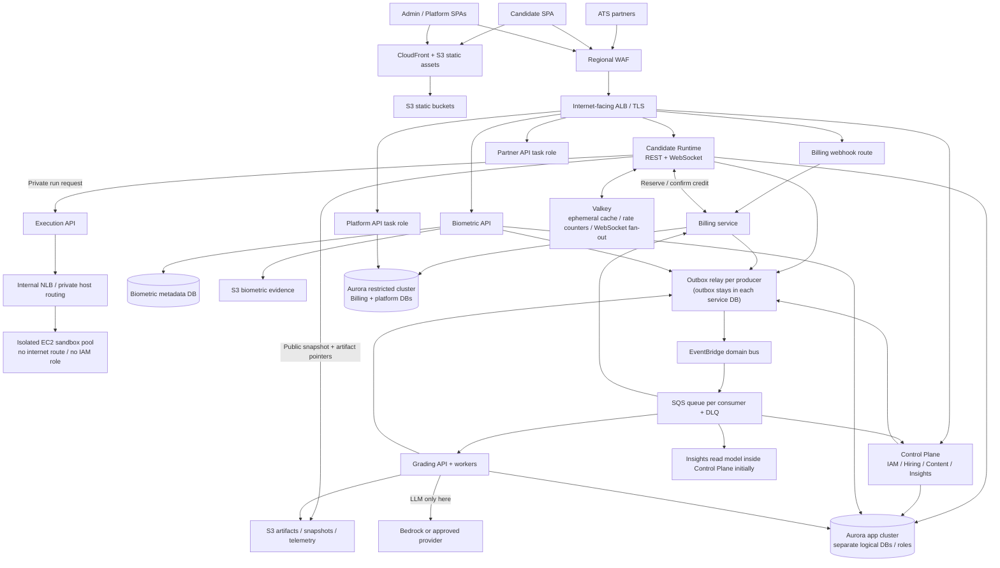

# CD-Recruit / Proctora — Validated Cost-Optimized AWS Architecture

**Review date:** 12 October 2026  
**Purpose:** Reconcile the initial 10-service target, the revised 6-service diagram, and the infrastructure / cost plan into a buildable recommendation.  
**Status:** Engineering recommendation for review — not an AWS deployment specification. Account structure, regional strategy, final AWS services, quotas, and committed pricing remain decisions for the deployment team.

---

## 1. Executive decision

### Recommended direction

Use a **cost-optimized hybrid microservices architecture**, not an immediate extraction into ten independently operated services.

Keep six logical service groups as the near-term target:

1. **Control Plane** — IAM, organizations, hiring, content authoring, insights and staff/admin APIs. This remains a modular monolith for now, with strict module and database boundaries. Separate it later only when a measurable trigger is reached.
2. **Candidate Runtime** — session lifecycle, assessment delivery, timers, WebSockets, autosave, candidate-facing APIs, and the first version of integrity/proctoring signal processing.
3. **Execution** — a private execution API plus a separate, isolated EC2 sandbox host pool for code and database exercises.
4. **Billing** — credit reservations/consumption, ledger, payments, webhooks, reconciliation and finance controls.
5. **Biometric** — identity/liveness processing, evidence upload/access, retention and deletion.
6. **Grading** — asynchronous deterministic/LLM grading, Say-Do correlation, confidence, provenance and score generation.

This means **six logical code/deployment groups, not necessarily six ECS services**. Separate ECS task roles/processes are justified for `staff-api`, `partner-api`, `platform-api`, `grading-api`, and `grading-worker`, and the execution sandbox is a separate EC2 fleet. Reusing an image does not mean those processes must share IAM permissions or scaling policy.

### Why this is the best compromise

- It isolates the two boundaries where a mistake has unusually high impact: **untrusted code execution** and **financial accounting**.
- It isolates biometric evidence and scoring from the live assessment path.
- It lets runtime, grading workers, and sandbox capacity scale independently.
- It avoids paying the operational and compute cost of extracting `iam`, `hiring`, `content`, and `insights` before evidence says they need it.
- It preserves a path to seven or ten service boundaries later without requiring a rewrite if contracts, schemas, and module seams are enforced now.

**Trade-off accepted:** the first Control Plane process has a wider compromise/failure blast radius than four separately deployed services, and Candidate Runtime initially shares a process with integrity ingestion. Those are explicit temporary compromises, not properties to claim as fully isolated microservices.

### Main verdict on the two supplied plans

| Area | Verdict | Required adjustment |
|---|---|---|
| Six logical groups | **Good cost-first starting point** | Make the service count terminology precise; integrity is initially a module within Candidate Runtime, not a separate service. |
| Ten-service target | Useful as a **future decomposition map**, not a launch commitment | Extract the four Control Plane domains only when a measurable trigger is met. |
| ECS Fargate for ordinary APIs/workers | Keep | Use ARM64 only after native dependencies (Prisma engines, ONNX, runtime libraries) pass build and load testing. |
| EC2 pool for untrusted execution | Keep | Do not expose sandbox hosts publicly; test Piston, gVisor/runtime, Docker privileges, and job-authentication assumptions together. |
| Aurora PostgreSQL | Keep as a candidate for production | Correct the shared ACU-range configuration and re-cost in `ap-south-1`. Consider provisioned RDS only after workload measurements. |
| Two Aurora clusters | Reasonable compromise | App cluster and restricted finance/platform cluster; separate databases and roles within each, with the shared-cluster trade-off documented. |
| EventBridge + SQS | Keep for business events and async work | Use transactional outbox + consumer inbox/idempotency. Never send raw high-volume telemetry through the event bus. |
| gRPC for all internal synchronous calls | Not necessary initially | Prefer REST + OpenAPI-generated clients unless a measured requirement justifies gRPC. Contracts/timeouts matter more than the protocol. |
| API Gateway for partner API | Defer at launch if partner volume is low | ALB + regional WAF + app-level API key/HMAC can work initially. Add API Gateway when usage plans, per-partner quotas, self-service key management or an API portal are required. |
| Custom JWT vs Cognito/Keycloak | Do not combine this migration with an identity-provider rewrite | Preserve the current issuer during extraction; formalize issuer/audience/role claims, key rotation and local verification. Choose an IdP separately. |
| Estimated `$715/month` total floor | **Budgetary estimate only; not yet validated** | Reconcile Aurora capacity math and reprice Mumbai region, egress, logs, S3, secrets, backup copies, email, and per-drive usage. |
| Backups and retention | Strong direction | Reconcile cross-region RPO claims; scope S3 versioning by data class; make biometric “no backup” a signed privacy/product decision, not a blanket assumption. |
| Documentation consistency | Not ready to implement verbatim | The latest diagram, migration document and infrastructure plan conflict on API Gateway, execution routing, integrity separation, email, and database topology. This review treats the dated six-group diagram + infrastructure plan as the cost-first target, with the specific corrections below. |

---

## 2. Reconciled target architecture

### Edge and routing decisions

- SPAs are static assets on S3 behind CloudFront with Origin Access Control. Keep API/telemetry/WebSocket traffic on the direct ALB path unless a tested reason favors routing it through CloudFront.
- The ALB exposes only documented application routes. Payment webhooks have a narrow route and method, signature verification, idempotent persistence and a fast response.
- **Default recommendation: the browser calls Candidate Runtime for code runs.** Candidate Runtime validates session state, timing, attempt limits and permissions before calling the private Execution API. Do not expose `/exec` publicly as an independent bypass unless you deliberately adopt short-lived signed run tokens and test every authorization path.
- Partner API can be an ALB-routed task role at launch. Keep it isolated from signing keys, answer keys, scoring data and unrestricted admin DB access.
- Do not add a service mesh. Use private service discovery / ECS Service Connect if helpful. AWS App Mesh reached end of support on 30 September 2026, so it should not be used for a new build. See [AWS App Mesh notice](https://docs.aws.amazon.com/app-mesh/latest/userguide/what-is-app-mesh.html).

### What counts as a service

| Logical service group | Runtime processes / roles | Scaling shape |
|---|---|---|
| Control Plane | `staff-api`, `partner-api`, `platform-api` (same code image is possible, different task roles/config) | Low admin traffic; partner/import bursts; platform plane separately protected |
| Candidate Runtime | `candidate-runtime` (sessions, WebSockets, telemetry ingest, integrity module) | Connections, request rate, event-loop lag; pre-scale before drives |
| Execution | `execution-api` on Fargate + sandbox host pool on EC2 | Queue wait, active jobs, host busy slots; scheduled warm capacity |
| Billing | `billing-api` plus scheduled reconciliation/export tasks | Acquire latency and pool contention; always preserve a minimum during drive windows |
| Biometric | `biometric-api` plus scheduled retention/purge job | CPU/inference latency and evidence-upload rate |
| Grading | `grading-api` + `grading-worker` | Worker concurrency from SQS backlog and LLM quota; worker may use Spot if jobs are retry-safe |

If telemetry interferes with session latency, extract `integrity-service` as a seventh group. Do not pre-pay for that separation before the load test shows contention or a stronger security boundary is required.

---

## 3. Data ownership and database layout

### Production baseline: two clusters, separate logical databases

**Cluster A — `cdr-app`**: runtime/session DB, biometric metadata DB, grading DB, and Control Plane domain DBs (`iam`, `hiring`, `content`, `insights`). Integrity data lives inside runtime initially unless the decision to extract integrity is made.

**Cluster B — `cdr-restricted`**: billing DB and platform/super-admin DB. This cluster is reachable only from the billing and platform task roles, migration tasks, and tightly controlled backup/admin paths.

Within each cluster:

- Separate PostgreSQL database per bounded context.
- Separate runtime, migrator and read-only backup roles per database.
- No cross-service foreign keys, joins, views or direct table access.
- Use IDs and versioned snapshots at service boundaries; build read models from events for cross-domain screens.
- Store each service’s DB credentials separately in Secrets Manager. Use task roles and security groups to constrain access at the cluster/network level.

**Important limitation:** databases in the same Aurora cluster share the engine, compute capacity, maintenance/failover domain and cluster-level recovery unit. A separate logical database and role is a useful access boundary, but it is not the same failure or security isolation as a separate cluster. The two-cluster split is an intentional cost trade-off. Split another cluster only for an independent recovery requirement, demonstrated noisy-neighbor problem, compliance obligation, or a customer-specific isolation contract.

**KMS permission correction:** do not grant an ECS application task `kms:Decrypt` on the key used only to encrypt an Aurora cluster; the application connects through PostgreSQL and does not decrypt Aurora storage itself. Separate database encryption keys from S3 object-encryption keys where feasible. A task reading SSE-KMS S3 objects may need narrowly scoped S3/KMS permissions for those objects, but that is not a reason to reuse an Aurora key for artifacts or grant broad `kms:Decrypt`. Use a distinct asymmetric signing key for JWT signing and give only the issuer `kms:Sign` (or equivalent signing capability), never the private key material or signing permission to candidate/partner processes. This improves the claimed data-class separation and reduces excess task privileges.

### Aurora Serverless v2 correction

The infrastructure draft specifies the app writer as `1–16 ACUs` and app reader as `0.5–8 ACUs`. **That per-instance range cannot be configured as written:** Aurora Serverless v2 uses a single cluster capacity range that applies to each Serverless writer and reader. A promotion-tier-2 reader can scale independently of the writer’s current capacity, but it still uses the same configured minimum and maximum range. See [AWS Aurora Serverless v2 capacity configuration](https://docs.aws.amazon.com/AmazonRDS/latest/AuroraUserGuide/aurora-serverless-v2.how-it-works.html).

Practical setting to price/test:

- `cdr-app`: cluster range initially `1–16 ACUs`; writer and reader both use that range. Tier-2 reader can scale independently, but not below the cluster’s minimum.
- `cdr-restricted`: cluster range initially `0.5–4 ACUs`; reader promotion tier 1 is kept sized with the writer for faster failover.
- Non-prod may use a supported `0 ACU` minimum/auto-pause configuration only after confirming engine version, idle connections, scheduled jobs and developer workflow. Auto-pause is not appropriate for the live billing critical path.

These are starting points only. Set max ACUs as a **cost guardrail**, then confirm actual CPU, memory, connections, lock waits, ACU utilization, storage I/O and p95 latencies in the 2,000-candidate load test. Recalculate the idle floor because the app reader cannot independently use the lower 0.5 ACU minimum while the cluster minimum is 1 ACU.

### Transaction ownership

Only a service owner writes its data. Cross-service “transactions” become explicit state machines/sagas, not distributed database transactions. Keep the `billing_begin` PL/pgSQL function out of the new design if it touches runtime, organization or drive tables; move each invariant to its owning service before cutover.

---

## 4. Critical product invariants

### 4.1 Assessment credit lifecycle: reserve first, consume only on the promised event

The supplied migration design has Billing `Acquire` create a `CONSUME` ledger entry before Candidate Runtime performs its local session transition, then reverse it if no first question renders. This can be made correct by compensation, but it is easy to present a provisional debit as a completed charge and makes failure handling harder to reason about.

Use a clearer state machine:

1. Candidate Runtime verifies invite, schedule, presence and eligibility.
2. Runtime calls Billing `ReserveCredit(sessionId, orgId, driveId, idempotencyKey)` with a short deadline. Billing atomically reserves one credit and records an idempotent reservation within its own DB transaction.
3. Runtime conditionally transitions the session into its started/pending state and records the reservation reference in the same runtime DB transaction as an outbox event.
4. When the **first real assessment question has rendered** and the server has a durable confirmation, runtime emits `assessment.first_question_rendered` with a unique idempotency key. Billing converts the reservation to `CONSUMED` once.
5. If a validated start cannot progress within the approved timeout, a durable timeout workflow releases the reservation. It must distinguish platform faults from candidate abandonment according to the commercial specification.
6. A nightly reconciliation checks reservation/session/consumption cardinality and reports mismatches; it must not rely only on in-memory timers.

The credit pool needs a documented capacity strategy. If one pool row becomes a hot lock, first use attendance-aware jitter or slot distribution; shard the counter only if measurements prove the row is the bottleneck. Do not let retrying the same idempotency key with different parameters mutate an existing reservation.

**Fail-closed on Billing outage** is the safe initial policy: show a retry/hold state and do not start the candidate’s timer without a valid reservation. Already running sessions should continue.

### 4.2 Assessment content and hidden tests

- Publish an immutable, content-addressed snapshot when a drive is launched.
- Separate `public` snapshot content from `scoring` content (answer keys, hidden tests, rubrics).
- Candidate Runtime reads only public snapshot objects.
- Execution and Grading roles have only the scoring access required for their function.
- Past sessions always reference the snapshot and rubric/model version used at the time.
- Use separate S3 bucket or prefix + KMS/IAM policy for scoring data. A separate bucket/key is the clearer boundary for hidden tests.

### 4.3 Submission and grading

- Candidate Runtime writes the submission bundle to S3, calculates a SHA-256 digest, and commits `SUBMITTED` plus an outbox record in one runtime DB transaction.
- SQS triggers Grading workers. Workers are idempotent by `sessionId + gradingVersion`; duplicate messages must not produce duplicate final scores or duplicate LLM charges.
- Deterministic scoring and Say-Do correlation should not depend on the LLM response.
- Every score records `sayDoProvenance` (`COMPUTED` or `PLACEHOLDER`), model/rubric version, confidence and human-review status. `PLACEHOLDER` must not be published as a valid score or sent to ATS export.
- A provider outage delays grading; it must not block a candidate from submitting the assessment.

### 4.4 Email is part of the product flow

The migration design includes invite/email workers, while the infrastructure document lists SES as “on hold.” Those cannot both be true if the product is expected to issue candidate invites or assessment links by email. Confirm the provider with the product/deployment team (SES, existing provider, or equivalent), but keep transactional email in the architecture and include it in cost, DNS/DKIM, bounce/complaint handling and retry plans. Do not silently remove the email delivery requirement.

---

## 5. Synchronous calls, events and telemetry

### Recommended communication policy

| Use case | Initial choice | Reason / contract |
|---|---|---|
| Browser → public API | HTTPS REST/JSON; WebSocket only for Candidate Runtime | OpenAPI contracts and normal browser support |
| Runtime → Billing | Private REST or gRPC; start with generated REST client unless there is a concrete need for gRPC | Idempotent reservation, short deadline, fail closed |
| Runtime → Execution API | Private synchronous request/response initially | Candidate needs a run result; set strict per-language timeout and never debit candidates for platform execution errors |
| Service facts | Transactional outbox → EventBridge → one SQS queue per consumer | Fan-out without request-time dependencies |
| Work for one consumer | SQS standard queue + DLQ | Retry/back-pressure; consumers must tolerate duplicate and out-of-order delivery |
| Large bundle, event log or report | S3 object + pointer, object hash and schema/version in message | Avoid putting large payloads on EventBridge/SQS |
| High-volume telemetry | Batched runtime API writes to S3 chunks; small session state to PostgreSQL | Keeps raw high-rate events out of OLTP DB and off the domain bus |
| Scheduled work | EventBridge Scheduler or ECS one-off tasks | Reconciliation, retention/purge, backups, capacity prewarm |

**REST vs. gRPC:** the original plan proposes six gRPC edges. For a small NestJS team and this call volume, the main benefits are contract discipline and deadlines—not raw performance. REST + OpenAPI-generated clients can supply those with less protocol/tooling complexity. If the team already has a working gRPC/Protobuf toolchain, it is still a valid choice; do not make switching transport a prerequisite for the migration.

**Event delivery is not exactly-once.** Standard SQS queues use at-least-once delivery and can produce duplicates or out-of-order messages. Every consumer therefore needs an inbox/deduplication key, idempotent handlers, aggregate versions, bounded retry, a DLQ, and an operator redrive procedure. See [AWS SQS standard queue behavior](https://docs.aws.amazon.com/AWSSimpleQueueService/latest/SQSDeveloperGuide/standard-queues.html).

### Outbox/inbox minimum

Every event should include `eventId`, `eventType`, `schemaVersion`, `occurredAt`, `producer`, `tenantId`, `aggregateId`, `aggregateVersion`, `correlationId` and `traceId`. Include only essential identifiers; avoid candidate PII in events.

- Commit the domain state change and outbox row in one local DB transaction.
- Publish asynchronously; mark delivery only after successful publish.
- Consumer inserts `eventId` into an inbox table with a unique constraint before applying its state change.
- Reject or safely ignore stale aggregate versions.
- Define event retention, DLQ age thresholds and redrive ownership.

### Telemetry details to preserve

The supplied design’s client batching and S3 chunk approach is directionally good. Preserve the key durability rule: **do not acknowledge `lastDurableSeq` until the relevant batch is durably represented in S3 or another approved durable store**. A server-memory buffer alone is not durable. Keep client-side IndexedDB resend of unacknowledged batches, per-session monotonic sequence numbers, dedupe, compaction manifests and lifecycle rules.

Before adopting the exact 45-second / 256-KB flush settings, test task crashes, browser refresh, network disconnect, duplicate batches, S3 write throttling and final submission while a batch remains buffered. Set the retention lifecycle as a backstop, not in conflict with the contractual retention clock.

---

## 6. Execution isolation — treat as a separate security project

This is the strongest reason to move beyond a monolith. However, the diagram is not sufficient by itself to prove a secure sandbox.

### Recommended starting design

- Execution API runs privately on ECS Fargate; Candidate Runtime is its only normal caller.
- EC2 sandbox hosts live in isolated private subnets with no NAT/Internet Gateway route, no public IP, no general outbound route, and no IAM instance role.
- Only the internal NLB / execution security group can reach the host job endpoint.
- Use pre-baked immutable AMIs/images with pinned versions and a scheduled rebuild process.
- Do not pass cloud credentials, payment credentials, application DB credentials, hidden tests beyond the individual job needs, or long-lived shared secrets into arbitrary candidate containers.
- Every job runs with bounded CPU, memory, wall time, process count, output size, file size, and read-only filesystem where supported. Disable network access from the actual workload container, not just at the API layer.
- Destroy/reset all per-job state after the run. SQL/NoSQL assessments need an explicit ephemeral database/container lifecycle, fixture seeding, resource limits and cross-candidate isolation. Do not give untrusted code access to a shared business database.
- Validate retry safety and idempotency before using Spot capacity for jobs.

### Items that must be proven in a staging security test

1. Can the deployed Piston architecture run without a privileged path that enables container-to-host escape? If any component requires privileged access, document exactly which component, why, and how untrusted code is still isolated.
2. Is gVisor (`runsc`) actually compatible with the selected Piston/runtime images, SQL/NoSQL workers and host kernel? Confirm with adversarial tests, not diagram annotations.
3. How does each sandbox host authenticate jobs if it has no instance role and no egress? Prefer short-lived signed job claims that the host can verify using a public key baked into the image, with internal TLS. Do not improvise by placing a reusable HMAC secret in user data or an unprotected AMI.
4. Are the hidden tests supplied only to the execution process that needs them, and are they unavailable from the candidate runtime, sandbox OS, logs, error messages and candidate-controlled outputs?
5. Can the platform prove there is no `runLocalFallback` or alternate code execution path in production?

Keep Piston and the supported SQL/NoSQL engine license review as a Wave 0/1 gate. Do not assume the NoSQL engine or pretrained face-model weights are commercially licensed without checking the exact packages, model artifacts and versions shipped.

---

## 7. Security and identity baseline

### Keep for launch

- Separate AWS task roles per process/role, least-privilege security groups, Secrets Manager credentials, KMS encryption, TLS externally and TLS to database endpoints.
- Candidate, staff, partner and platform JWT audiences/roles are distinct. Validate issuer, audience, expiry, role and tenant binding on every request; use short-lived tokens and rotate signing keys.
- Preserve local JWT validation and the current issuer while services are extracted. If moving from symmetric signing to asymmetric signing/JWKS is needed, make that a small, separately tested change instead of combining it with service extraction. Decide later whether Cognito or Keycloak materially improves the product enough to justify migration.
- Partner keys should be stored hashed where possible, individually revocable and rotated. Support HMAC-signed webhooks if outbound webhooks are introduced. Do not treat an API key alone as user identity.
- Candidate-facing ALB routes must have no route to Billing or Platform API. Security groups should also block candidate workloads from the restricted database cluster.
- Do not exclude entire candidate routes from every WAF managed rule by default. Scope down the specific body-inspection rules that false-positive on source/SQL text, but keep IP reputation, safe request-size controls, rate limits, bot/abuse controls where appropriate, application validation and security telemetry. Test rules in Count mode before enforcing.
- Enable CloudTrail and make it difficult for production identities to disable or delete logs/backups. Use separate backup account/vault controls if the deployment team approves multi-account setup.
- Use CloudWatch logs, metrics and alarms from day one. Carry `correlationId`/`traceId` through HTTP, service calls, SQS and outbox records. OTel tracing can start in staging and be sampled in production rather than deploying a full observability platform upfront.

### Biometric evidence policy must be explicit

A no-versioning/no-replication/no-backup S3 bucket can support strict deletion, but it makes mistaken deletion and an account incident unrecoverable. That may be acceptable only if the privacy notice, customer contracts, appeal window and legal/DPIA policy permit it. If the evidence is required for a decision dispute, define a recoverability window that does not conflict with the promised deletion date. Make the purge job authoritative and the lifecycle rule a conservative backstop; an absolute 60-day upload-age expiration may delete evidence before a delayed decision’s appeal window ends.

---

## 8. Reliability, scaling and disaster recovery

### Scale by the workload, not by service count

- Candidate Runtime: scale on request rate, active WebSockets, event-loop lag, CPU/memory and database pool saturation. Pre-scale before published drive windows.
- Execution API and EC2 pool: scale on queue wait, queued/in-flight jobs and usable host slots; maintain a small warm baseline if cold starts would harm an active test.
- Billing: scale the API task count modestly before a drive. The primary bottleneck may be a single credit-pool row, not CPU. Measure lock wait and acquisition p95 before increasing task counts.
- Biometric: pre-scale before identity-check windows and monitor ONNX inference latency, memory and CPU architecture compatibility.
- Grading workers: scale on oldest-message age and backlog per worker, capped by LLM provider quotas and the per-assessment token budget. Do not scale solely on queue depth without considering job duration and provider rate limits.
- Control Plane: keep small; email/invite/import operations should go through queue-backed workers when bursts can affect staff APIs.

### Prewarming

Use drive schedule + `expectedAttendance` to raise database and task floors before the assessment window. Start conservatively: database capacity first, sandbox hosts early enough for AMI/host warm-up, then ECS tasks. The infrastructure draft proposes T−45/T−35/T−30 minutes; the older migration document mentions shorter prewarm timings. Keep those as testable starting values, then derive final timings from p95 capacity-ready times. Reactive autoscaling alone is not sufficient for an all-at-once drive start.

For 2,000 candidates, the supplied load model estimates approximately 2,000 concurrent WebSockets, ~670 telemetry requests/second if batches arrive every three seconds, ~33 code runs/second under its stated workload, and around 65–70 concurrent vCPU of code execution. Treat these as test assumptions to reproduce in k6, not proven capacity.

### Recommended pilot objectives (operational targets, not contract SLA)

| Area | Starting target | Evidence required |
|---|---|---|
| Candidate critical path | ≥99.5% successful start/submit attempts in a full synthetic drive; set a stricter target if customer commitments require it | k6 results + real application success metrics, not host CPU alone |
| Session correctness | No acknowledged answer loss; no double consumption; no timer start without a valid reservation | Failure injection and reconciliation reports |
| Billing | Idempotent acquire/reservation and consume; every unresolved reservation visible | Duplicate calls, timeouts, process crash and DB failover tests |
| Runtime data | In-region DB RPO target ≤5 minutes; RTO target ≤1 hour for a logical-data incident | Quarterly restore/failover drill |
| Grading | Durable jobs; no silent loss; oldest message age alert; default goal results within ~1 hour in normal operation | Worker outage, Spot interruption, provider throttle/outage test |
| Region loss | One-region deployment initially; documented manual rebuild; no warm standby | Signed RTO/RPO by data class and successful restore rehearsal |

### Backup baseline

1. Aurora automated backups / PITR for every production cluster.
2. Cross-account snapshots in a dedicated backup/vault account if the deployment team accepts the account overhead; production should not be able to delete/shorten vault retention.
3. Logical dumps for restricted data daily and for selected app domains weekly so a single logical database can be restored without restoring the whole cluster.
4. Append-only ledger plus nightly immutable billing export (PII-free by automated test); keep Object Lock Compliance retention only after export contents and retention requirements are verified.
5. S3 versioning for artifacts, hidden tests and report content where recovery matters. Separate lifecycle policies for each data class.
6. Restore tests: quarterly PITR/cluster recovery, monthly restricted logical-dump restore, and periodic isolated vault restore. Alarm on a missed backup, copy or restore test.

### RPO/RTO must match the actual backup schedule

The infrastructure plan gives a broad region-outage RPO of ≤24 hours while the app cluster’s cross-region copies are described as weekly. **Weekly cross-region copies can imply up to roughly seven days of cross-region data loss**, not a 24-hour RPO. Choose one of these deliberately:

- accept a longer regional RPO for the app data and document it; or
- copy app recovery points at least daily to the secondary region, and price the extra storage/copy cost.

The recommended low-cost launch posture is one primary region, strong in-region PITR + cross-account recovery, and cross-region protection for finance/WORM data if required. Do not claim regional RPO/RTO that the copy cadence cannot meet.

---

## 9. Cost review and cost controls

### What to trust in the current estimate

The infrastructure draft reports approximately **$610/month production idle floor, $100/month scheduled non-prod, $4/month vault, and $20–35 infrastructure per 2,000-candidate drive** before LLM grading; it estimates LLM grading separately at $60–160 per drive. These are useful hypotheses, not validated prices. The draft itself asks for an `ap-south-1` Pricing Calculator pass and a ±20% tolerance.

The `$715/month` base total should **not** be approved as a firm operating budget yet, for the following reasons:

- Aurora Serverless v2 app writer/reader range is not configurable as written; the corrected minimum changes the floor.
- The estimates use `us-east-1` basis while the proposed deployment is Mumbai; the exact region-specific prices must be modeled per service rather than applying a universal multiplier.
- The infrastructure markdown refers to cost-dial sections `12.3` and `12.4`, but the supplied file ends at Section `10.3`; the referenced cost breakdown is missing from this version.
- Confirm whether estimates include data transfer, NAT data processing, logs/metrics, ECR, Secrets Manager, KMS API calls, S3 requests/storage/retrieval, event volume, SES/provider email, snapshot copies, domain/Route 53 charges, and test/CI environments.
- A “cost per drive” estimate must include the duration and count of pre-scaled Fargate tasks, actual Aurora ACU-hours for writer and reader, EC2 sandbox vCPU-hours, S3 telemetry payloads and requests, data transfer, cache ECPUs, and any LLM/provider usage.

**Planning position:** carry the supplied $715 as a rough reference only and get the deployment team to produce a new regional calculator estimate before launch. For approval, use a base range plus variable per-drive cost and a contingency rather than a single-point number. No amount in this document is an AWS quote. Configure budget alarms from the newly validated estimate; do not enforce an AWS budget action that can shut down candidate sessions or payment webhooks.

### Cost levers in priority order

1. **Avoid premature service extraction.** Keep IAM/hiring/content/insights in Control Plane until triggers show operational isolation has value.
2. **Run workers only when work exists.** Grading workers scale from zero with a reliable scale-out signal; keep at least a small sandbox warm only if cold-start test data justifies it.
3. **Use scheduled pre-scaling and downscaling** around booked assessment windows; protect the post-session drain window until bundles and grading jobs are durably queued.
4. **Set hard ceilings** for ECS max task counts, Aurora max ACUs, sandbox vCPU, Valkey memory/ECPUs, LLM concurrency/tokens, logs retention and Cost Anomaly Detection/Budgets.
5. **Do not overbuy edge services.** Start without API Gateway if ALB + WAF + application key management meets partner needs. Reconsider CloudFront’s paid flat-rate plan based on static-asset usage and required WAF/plan features—the chatty API traffic in this design does not go through that CDN distribution.
6. **Do not add RDS Proxy by default.** Tune Prisma pools and cap task counts first. Add a proxy if measurements show connection storms, excessive aggregate pool size or failover reconnection issues; re-cost the effect on Aurora auto-pause for non-prod.
7. **Keep telemetry out of PostgreSQL** unless the test proves the current S3 chunk path is too costly or operationally complex. Raw event storage is a significant volume/retention decision.
8. **Avoid cross-region copies for every low-risk dataset by default.** Price and protect restricted/finance data first, then add broader regional DR according to the required RPO.
9. **Use CloudWatch logs/metrics and trace IDs first.** Add high-volume tracing, Container Insights and advanced security products only when the measured debugging/compliance requirement warrants the spend. Do not remove essential audit logs to save small amounts.
10. **Keep LLM spend separate from infrastructure.** Enforce model, prompt and output token budgets, cache only where semantics permit, make grading idempotent, and track cost per assessment and per customer.

### Cost estimate template for the deployment team

Ask for three scenarios for `ap-south-1`: **idle month**, **one 2,000-candidate drive**, and **multiple overlapping drives**. Each must itemize compute, database compute/storage/I/O, networking, WAF/CDN, cache, object storage/requests, queues/events/scheduler, logging/metrics, secrets/KMS, backups/copies, email, LLM, and data transfer. Include on-demand prices, any commitments/discounts, max-cost guardrails, and what is excluded. Validate the result against one controlled load test and AWS Cost Explorer afterward.

---

## 10. AWS deployment options — engineering input, deployment-team decision

These are recommendations to take to the deployment team, not commitments.

| Topic | Engineering recommendation | Decision to confirm with deployment team |
|---|---|---|
| Region | Start in one primary region (Mumbai is a natural candidate for India-first usage) | Customer contract, latency, data residency, Bedrock/model availability, support and price; do not infer legal residency rules from customer geography alone |
| Accounts | Prod and non-prod separated; prefer a vault account for immutable recovery | Whether to use 3 or 4 accounts, who owns Organizations/SCPs, billing/log archive, approvals and on-call responsibility |
| Compute | ECS Fargate for normal service processes; EC2 ASG for untrusted execution | ARM64 availability/compatibility, Spot quotas, Fargate quotas, deployment strategy and EC2 instance families |
| Database | Two production Aurora clusters with per-domain DBs/roles if the budget matches requirements | Aurora Serverless v2 vs provisioned RDS, reader count, ACU range, proxy, storage mode and PITR/copy retention |
| Edge | S3 + CloudFront for SPAs; ALB + regional WAF for APIs | Flat-rate vs metered CloudFront plan, WAF package/rules, Cloudflare compatibility, TLS/domains, API Gateway trigger |
| Async | EventBridge + SQS standard queues + DLQs + Scheduler | Event archive/replay retention, FIFO needs, quotas, queue redrive ownership and costs |
| Secrets/keys | KMS + Secrets Manager, with key policies by data class | Number of CMKs and rotation approach; whether a separate biometric key and restricted finance key are mandatory |
| Identity | Preserve existing JWT during migration | Whether to keep current issuer, migrate to Cognito, or deploy Keycloak; avoid coupling that to service extraction |
| Observability | CloudWatch baseline, correlation/trace IDs, selected OTel sampling | Retention, alert destinations, dashboard ownership, X-Ray/ADOT, security monitoring products |
| Backups | PITR plus independent cross-account copy and tested logical restore | Vault account, Vault Lock mode/retention, cross-region scope, restore RTO/RPO, deletion policy and budget |
| Email / AI | Existing mail provider or SES; model access behind `LlmPort` | Production mail provider and deliverability setup; Bedrock vs approved external model, region, privacy, quota and budget |

Do not create one AWS account per service. Use IAM task roles, security groups, data stores and deployment permissions for the initial boundaries; accounts are primarily environment/security blast-radius boundaries.

---

## 11. Migration approach and phase gates

### Wave 0 — Inspect and prepare (no service extraction)

**Engineering:**

- Read the actual Prisma schema and all migrations; inspect DB triggers, stored procedures, raw SQL, cross-module joins, cron jobs, `EventEmitter2`, WebSocket gateways, BullMQ use and direct DB side doors.
- Create a module-to-domain ownership map and write down every invariant that currently depends on a single DB transaction.
- Confirm the current code paths for credit acquisition, first question render, candidate timer start, submission, candidate data deletion, email sends and SQL/NoSQL exercise execution.
- Establish `contracts/` (OpenAPI or Protobuf, event schemas, snapshot schemas), boundary lint and an explicit exception list that shrinks every wave.
- Implement the transactional outbox/inbox library and idempotency pattern; don't make a shared “kit” full of domain entities.
- Remove or quarantine host-execution fallback with explicit sign-off before cloud cutover.
- Test model/runtime licensing for ONNX face weights, Piston, and the exact NoSQL/SQL execution engine.

**Deployment team:** create the first non-production AWS environment, CI/CD via OIDC, baseline networking, logs, secrets and a tested deploy/rollback pipeline. Lift-and-shift the current monolith to ECS + PostgreSQL/Aurora in staging before decomposing it.

**Exit gate:** baseline monolith works in staging; backup/restore test passes; boundaries and service contracts are reviewed; a cost report exists; the 2,000-candidate load profile is defined.

### Wave 1 — Execution isolation + Billing seam

- Build execution API and isolated sandbox pool. Test network egress deny, container escape defenses, CPU/memory/time quotas, output caps, SQL/NoSQL isolation and retry behavior.
- Finalize the Billing reservation/consumption contract before more `billing_begin` code lands.
- Build Billing with its own DB/cluster boundary and idempotent webhooks/acquire/reserve/consume/release operations.
- Shadow-compare old billing decisions against new Billing; do not turn on enforcement until every mismatch is explained and reconciled.

**Exit gate:** execution only runs through the isolated boundary; no unexpected outbound traffic; billing shadow reconciliation passes; candidate double-click/retry/crash cases have no duplicate charge.

### Wave 2 — Candidate Runtime + Biometric

- Extract Candidate Runtime with snapshot-only content reads, invite projection, durable telemetry batches and outbox publication.
- Keep integrity inside Candidate Runtime initially, but instrument it separately so it can be extracted when contention is proven.
- Extract biometric verification/evidence into its own task role and data-access boundary.
- Keep already-running assessments resilient to a Control Plane, Billing or Content outage according to the agreed failure matrix.

**Exit gate:** an end-to-end synthetic candidate can start, answer, run code, upload evidence, autosave and submit while Control Plane is available only for setup and can then be disconnected. Failures never silently charge or lose acknowledged answers.

### Wave 3 — Grading + read models

- Move grading to an asynchronous worker with SQS, DLQ, idempotency and LLM quotas.
- Remove placeholder scoring from candidate/ATS-visible paths; test Say-Do provenance and confidence gates.
- Add event-driven dashboard/read models. Keep insights inside Control Plane until read load or release cadence proves it needs extraction.

**Exit gate:** submissions always persist; grading retries safely; provider throttling/outage delays but does not lose jobs; a placeholder can never appear as a valid score/export.

### Wave 4 — Conditional Control Plane extraction

Extract IAM, hiring, content or insights only when one of these measurable triggers occurs:

- Their release cadence is blocking another domain’s delivery.
- Partner traffic or invite/import bursts cause measurable staff API degradation.
- Content protection requires the authoring plane to have a harder security boundary.
- Dashboard/report load measurably harms transactional workload.
- A contract requires domain-specific RTO/RPO, tenancy or regulatory isolation.

Until then, keep domain modules and databases separated even though the process is shared. Document that this is a modular control-plane deployment, not fully independent microservices.

### Wave 5 — Production hardening and sign-off

- Run 2,000-candidate k6 test at realistic arrival rates, plus staggered and burst-start variants.
- Inject failure: Billing timeout, runtime crash after reservation, SQS duplicate/reorder, EventBridge delay, S3 write failure, Valkey outage, sandbox Spot interruption, LLM throttling, Aurora failover, single-AZ loss and bad deployment.
- Rehearse full restore from the vault and recover a single logical DB.
- Review Cost Explorer per drive and tune autoscaling, ACU ceilings, retention and log levels.
- Complete runbooks and identify the named owner for alarms, DLQ redrive, backups, incidents and cost alerts.

**Do not make the migration date-based only.** Advance when the exit gate passes, rollback is proven and the business invariant tests are green.

---

## 12. Acceptance tests required before production

### Architecture and security

- [ ] Each service image boots and passes readiness when peers are stopped; it does not crash-loop because a non-critical dependency is unavailable.
- [ ] Candidate role cannot read scoring snapshots, hidden tests, billing DB, platform DB, biometric objects or other tenants’ artifacts.
- [ ] Partner task role cannot sign JWTs or read scores/hidden tests/platform data.
- [ ] Sandbox cannot reach the public internet, application DBs, task credentials or host metadata; test from inside a running job.
- [ ] No host-execution fallback is reachable in the production build.
- [ ] Database credentials are per service/database; no cross-domain table access or cross-domain foreign keys remain in extracted domains.
- [ ] WAF rules are tested against candidate source code, SQL submissions, telemetry JSON, payment webhooks and malicious requests.

### Correctness and failure recovery

- [ ] Repeating reservation/acquire/consume/release requests with the same idempotency key does not double reserve or charge.
- [ ] First-question-render confirmation is the point at which an assessment credit becomes consumed.
- [ ] Crash after reservation and before session start converges through retry/release without duplicate charge.
- [ ] Duplicate/out-of-order SQS deliveries produce one final side effect per logical event.
- [ ] Outbox rows remain publishable when EventBridge/SQS is temporarily unavailable.
- [ ] Submission is durable before the candidate sees a final confirmation; all acknowledged telemetry batches survive task restarts.
- [ ] Spot/interrupted code jobs are retried safely and platform failures are not treated as candidate mistakes.
- [ ] DLQ alarms, redrive and operator ownership are tested, not just configured.

### Load and data recovery

- [ ] Load test includes 2,000 concurrent candidates, ~670 telemetry requests/sec under the stated batching assumption, 33 code executions/sec under the stated run rate, and the estimated sandbox vCPU load.
- [ ] Candidate Runtime event-loop lag, WebSocket latency, Aurora connections/lock waits/ACU, Billing Acquire p95, SQS oldest message age and sandbox queue wait are captured.
- [ ] Scheduled prewarm has adequate margin under cold deployment and task replacement conditions.
- [ ] Restore rehearsal demonstrates per-cluster and per-logical-database recovery; cross-region RPO matches the copy frequency actually configured.
- [ ] Biometric purge is tested against delayed decisions, appeals and deletion requests.
- [ ] Cost report distinguishes idle floor, one drive, overlapping drives, LLM usage, and development/staging spend.

---

## 13. Decisions that should be signed off

### Engineering sign-off

1. **Six logical service groups initially**, with Candidate Runtime containing integrity at first and Control Plane keeping IAM/hiring/content/insights modular.
2. Billing reservation/consumption contract and exact first-question-render billing invariant.
3. Runtime as the only browser-facing route to Execution by default.
4. REST/OpenAPI or gRPC as the internal sync contract; no mixed ad hoc calls.
5. Domain ownership, outbox/inbox, idempotency, immutable snapshots and S3 telemetry durability.
6. Sandbox threat model and proof that the actual Piston/gVisor/runtime deployment is sufficiently isolated.
7. Which biometric and candidate data must be recoverable, and the deletion/appeal window.

### Deployment-team sign-off

1. AWS accounts / Organizations / SCPs / vault account.
2. Region and secondary-region recovery posture.
3. Aurora Serverless v2 versus provisioned RDS, reader arrangement and final capacity bounds.
4. Public edge/CDN/WAF plan, direct ALB design, optional API Gateway and DDoS strategy.
5. ECS platform, task/Spot quotas, service discovery and ARM64 compatibility.
6. Per-class KMS keys, Secrets Manager and cross-account backup permissions.
7. CloudWatch retention and alerting, optional OTel/X-Ray sampling and security monitoring products.
8. Regional AWS Pricing Calculator workbook and budget ceilings.

### Product/legal sign-off

1. Credit semantics and the trusted event that marks the start of a billable assessment.
2. Candidate data, telemetry, evidence, scores and financial retention periods.
3. Whether evidence must be recoverable during the appeal period.
4. Email provider, identity provider and permitted LLM provider/region.
5. Launch countries, data-handling commitments and required customer-specific isolation.

---

## 14. Reference notes from this review

- AWS states that Aurora Serverless v2’s min/max ACU range applies at the cluster level to each Serverless writer/reader: [Aurora Serverless v2 how it works](https://docs.aws.amazon.com/AmazonRDS/latest/AuroraUserGuide/aurora-serverless-v2.how-it-works.html).
- AWS documents SQS standard queues as at-least-once and potentially out-of-order: [SQS standard queues](https://docs.aws.amazon.com/AWSSimpleQueueService/latest/SQSDeveloperGuide/standard-queues.html).
- AWS App Mesh end-of-support notice: [What is AWS App Mesh](https://docs.aws.amazon.com/app-mesh/latest/userguide/what-is-app-mesh.html).
- CloudFront flat-rate plans include CloudFront, WAF/DDoS, DNS, CloudWatch log ingestion and other listed plan features, but whether a plan is best for this topology depends on which traffic actually passes through its distribution: [CloudFront pricing](https://aws.amazon.com/cloudfront/pricing/).
- NAT gateways incur both availability-hour and data-processing charges; using S3 gateway endpoints can avoid NAT processing for S3 traffic: [NAT gateway pricing](https://docs.aws.amazon.com/vpc/latest/userguide/nat-gateway-pricing.html).
- AWS Backup supports cross-account copies; the destination account/vault and encryption/permissions need deliberate setup: [Cross-account backup copies](https://docs.aws.amazon.com/aws-backup/latest/devguide/create-cross-account-backup.html).
- ALBs natively support WebSocket upgrades: [ALB listeners](https://docs.aws.amazon.com/elasticloadbalancing/latest/application/load-balancer-listeners.html).

---

## Final recommendation

Approve the architecture **direction**, not every SKU or dollar number. Build the six-group hybrid model, harden the billing and execution boundaries first, preserve a single primary region at launch unless contracts say otherwise, and make the deployment team produce the regional cost/recovery sheet. Do not start by creating ten fully independent services; do start by enforcing service ownership, idempotent contracts, durable events, data retention rules and the execution threat model. That provides a complete product architecture now while keeping future extraction possible and AWS costs controllable.
