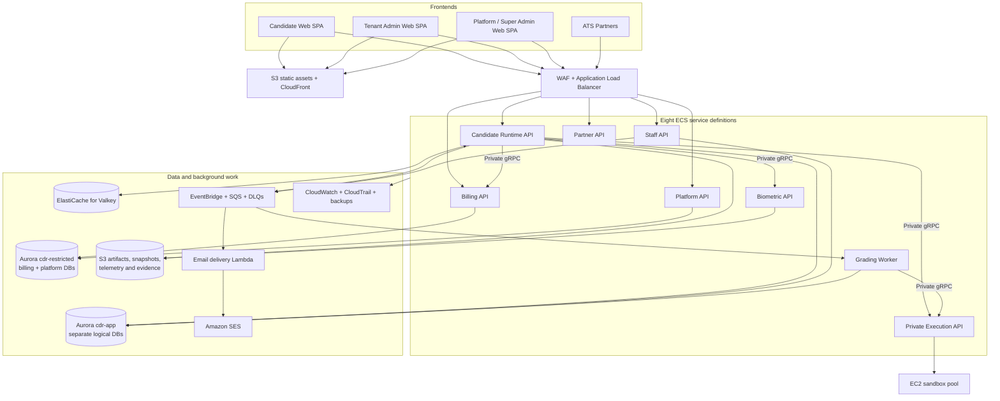

# CD-Recruit / Proctora — Architecture Explained End to End

**Version:** 4.0  
**Date:** 13 October 2026  
**Status:** Companion explanation for the proposed architecture; formal decisions are recorded in `CD-Recruit_Microservices_Architecture_Specification_v0.2.md`.  
**Audience:** Developers, deployment/platform engineers, product owners and reviewers who need to understand how the entire platform works.

> **Important:** The repository audits are complete, but the implementation prerequisites are not all complete. The current application is still a tightly coupled NestJS modular monolith. The 2,000-active-candidate target is a test objective, not a verified production capacity. Cost estimates remain provisional.

## 1. The simple mental model

Proctora/CD-Recruit is an online assessment platform. A candidate gets an invitation, proves they can enter the assessment, answers questions, runs code in an isolated environment, submits the work and eventually receives a result. Recruiters create drives and review results. Super Admin operates the platform itself: tenants, plans, billing overrides, account suspension and platform-wide recovery.

The AWS design divides responsibilities so that every request does not go through one backend process, but it does not create a service for every feature. It has **six logical business groups and eight ECS service definitions**. A separate EC2 sandbox pool runs untrusted code. The remaining Control Plane domains stay in a common application codebase for now.

Think of the components as:

- The **frontends** are the websites users interact with.
- **CloudFront/S3** deliver the frontend files.
- **WAF and ALB** filter/route backend requests.
- **ECS Fargate** runs normal backend services.
- **EC2 sandbox machines** run candidate-submitted code.
- **Aurora PostgreSQL** stores structured, authoritative records.
- **S3** stores larger files and versioned assessment artifacts.
- **Valkey** keeps temporary state/cache; it is not the financial ledger or the only place an answer is saved.
- **EventBridge and SQS** connect background tasks, retries and grading jobs.
- **CloudWatch/CloudTrail and backup services** help operators see failure and restore data.

For the official boundaries, responsibilities, statuses and open decisions, consult the formal specification. This document explains them in everyday language.

## 2. What the repository audit confirmed

The checked-out branch in the audit was `dev-microservice`, commit `4bec750`. The current backend is a NestJS modular monolith with 39 registered feature/infrastructure modules and 41 Prisma models in one current PostgreSQL schema. The precise branch/commit must be checked again before implementation.

The audit uncovered four important issues before extraction:

1. The `billing.billing_begin()` SQL procedure reaches across Billing, Candidate Runtime, organisation and drive data in one transaction. That must be redesigned before Billing can own its database independently.
2. The current coding path queries question test cases and filters hidden tests from within the existing application. Candidate Runtime must not see hidden test cases or answer keys.
3. Evidence-video uploads currently pass multipart file buffers through the Node process. Direct upload to S3 using temporary signed URLs is the preferred target.
4. Existing k6 load tests are configured for only five virtual users. They do not prove that the system can support 2,000 concurrent candidates.

The audit also confirmed that the three frontends are independent apps, not microfrontends. Candidate Web and Super Admin Web are static SPA candidates. Admin Web currently builds a TanStack Start/Nitro server, but the inspected application uses browser-side authentication and API fetching and has no identified server-side feature that needs SSR. It should be converted to a standard static SPA after regression tests pass.

These are audit findings, not claims that the fixes have already been implemented.

## 3. The target architecture at a glance

The route from the browser to Execution does **not** exist in the target. The browser calls Runtime; Runtime validates the candidate and then calls the private Execution API. Platform Web is independently delivered so it can still load if a business API is down.

## 4. How many services are actually being deployed?

There are two different counts:

- **Six logical groups:** Runtime, Execution, Billing, Biometric, Grading and Control Plane.
- **Eight ECS service definitions:** Candidate Runtime API, Execution API, Billing API, Biometric API, Grading Worker, Staff API, Partner API and Platform API.

Those are not contradictory. Staff, Partner and Platform are separate runtime entrypoints using a common Control Plane codebase but different route composition, credentials and task permissions. They should not all start the entire monolith and simply hide routes with URL checks. Each process needs an explicit composition root and the minimum secrets/permissions for its role.

The EC2 sandbox pool is separate compute, not another ECS service definition. The three frontend sites are static hosting, not backend ECS tasks. A small SQS-triggered Lambda is proposed for low-volume email delivery; if email cannot be implemented there and requires a separate always-on ECS worker, that adds a deployable and must be reflected in the cost model.

### The eight backend deployables

| Deployable | What it does | What it must not do |
|---|---|---|
| Candidate Runtime API | Invitation validation, session lifecycle, timing, question delivery, autosave, WebSocket, submission bundle | Read hidden tests, answer keys, billing DB or biometric evidence |
| Execution API | Validates/coordinates code/SQL/NoSQL jobs and dispatches to sandbox hosts | Be publicly called directly by the browser; run untrusted code in the main API process |
| Billing API | Price book, payment webhooks, credit pools, reservations, ledger, overrides and reconciliation | Share database credentials with Runtime or permit duplicate credit changes |
| Biometric API | Face/identity checks, upload tickets, evidence access and deletion policy | Accept broad permanent evidence access by every staff service |
| Grading Worker | Deterministic/AI scoring, Say-Do correlation, confidence and provenance | Lose grading work if stopped or publish placeholder scores as computed results |
| Staff API | Tenant Admin operations over Hiring, Content, IAM and Insights modules | Possess Billing or Platform database credentials |
| Partner API | Versioned ATS integration, candidate ingestion/status and approved exports | Use platform privileges or read hidden tests |
| Platform API | Super Admin operations, configurable plans/pricing/overrides and platform-health view | Depend on Candidate Runtime or Staff API simply to show system health |

## 5. Frontends and request routing

### Candidate Web

The candidate application is a React/Vite SPA. Static files can be hosted in S3 and distributed through CloudFront at `assess.<domain>`. It uses a candidate-specific session token after invitation redemption. The production CDN/security-header configuration must retain the required browser isolation headers for the webcam/MediaPipe/SQL.js WASM features.

### Tenant Admin Web

The current TanStack Start server does not appear to add a required server-side capability. The intended migration is to standard Vite + TanStack Router with a normal `dist/index.html`, then host the app statically at `app.<domain>`.

Before retiring the Node runtime, test deep links, login, logout, refresh, 401 redirects, API headers/CORS, Monaco, Recharts, CSV upload and browser-only dependencies. SSR is not kept just because the framework was used in an initial template.

### Platform / Super Admin Web

The application lives in `frontend/super-admin-web`; architecture docs may call it Platform Web. Keep the folder/package name to avoid unrelated churn. It is a static Vite SPA hosted at `platform.<domain>` with strict platform authentication, MFA and network controls as approved.

### What the edge components do

- **Route 53:** connects domain names to AWS endpoints.
- **CloudFront:** delivers and caches frontend static files.
- **WAF:** blocks/limits suspicious HTTP traffic. It does not decide if an individual user can access another tenant's information.
- **ALB:** sends API traffic to the correct backend target based on hostname/path.
- **VPC/subnets/security groups:** keep databases and internal calls private and restrict which tasks can reach which destinations.
- **NAT gateway:** permits selected outbound connectivity from private app tasks. It is not the route for presigned browser-to-S3 uploads. One versus two NAT gateways is a deployment cost/availability decision.

## 6. What runs where: compute and databases

### ECS Fargate

Fargate runs the ordinary API services and the Grading Worker. It manages container infrastructure so the team does not have to patch a general-purpose server for each API. Each task has a defined CPU/memory allocation, task role, secrets, health check and scale policy. Running tasks cost money, even when idle. The count of ECS service definitions itself is not the core cost driver.

### EC2 sandbox pool

Candidate code is untrusted. Execution API sends the job to a private pool of EC2 hosts that can run Piston plus isolated/disposable language and database sandboxes. The sandbox should have no public route, no broad instance role, no access to production data and no general job egress. Set hard execution time, CPU, memory, process, file/output and filesystem boundaries. Use Spot for some burst capacity only after interruption/retry behavior is tested; keep sufficient non-Spot capacity for an accepted service level.

An initial test model proposes four `c6i.xlarge` sandbox hosts pre-warmed for a 2,000-candidate window and up to ten hosts as the scale ceiling. Those are hypotheses, not validated sizing. For example, 10 code runs/second with a 5-second run could imply 50 concurrent jobs at the worst case; a 40-vCPU ceiling would then queue work. Average and p95/p99 execution time, jobs/vCPU and real queue wait must be measured before this is approved.

### Aurora PostgreSQL

Two clusters are proposed:

- `cdr-app`: Runtime, Biometric metadata, Grading and Control Plane logical databases.
- `cdr-restricted`: Billing and Platform logical databases.

Each domain gets its own DB/role/secret, but multiple databases share the cluster capacity and failure domain. This is an accepted cost compromise—not full physical isolation. If `cdr-restricted` fails, both Billing and platform data-mutating operations may be impaired. The Super Admin health view should still be able to display infrastructure status from CloudWatch/health aggregates, but it cannot perform a Billing database transaction while that database is unavailable.

The current code has one Prisma schema with 41 models; the per-domain DB layout is a planned migration. Do not claim the separate DBs already exist. Aurora Serverless v2 capacity ranges are configured at cluster level and apply to each Serverless reader/writer in that cluster. Correct the draft settings and price both clusters/readers before deploying. Official reference: https://docs.aws.amazon.com/AmazonRDS/latest/AuroraUserGuide/aurora-serverless-v2-administration.html

### S3

S3 stores large or versioned objects: frontend builds, public and scoring content snapshots, submissions, reports, telemetry chunks and biometric evidence. Use separate buckets/prefixes and key permissions by data sensitivity. Large video files go directly from the browser to S3 using a short-lived presigned URL, not through the Runtime Node heap.

### Valkey

Valkey is a fast in-memory store. Amazon ElastiCache is the AWS managed product. Use it for current heartbeat state, rate-limit counters, cache and WebSocket coordination. Do not store the only copy of an accepted answer or the Billing ledger there.

The remaining cost choice is ElastiCache Serverless for Valkey versus a small node-based cluster. Serverless is attractive for irregular/spiky use; node-based may be cheaper for persistent predictable load. Compare with measured request/byte rate. Official reference: https://aws.amazon.com/elasticache/pricing/

## 7. What data is captured and stored?

| Data | Captured from | Authoritative storage/owner | Notes |
|---|---|---|---|
| Candidate invitation/session identity | Invite link, Runtime session flow | Hiring owns roster/invite; Runtime stores session reference/projection | Runtime should hold only needed candidate snapshot fields, not full roster access |
| Candidate responses and code | Candidate interaction and autosave/submit | Runtime DB and S3 submission bundle | Acknowledged answer checkpoints must be durable |
| Heartbeat | Candidate browser every ~15 seconds in the audited implementation | Valkey temporary presence; durable session state changes in DB | TTL/cache loss may drop current-presence signal, not answers |
| Coding editor autosave | Candidate browser every ~30 seconds in the audited component path | Durable Runtime answer store; use sequence/version to dedupe | Do not acknowledge autosave if it lives only in Valkey |
| Proctoring anomaly flags | Candidate runtime/proctoring events | Integrity/Runtime ownership, as the domain split is implemented | Flags are review inputs, not conclusive proof of misconduct |
| General keystroke/focus/paste telemetry | Proposed by the earlier architecture plan; implementation not confirmed by latest audit | If confirmed, sequence/chunk files in S3 with explicit retention | Must verify feature implementation, privacy scope and object-chunk volume before pricing |
| Identity selfies/ID photos | Browser direct upload | Sensitive biometric S3 bucket + metadata DB | Proposed workload: 3 photos/session, 180 KB each; unverified assumption |
| Evidence clips | Browser direct upload after a permitted evidence ticket | Sensitive biometric S3 bucket + metadata DB | Proposed workload: 0.1 clips/session, 2.5 MB each; unverified assumption |
| Public questions and configuration | Content authoring and drive launch | Content DB + immutable public snapshot in S3 | Runtime can read only the public part |
| Hidden tests/answer keys/rubrics | Content authoring | Private scoring snapshot in S3 | Only Execution/Grading roles may read them |
| Scores and AI rationale | Grading jobs | Grading DB and report artifacts | Must include prompt/rubric version, confidence and computed/placeholder provenance |
| Billing account, credit pools, ledger, orders and payments | Purchase, payment webhooks and assessment milestones | Billing DB in restricted cluster; immutable export to WORM S3 if approved | Ledger entries are not directly edited/deleted; reverse via compensating entries |
| Platform user/tenant/config/audit metadata | Super Admin actions | Platform DB and audit stream | PII access through privileged path only |
| Logs/metrics | Service/system operations | CloudWatch/CloudTrail and approved archive | Never log tokens, keys or unnecessary PII |

### Telemetry arithmetic that needs to remain visible

At 2,000 active candidates over 3 hours, the audit assumptions produce:

- Heartbeat requests: `2,000 / 15 = 133.3/sec` and 1.44 million over three hours.
- Autosave requests: `2,000 / 30 = 66.7/sec` and 720,000 over three hours if everyone is actively saving.
- Anomaly events: at `0.15/candidate/minute`, 5 events/sec and 54,000 over three hours. The older 18,000-event number corresponds to a different assumption (9 events/session).
- Code runs: 40,000 over three hours = 3.7/sec average, with 10/sec as an assumed peak.
- The listed traffic totals 218.7 request/sec; adding a 20% retry/reconnect allowance gives 262.4/sec. The claimed 380–450 peak must be established by a test profile, not repeated as a derived fact.

Heartbeat payload assumptions imply ~360 MB raw input; autosaves ~2.88 GB; corrected anomaly payload ~32.4 MB; final bundles ~90 MB, excluding headers/responses and direct image/video data. Direct-upload assumptions imply ~1.6 GB of image/video/compressed submission objects. Neither number includes an unverified general telemetry stream.

Do not accept “<15 PostgreSQL writes/sec” as a fact. If all candidates generate one durable autosave every 60 seconds, that alone is 33.3 row-write operations/sec, before flags/submissions. It may be reduced through safe batching or if only a fraction are actively editing, but answer durability must remain intact.

## 8. Candidate journey end to end

### Step 1 — Invitation and access

The candidate opens an invite link. Candidate Web loads from CloudFront. Dynamic API requests reach Candidate Runtime through WAF/ALB. Runtime resolves the invite against its local projection of the invitation token hash and schedule, checks the server-side time gate and creates a session. Hiring can be temporarily unavailable if Runtime already has the valid projection and public snapshot.

### Step 2 — Identity and consent

The candidate completes diagnostics and required consent. Runtime asks Biometric API for a short-lived evidence upload ticket. The browser sends the image/clip bytes directly to S3. Biometric validates evidence/status and stores metadata. If the biometric service is unavailable, the product may continue with `identity_pending` only if the approved policy permits it; this is a product/security sign-off, not an automatic fallback.

### Step 3 — Begin and credit reservation

Runtime verifies the charge-preconditions and calls Billing via private gRPC to reserve a credit. If the result is HOLD/unavailable/unknown, the timer does not start until Runtime has safely resolved the reservation. Runtime then starts the session from its own state machine.

### Step 4 — Answer and run

Runtime serves public question content from the immutable snapshot. Candidate answers/autosaves are stored durably. When the candidate clicks Run, Runtime authorizes the active session and calls the private Execution API. Execution runs the job in a bounded sandbox and returns permitted sample output. It does not return hidden test material. Session timer and WebSocket state are server-authoritative.

### Step 5 — Chargeable milestone

When the first real question has been delivered and the approved acknowledgement is received, Runtime records the milestone durably and publishes it through an outbox. Billing consumes the held reservation idempotently. The product meaning of “rendered” needs a final contract because a server cannot perfectly prove a human actually saw pixels; the proposed protocol uses a server delivery record plus authenticated client acknowledgement.

### Step 6 — Submission

Runtime waits for the required durable answer/telemetry checkpoint, writes the submission bundle to S3, changes the session status and commits the corresponding outbox event atomically. The candidate gets a submission acknowledgement without waiting for AI scoring.

### Step 7 — Grading

EventBridge/SQS delivers the durable grading job. Grading Worker reads the bundle and authorized scoring snapshot, runs deterministic tests and approved rubric evaluation, applies the Say-Do logic and writes a versioned result. On failure, work retries; repeated deliveries must not duplicate a score or cost-bearing workflow. Placeholder Say-Do output must not be published as a calculated result.

### Step 8 — Recruiter review and exports

Insights/read-model functions update report summaries. The recruiter uses Admin Web to see scores and any review flags. Opening sensitive evidence requires permission checks and a short-lived signed URL. Reviewer decisions are recorded with actor/time/note and can later be exposed to an ATS only under the partner contract.

## 9. Admin and Super Admin journeys

### Tenant Admin: create and launch a drive

1. Recruiter signs in through the self-managed staff JWT boundary.
2. Staff API validates the token, role and organisation on every protected operation.
3. Drive configuration and roster are stored in Hiring-owned tables; question authoring uses Content-owned data.
4. On Review & Launch, Content publishes an immutable snapshot. Billing verifies the selected funding option. The drive is scheduled only after the required prerequisites are satisfied.
5. An invitation-upserted event updates Runtime's invitation projection. Capacity planning schedules prewarming. Emails are sent through the mandatory queue-backed SES path. If email delivery fails, it retries and is visible; manual link copying can be a controlled fallback only if Product approves.
6. Tenant Admin can see current balance from Billing, not by connecting directly to the billing database. Dashboard reports can be slightly stale and should show their last-updated time.

### Self-service purchase and automatic credit grant

1. Public Pricing Page loads published plans/credit packages from the backend.
2. Customer creates/validates an account and organisation.
3. The selected order references a fixed price-book version and terms.
4. Customer pays through the payment provider.
5. Billing verifies the signed payment-captured webhook and posts a ledger grant exactly once.
6. Admin dashboard displays the updated balance, possibly after a short “processing” state.

Normal purchase must not require Super Admin action. Pricing remains configurable so business authorities can change packages and amounts through Platform Web later. Historical orders retain the price version they bought under.

### Super Admin: operate the platform

Platform Web is statically delivered and independently available. Platform API manages platform identities/roles/MFA, tenant registry/plan configuration, pricing versions, trial and credit overrides, account restrictions, maker-checker approvals and platform audit. It also displays operational health from CloudWatch/health data rather than requiring Runtime or Staff API to be healthy.

The shared `cdr-restricted` cluster is still a dependency for platform data-mutating operations. If it fails, the UI and incident visibility should remain available, but financial/platform writes may be blocked until database recovery. The deployment choice is an explicit cost/reliability compromise.

Super Admin interventions must be audited. Credit or account corrections are controlled state transitions, not direct SQL edits from the console. Key/DB recovery itself uses audited break-glass paths outside the ordinary application login.

## 10. What each service calls

| Caller | Callee | Protocol | Purpose | Failure behavior |
|---|---|---|---|---|
| Browser | Candidate Runtime | REST/WebSocket | Candidate-facing session work | Safe error/reconnect; no timer starts before reservation is resolved |
| Candidate Runtime | Billing API | Private gRPC | Reserve credit before session start | Hold session on failure/unknown outcome; retry/query by idempotency key |
| Candidate Runtime | Execution API | Private gRPC | Interactive sample code/SQL/NoSQL run | Bounded wait, visible retryable error; do not mark platform failure as candidate fault |
| Candidate Runtime | Biometric API | Private gRPC | Ticket/status/authorization | Degraded `identity_pending` only if policy permits; raw bytes are not proxied through Runtime |
| Candidate Runtime | EventBridge/SQS via outbox | Async | Submitted event, chargeable milestone, session transitions | Outbox remains pending and retries |
| Grading Worker | Execution API | Private gRPC | Run authorized hidden test suite | Retry-safe job, capped attempts, DLQ and visible grading-pending state |
| Staff API | Billing API | Private synchronous API | funding option, checkout, balance, approved adjustment | Keep draft state; do not schedule an unfunded drive |
| Staff API | Content modules/API | Internal contract initially; private service API if extracted later | publish immutable snapshot | Do not finalize launch until snapshot ID/hash returned |
| Partner ATS | Partner API | HTTPS REST | batch ingest/poll results | scoped API key, versioned contract, idempotency, generous batch-specific quotas |
| Payment provider | Billing webhook | HTTPS POST | payment event | signature validation, persist idempotently, return quickly; async completion |
| Platform API | approved business services | Private API/events | tenant/product operations | Show partial/unavailable status; no direct cross-domain DB shortcut |
| Queue | Grading/email/reconciliation worker | SQS | durable background tasks | retry, DLQ, alert, operator redrive |

## 11. Reliability and what happens when something fails

| Failure | Intended outcome |
|---|---|
| One ECS task exits | Scheduler/ALB removes unhealthy target and ECS replaces task; running client reconnects/resyncs where supported |
| Candidate Runtime unavailable | New candidate operations may pause; Platform health view remains available. Active candidate recovery/resume semantics must be tested. |
| Billing API unavailable before reserve | Candidate sees a waiting/hold state; timer does not start. |
| Billing delayed after first-question milestone | Durable Runtime outbox and held reservation preserve reconciliation; never blindly debit on retry |
| Execution API/sandbox capacity exhausted | Request is queued or rejected with retry-safe response; do not penalize candidate for infra failure; enforce queue bound and admission policy |
| Sandbox Spot host interrupted | Stop assigning work, mark unhealthy, retry safe job once or return a retryable result; no host-level fallback |
| S3 upload failure | Keep client retry/checkpoint; do not acknowledge evidence/submission checkpoint before durability conditions are met |
| Valkey unavailable | Cache/heartbeat coordination may degrade; authoritative session/answer/credit records remain durable |
| Grading/LLM provider down | Submission remains accepted; job waits/retries and UI says grading pending |
| SQS duplicate/reordering | Inbox/idempotency/state machine protects business outcome; FIFO only where ordering is required |
| `cdr-app` Aurora failure | Runtime/control-plane/grading DB users in that cluster may be affected; restore/failover follows runbook; restricted cluster is separate |
| `cdr-restricted` Aurora failure | Billing and platform DB operations can be affected; static Platform Web/independent infrastructure-health view still loads, but data writes may not be available |
| Region loss | Restore-from-IaC/backups under an agreed RTO/RPO; no active-active recovery is promised in the current proposal |

## 12. Cost: what to believe today

The audit's cost table shows $301.90 idle and $362.90 for one reference drive. The prior infrastructure proposal shows $715 base and $20–35 extra infrastructure per drive before $60–160 LLM grading. **The $301.90 model is incomplete for the final topology**, because it does not consistently include the second Aurora cluster/readers, full backup-vault and cross-region costs, WAF/CloudFront/API configuration, KMS/secrets, queues/scheduler, mandatory email and all potential event-chunk writes. The two totals must not be averaged or presented as one reconciled quote.

For temporary planning only, the more complete prior estimate implies:

| Scenario | Temporary range | Status |
|---|---:|---|
| Idle baseline | ~$715/month | Unverified placeholder |
| 1 × 2,000-candidate drive | ~$795–910/month | Unverified placeholder |
| 4 drives/month | ~$1,035–1,495/month | Unverified placeholder |
| 12 drives/month | ~$1,675–3,055/month | Unverified placeholder |

This uses old US East draft assumptions. It is not a Mumbai quotation and may still exclude items. LLM assumptions differ between documents and must be measured from model, token and retry data. Deployment team must build one region-specific worksheet covering 0/1/4/12 drives, full backups/networking/observability/email/LLM, and submit it for authority approval.

Cost control priorities are: avoid always-on grading workers where delay is acceptable; prewarm only around known drives; run static websites without ECS tasks; use Valkey only where it avoids real load; use S3 direct upload for large files; cap and monitor LLM token use; make queue retries finite/observable; and do not reduce essential backups or sandbox isolation just to make the headline number smaller.

## 13. Availability priorities and trade-offs

1. **Platform/Super Admin recovery visibility:** highest operational recovery priority. The static site and health dashboard should not depend on Candidate Runtime or Staff API. Keep the Platform API replicated across two AZs. It still has a shared restricted-cluster dependency for data-changing platform operations.
2. **Tenant Admin:** next priority for normal business administration, launch/finance UI and reporting. Reporting can use a read model with explicit freshness.
3. **Candidate assessment:** the user described this as the third availability priority behind administrative recovery, but live sessions still need an approved drive-window reliability objective. Scaling should protect active sessions and data even when no wider SLA has been agreed.
4. **Grading:** may be delayed, but a submitted bundle/job must not be lost.

This is an operational-priority order, not an assertion that candidate assessment reliability is unimportant. The residual shared database and runtime dependencies are recorded explicitly in the formal specification.

## 14. What must happen before splitting code

Audit completion is not implementation readiness. The sequence is:

1. Freeze the Billing reservation/chargeable-milestone contract and remove cross-domain `billing_begin()` behavior.
2. Fix the hidden-test boundary and prove there is no local/in-process execution fallback.
3. Define entity/table ownership and eliminate cross-service transaction/FK/query dependencies for the first extraction.
4. Establish gRPC contracts, private service identity, outbox/inbox, idempotency, deadline/retry policy and DLQs.
5. Define durable autosave/telemetry acknowledgement and validate request/object volumes; Valkey cannot be the only accepted-answer store.
6. Convert large biometric evidence uploads to presigned S3 uploads and approve retention.
7. Complete Admin Web static SPA regression tests and SES email launch requirements.
8. Build the first staging environment and a consistent AWS Calculator model with deployment.
9. Run staged 250/500/1,000/2,000 candidate load tests and selected failure/recovery drills.
10. Start service extraction only after the formal spec's P0 gates are passed and approved. Continue remaining readiness gates before each cutover.

## 15. Related documents and source references

- **Formal architecture source of truth:** `CD-Recruit_Microservices_Architecture_Specification_v0.2.md`.
- **Developer implementation and migration gates:** `CD-Recruit_Developer_Side_Microservices_Migration_Plan_v3.md`.
- **Repository audit:** combined engineering audit in `Pasted text(20261013-061654).txt` (branch `dev-microservice`, commit `4bec750`).
- **Frontend topology audit:** `Pasted text(20261013-054723).txt`.
- **Admin Web SSR/static audit:** `Pasted text(20261013-060418).txt`.
- **Earlier migration plan:** `CD-Recruit_Microservices_Migration_Architecture_and_Plan(3).md`.
- **Earlier infrastructure plan:** `CD-Recruit_AWS_Infrastructure_Configuration_Reliability_and_Cost_Plan.md`.

**Bottom line:** the architecture direction is sound as a cost-optimized hybrid, but the present repository cannot be safely split by moving folders alone. Correct Billing's transaction invariant, close the hidden-test boundary, preserve durable answers, create strict runtime compositions, and validate the actual 2,000-candidate workload before treating sizing or costs as final.

---

# Addendum A — Multi-Tenant Capacity, Ceilings, Fallbacks and Failover

**Added in version 4.0 on 13 October 2026.** This is a new standalone section. The previous version remains available unchanged. The formal policy definition is in `CD-Recruit_Microservices_Architecture_Specification_v0.2.md`.

## A1. What does “2,000 candidates” count?

The platform-wide capacity number means **concurrent active assessment sessions across all tenants and all drives using the same production capacity pool**. It does not mean 2,000 invitations, registered candidates, or 2,000 candidates per tenant.

For example, if Tenant A has 600 active sessions, Tenant B has 450, and Tenant C has 250, the platform has 1,300 active sessions. If the configured safe ceiling is 1,000, new sessions must wait even though no individual tenant has reached 1,000.

| Counted or not? | Rule |
|---|---|
| Candidate invited but not started | Does not consume a live-session slot |
| Candidate waiting for admission | Does not start the assessment timer or consume a chargeable credit; any short-lived pending lease is counted against capacity while it is held |
| Active assessment attempt | Consumes one global slot, one tenant slot and one drive slot |
| Same assignment opened in another tab | Reuse the existing session or reject the duplicate; do not create a second billable/live slot |
| Same person with two genuinely different assignments | Each simultaneously active attempt consumes a slot unless product policy explicitly prevents overlapping attempts; do not link identities across tenants by email alone |
| Completed/cancelled/expired attempt | Releases its slot only after a durable, idempotent terminal transition or approved recovery rule |

Every session must be bound to `tenant_id`, `drive_id`, `assignment_id`, `candidate/attempt identifier` and `session_id`. The backend derives the authorised tenant from the verified invitation/session token and stored assignment; it must not trust a tenant ID supplied only in the browser request.

## A2. Three limits work together

1. **Global safe ceiling:** concurrent sessions accepted by the entire production deployment, across all tenants. Effective limit is the lowest of the configured launch ceiling, the highest capacity tier actually validated by load tests, and any temporary safety ceiling applied by operations.
2. **Tenant quota:** the maximum concurrent sessions one tenant may occupy. This protects other tenants from a noisy neighbour. It is configurable and must not exceed the platform ceiling.
3. **Drive reservation:** the maximum concurrent sessions committed for one scheduled assessment drive. Reservations for overlapping drives across all tenants must fit within the bookable global capacity. Invitations can exceed a drive's concurrent reservation, but that does not promise everyone can start at once.

Recommended rollout is a configurable **1,000-session first milestone**, then 1,500, then 2,000 only after each tier passes its tests and deployment/engineering approve the evidence. These are milestones, not verified capacities or permanent product promises. The system must not be hard-coded to 2,000.

## A3. What happens when capacity is full?

Before admitting a candidate, Candidate Runtime must validate the invitation and tenant/drive scope, check global/tenant/drive capacity, acquire a capacity lease, and confirm the Billing reservation contract. Admission decisions must be atomic across Runtime replicas. The authoritative lease/count lives in the Runtime-owned logical database; Valkey may cache presence or coordination state but is never the only capacity or billing authority.

If any limit is reached, the candidate enters a bounded waiting room with a clear message and retry/backoff. The assessment timer does not start while waiting. Do not consume a credit. Do not use an unbounded in-memory queue. As a slot becomes available, admit eligible candidates fairly across tenants, while honouring approved drive reservations and tenant quotas.

When a configured ceiling is lowered during a live drive, do not evict or terminate active candidates merely to force the count below the new value. Apply the lower limit to new admissions, keep active sessions protected, and show the temporary over-ceiling state until sessions complete. Do not lower a ceiling below already committed future drive reservations without an approved reschedule or customer communication plan.

## A4. Fallbacks and failover behaviour

| Failure | Required behaviour |
|---|---|
| One ECS task or one Availability Zone fails | ALB/ECS health checks route new requests to healthy tasks and replace failed tasks. Browser reconnects and resumes from durable session state; a lost process must not silently release a capacity lease. |
| Capacity limit reached | Bounded waiting room / staggered start; do not start timer, debit credit, or over-admit. |
| Runtime-owned database or authoritative admission check unavailable | Fail closed for new admissions because the global count cannot be proven. Existing sessions may continue only where required durable writes still work. Never fail open using a local counter or Valkey-only count. |
| Billing reservation unavailable before start | Keep candidate in hold/retry. No timer or credit consumption. Resolve timeouts with the same idempotency key; release any temporary capacity lease if admission cannot proceed. |
| Runtime or answer persistence cannot durably acknowledge autosave | Do not claim the answer is saved. Show saving/reconnect status and retry using sequence/idempotency keys. Product must approve the exact infrastructure-fault timer policy. |
| Execution API or sandbox pool overloaded | Bound the queue, apply per-tenant run limits, return retryable status and preserve the assessment. Never execute code inside Candidate Runtime or on the API host as a fallback. |
| Biometric verification unavailable | Keep the candidate in `identity_pending`/hold if the drive requires it. Do not silently bypass identity checks; any manual-review route must be an approved policy. |
| Valkey unavailable | Cache, rate-limit and transient-presence functions may degrade. Rebuild transient state from durable records where possible; correctness must not depend on Valkey retaining answers, billing entries or the only copy of a capacity lease. |
| SQS/EventBridge delay or duplicate | Keep events in an outbox, retry with bounded backoff, deduplicate at consumers and alarm on DLQ/oldest-message age. Submitted work remains visibly pending; no duplicate grading or billing mutation. |
| S3 evidence upload fails | Retry a short-lived presigned upload and verify the final object/checksum. Do not acknowledge evidence as durably stored before verification. |
| SES/email fails | Retry through the queue and alert on bounce/complaint/DLQ. Email delay must not reverse a committed payment or assessment result. |
| Aurora cluster fails over | Reconnect with bounded backoff and idempotent retries. New admissions pause until the authoritative Runtime database is reachable and quota checks work again. |
| Region-wide outage | Restore using infrastructure-as-code and approved backups. The proposal is not active-active multi-region; RTO/RPO remain unproven until restore drills. |

## A5. Tenant isolation and restrictions

Tenant scope must be enforced server-side in every API, database query, object-storage path/policy, cache key, event, background job, report and partner API credential. Database roles and least-privilege policies must prevent one tenant-facing service from querying unrelated tenant records. Cross-tenant administrator actions require a separate Platform trust domain and audit trail.

The backend must also apply per-tenant request-rate, WebSocket/session, code-run and upload controls. Exact numerical rates are load-test outputs and remain open; do not invent fixed limits before the test data is available. A tenant's invitations or batch-ingestion size must not grant the ability to exhaust the shared execution queue.

**Not yet proven:** the existing audit did not demonstrate a complete end-to-end test of aggregate concurrency across tenants, atomic admission counters, drive reservations, or tenant-noisy-neighbour protection. Treat these as implementation requirements, not current capabilities.

## A6. Required validation before advertising a ceiling

Test multiple tenants at once, not a single tenant in isolation. At minimum, simulate (a) a 50/30/20 percent mix across three tenants, (b) one tenant attempting to monopolise capacity, (c) multiple drives with overlapping schedules, (d) duplicate same-assignment starts, (e) simultaneous start bursts at 1,000/1,500/2,000, and (f) a 2,500-session stress attempt. Repeat with a Runtime task failure, database failover, Billing timeout, Valkey loss, execution queue saturation and duplicate async events.

Acceptance requires: no aggregate over-admission beyond the effective global ceiling; each tenant and drive stays within its approved quota; no cross-tenant access; no duplicate credit consumption; no lost acknowledged answer; durable grading jobs; active sessions are not evicted to make room for new ones. Only test-passed tiers may be enabled. Re-price each tier with the selected AWS region and actual run profile.

