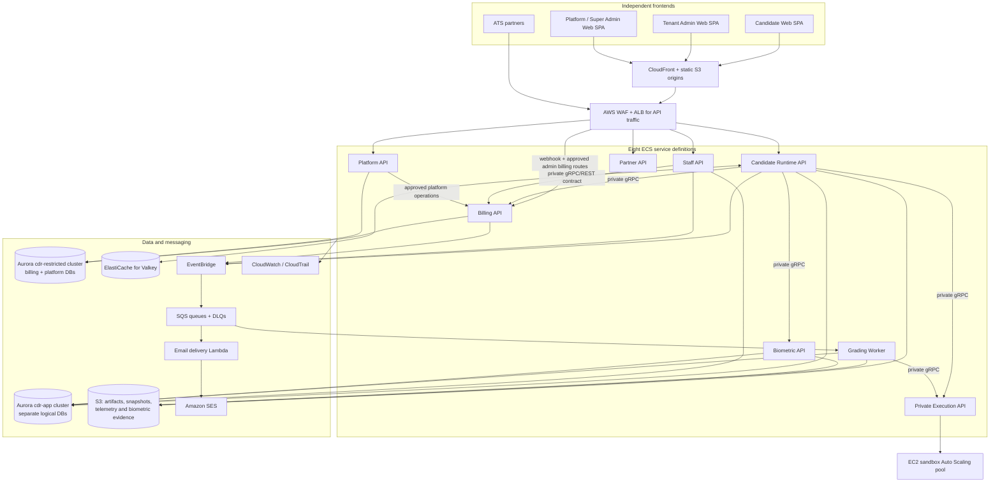

# CD-Recruit / Proctora — Microservices Architecture Specification

**Document ID:** CDR-ARCH-SPEC-001  
**Version:** 0.2  
**Status:** Draft for engineering, deployment and authority review — **not approved for production implementation**  
**Date:** 13 October 2026  
**Architecture owner:** Engineering  
**Applies to:** CD-Recruit / Proctora application, its backend services, web frontends, data stores, asynchronous processing and AWS deployment requirements.

## 0. Document authority, scope and status language

This is the proposed formal architecture record for the modular-monolith-to-microservices change. Once approved, it is the source of truth for architecture boundaries and decisions. The companion documents serve different purposes:

- **Architecture Explained End to End:** plain-language explanation of what the system does and how the parts interact.
- **Developer-Side Migration Plan:** repository-oriented implementation sequence, prerequisite gates, test gates and coding-agent instructions.
- **This specification:** formal definition of what is proposed, why it is proposed, where it belongs, how components communicate, and what must be signed off.

This document is deliberately a **Draft**. The combined repository audit is complete, but several conditions discovered by that audit remain unresolved in code. Completing the audit does not mean the prerequisites to split services have been satisfied. No service extraction should begin until the required Wave 0 exit gates in Section 15 are passed and recorded.

Decision status terminology:

- **Confirmed in audit:** directly observed in the checked-out repository or audit evidence.
- **Accepted working direction:** stated as a requirement by the product/engineering owner, but may still need formal sign-off.
- **Proposed:** recommended design to review and approve.
- **Open:** not yet decided; the document must not treat it as a fact.
- **Deployment-team decision:** engineering defines the need and constraints; deployment/operations selects exact AWS resources and configuration.
- **Product/legal decision:** requires business authority or counsel/privacy approval.

### Approval record

| Role | Name | Decision | Date | Notes |
|---|---|---|---|---|
| Engineering owner | Pending | Pending | Pending | Service boundaries, contracts, invariants and test gates |
| Deployment/platform owner | Pending | Pending | Pending | AWS accounts, region, network, resource sizing and cost model |
| Product/finance authority | Pending | Pending | Pending | Pricing rules, credit lifecycle and billing overrides |
| Security/privacy/legal | Pending | Pending | Pending | JWT/key recovery, biometric consent/retention, residency and audit retention |

## 1. Executive decision

### 1.1 Recommended direction

Adopt a **cost-optimized hybrid microservices architecture**: six logical business groups, eight ECS service definitions, a separately scaled EC2 sandbox pool for untrusted code, static hosting for all three frontends after the Admin Web conversion, and AWS-managed queues/storage/cache/monitoring. Keep tightly coupled control-plane business domains together for now rather than extracting every NestJS module into its own service.

The target is not “the most microservices possible”. It is independently deployable and permission-bounded units where different security, scaling or failure characteristics justify the overhead. The design accepts shared Aurora-cluster capacity/recovery risks to avoid the fixed cost and operational burden of one cluster per domain.

### 1.2 Target inventory

- **Six logical business groups:** Candidate Runtime; Execution; Billing; Biometric; Grading; Control Plane.
- **Eight ECS service definitions:** Candidate Runtime API; Execution API; Billing API; Biometric API; Grading Worker; Staff API; Partner API; Platform API.
- **One EC2 Auto Scaling sandbox pool:** isolated workers/hosts for Piston and disposable SQL/NoSQL execution environments. This is not an ECS service definition.
- **Three independently built frontends:** Candidate Web, Tenant Admin Web, Platform/Super Admin Web. All target static S3 + CloudFront hosting after Admin Web completes its conversion and passes regression gates.
- **Two production Aurora PostgreSQL clusters:** `cdr-app` and `cdr-restricted`, each containing separate logical databases/roles for its owners.
- **Managed asynchronous components:** EventBridge, SQS and DLQs, EventBridge Scheduler, S3 and ElastiCache for Valkey.
- **Email:** Amazon SES is mandatory. Proposed low-volume implementation is an SQS-triggered Lambda delivery worker so email adds no always-on ECS task; if application requirements make this unsuitable, add a separately scaled worker and update the service count/cost.

### 1.3 What is not approved yet

The number and structure of AWS accounts, target region, exact instance/ACU/task sizes, Valkey deployment mode, final cost budget, legal retention periods and production RPO/RTO targets remain open or deployment-/authority-owned. Cost figures in prior drafts are indicative and not an approved AWS estimate.

## 2. Business goals and non-goals

### Goals

1. Support one deployment handling **2,000 concurrently active candidates** during an assessment drive, subject to measured load-test acceptance.
2. Keep candidate code execution outside the main application runtime with a strong sandbox boundary.
3. Keep hidden tests, answer keys, the billing ledger and biometric evidence outside Candidate Runtime's access permissions.
4. Prevent charging an assessment credit until the approved chargeable milestone: verified candidate presence and the first real question successfully delivered and acknowledged according to the server-side protocol.
5. Enable self-service organisation onboarding and purchasing without manual Super Admin activation, while allowing audited Super Admin overrides.
6. Keep platform-level operational visibility usable when Tenant Admin or Candidate Runtime is degraded.
7. Make assessment grading durable and asynchronous; queued work may be delayed but must not silently disappear.
8. Lower idle cost by scheduling/prewarming burst capacity rather than keeping all workers at peak all month.
9. Migrate incrementally from the current monolith, with a working rollback/safe-forward path at every phase.

### Non-goals for the initial target

- Ten independent domain services at launch.
- Active-active multi-region application deployment.
- A service mesh or Kubernetes platform.
- Per-assessment-module services for MCQ, Coding, SQL, NoSQL, Prompting or Simulation.
- A data lake/analytics platform for raw telemetry.
- Finalising commercial prices in code. Prices, packages and entitlements must be configurable; actual amounts are business decisions.
- Claiming production-grade capacity or availability before the required tests pass.

## 3. Evidence baseline and repository facts

The combined audit inspected branch `dev-microservice` at commit `4bec750`, a NestJS 11/Prisma 5 monorepo. It reports 39 registered feature/infrastructure modules and 41 Prisma models in one current PostgreSQL schema. The exact current branch/commit must be rechecked immediately before implementation because branches move.

Confirmed findings that affect the architecture:

1. `billing.billing_begin()` is a PostgreSQL procedure that crosses the session, organisation, drive, credit-pool and ledger domains. It is a blocker to extracting Billing until the transaction and credit lifecycle are redesigned.
2. Candidate session begin calls the billing ledger from `SessionService.beginSession`.
3. The current coding path queries question test cases and filters hidden cases in Candidate Runtime code. This creates a hidden-test exposure risk and must be corrected before service extraction or public production use.
4. Proctoring evidence uploads currently pass multipart video buffers through the Node application and then to MinIO. This can consume process memory under concurrent uploads; direct presigned object upload is the target.
5. Existing k6 scripts are configured for only five virtual users. No supplied test proves the 2,000-active-candidate target.
6. Candidate heartbeat is observed at 15-second intervals. Coding workspace autosave is observed at 30-second intervals with a debounce. Actual traffic and payload volume must be confirmed by running safe local/staging tests and inspecting the complete call paths.
7. No code-level proof was found in this audit that the previously proposed general-purpose edit/focus/paste telemetry stream is fully implemented. Treat raw telemetry scope and event volume as a **verify-before-estimating** item.
8. The three frontends are independent apps, not microfrontends. Candidate Web and Super Admin Web are React/Vite static SPA candidates. Admin Web is currently TanStack Start/Nitro, but its inspected routes use browser-side data access and authentication; no route loaders or server functions requiring Node were found. Its proposed conversion to Vite + TanStack Router SPA still needs build and regression gates.

Evidence pointers from the audit:

- `backend/api/src/app.module.ts`
- `backend/prisma/schema.prisma`
- `backend/prisma/migrations/20260928183000_billing_database_invariants/migration.sql`
- `backend/api/src/session/session.service.ts`
- `backend/api/src/billing/ledger/ledger.service.ts`
- `backend/api/src/coding/coding.service.ts`
- `backend/api/src/proctoring/proctoring.controller.ts`
- `frontend/candidate-web/src/hooks/useHeartbeat.ts`
- `frontend/candidate-web/src/components/coding/CodingWorkspace.tsx`
- `k6/scripts/invite_load_test.js` and `k6/scripts/judge0_load_test.js`

The audit document is the evidence register; implementation must confirm line numbers and content on the then-current branch.

## 4. Definitions

| Term | Definition in this specification |
|---|---|
| Logical business group | A set of related capabilities/ownership boundaries. It does not imply one ECS service. |
| Deployable/service definition | A process/image/role with its own lifecycle, configuration, health check, task role and scale policy. Several may use a common code package if they have distinct process composition and permissions. |
| Candidate Runtime | Owns candidate session lifecycle, timing, question delivery, response persistence, WebSocket and the public candidate-facing API. |
| Execution API | Private service that authorizes/coordinates execution jobs and talks to isolated sandbox capacity. It is not directly internet-accessible. |
| Billing | Owns price-book versions, orders, payment receipts, credit pools/reservations, ledger and reconciliation. |
| Biometric | Owns identity verification metadata, evidence-ticket issuance, evidence access policy and deletion lifecycle. |
| Grading Worker | Consumes durable submission jobs, reads approved scoring material, computes scoring and publishes results. It need not expose a permanent public API. |
| Control Plane | IAM/org, hiring/drive, content authoring and insights/review business domains. These remain in a shared application codebase initially. |
| Staff API | A separately composed runtime for Tenant Admin/recruiter requests, limited to staff-facing capabilities. |
| Partner API | A separately composed runtime for authenticated ATS partners with the minimum partner permissions. |
| Platform API | A separately composed runtime for Super Admin/platform operators. It must not depend on Candidate Runtime or Staff API to display service health. |
| Outbox | A database row written atomically with a business state change, later published to the event backbone. |
| Inbox/deduplication | A durable consumer record that prevents duplicate message delivery from repeating a business operation. |
| Claim-check | A message carries an object ID/S3 URI and integrity metadata rather than a large body/personal data. |
| RPO | Maximum accepted amount of data loss measured in time. |
| RTO | Target time to restore a defined capability after a failure. Neither is a guarantee until tested and approved. |
| 2,000-active-candidate ceiling | 2,000 simultaneous active assessment sessions across the whole deployment, not per task/instance. |

## 5. Target architecture and deployables

The diagram is conceptual. The deployment team owns final listener/origin rules and exact AWS resources. In particular, the Execution API is private; a public ALB rule for arbitrary candidate access to `/exec/*` is **not** part of the approved target.

### 5.1 Eight ECS service definitions

| Deployable | Responsibilities | Data/permissions | Availability/scaling intent |
|---|---|---|---|
| `candidate-runtime-api` | Invite redemption, candidate JWT issuance, time gate, session lifecycle, question delivery, answer/autosave handling, WebSocket, submission bundle and outbox | Runtime logical DB; public snapshot read; artifact/event S3 prefixes; no hidden-test read, no ledger credentials, no biometric decrypt, no LLM key | Keep healthy before/during drives; at least two tasks for HA during the approved production window; pre-scale plus target tracking |
| `execution-api` | Validate execution requests, enforce quotas, route sample runs/hidden-test jobs, track job IDs, dispatch to sandbox hosts | No broad business DB; narrowly scoped read of the scoring snapshot necessary to execute hidden tests; no internet egress from sandbox hosts | Private; scale on queue wait/concurrency; prewarm during drives |
| `billing-api` | Dynamic price book, purchase orders, verified payment webhook, ledger, pools, reservation/consume/release, overrides, reconciliation | Billing DB in restricted cluster; payment secrets; WORM export write via a dedicated export role; no broad candidate answer access | At least two tasks across AZs for production transaction continuity; test hot-row contention |
| `biometric-api` | Identity/face inference, upload-ticket issuance, evidence access authorization, retention metadata | Biometric metadata DB; biometric S3 prefix and key only; no broad ledger access | Scale CPU/inference workers and active evidence requests before drive windows; failure policy may continue with identity pending only where product policy approves |
| `grading-worker` | Consume submitted jobs, deterministic grading, LLM rubric evaluation, Say-Do correlation, provenance/confidence and score events | Grading DB; submission bundle and scoring snapshot read; LLM provider key only in worker role | Scale on queue backlog/oldest-message age; may be zero at idle if cold-start delay is accepted |
| `staff-api` | Tenant staff/admin CRUD: drives, invites/roster, question/content authoring, org settings, dashboards/report read models and tenant-facing billing views | Separate logical DB credentials for its owned Control Plane domains; no `billing` or `platform` DB credentials. Because several domains share this process, its compromise has a broader control-plane blast radius than a dedicated domain service. | One small idle task may be acceptable outside drives; scale for admin activity and drive creation |
| `partner-api` | Versioned ATS API, partner key auth, candidate ingestion/status/result polling under partner contract | Hiring/partner mapping DB access only; no platform DB, signing-key administration, hidden-test or broad scoring access | Low baseline; scale independently on partner traffic; use app authentication/rate limits regardless of WAF |
| `platform-api` | Super Admin login/MFA enforcement, tenant/account/plan administration, audited overrides, operational status/health view, controlled break-glass workflows | Platform DB in restricted cluster, platform-scoped secrets/roles; no direct unrestricted Candidate Runtime DB access; invokes approved business operations through service contracts | **Highest operational recovery priority.** Two production tasks across AZs; health view must not depend on Staff API or Candidate Runtime being available. Shared restricted-cluster failure can still impair platform write operations. |

The eight count refers only to ECS service definitions. It excludes the EC2 pool, static frontends, one-shot migration/dump tasks, scheduled Lambda functions and a proposed SQS-triggered email Lambda. If email processing cannot be cleanly implemented as Lambda, add a ninth ECS worker and revise the cost model before approval.

### 5.2 Six logical groups

1. **Candidate Runtime:** `candidate-runtime-api`.
2. **Execution:** `execution-api` plus EC2 sandbox pool.
3. **Billing:** `billing-api`.
4. **Biometric:** `biometric-api`.
5. **Grading:** `grading-worker` (and no separate always-on grading API initially).
6. **Control Plane:** Staff, Partner and Platform runtime entrypoints using a shared codebase but distinct process composition, task roles, secrets and routes.

The control-plane domains—IAM, Hiring, Content and Insights—remain modules rather than separate services until measured scaling, security or release-cadence evidence justifies extraction.

## 6. Frontend architecture

### 6.1 Confirmed topology

| Frontend | Current source | Current nature | Intended hosting |
|---|---|---|---|
| Candidate Web | `frontend/candidate-web` | Independent React/Vite SPA | S3 + CloudFront, `assess.<domain>` |
| Tenant Admin Web | `frontend/admin-web` | TanStack Start/Nitro build; code audit found browser-side data/auth and no necessary server functions/loaders | Convert to standard Vite + TanStack Router SPA; S3 + CloudFront, `app.<domain>` |
| Platform/Super Admin Web | `frontend/super-admin-web` | Independent React/Vite SPA | S3 + CloudFront, `platform.<domain>` |

No Module Federation, `single-spa`, remote entries, import maps or cross-app runtime composition were found. Shared types/design tokens are compile-time workspace packages, not microfrontends.

### 6.2 Admin Web static-SPA conversion gates

The conversion is a prerequisite to the final frontend deployment topology, not a reason to delay the backend repository audit. Before approval:

- `npm --workspace=frontend/admin-web run build` must produce a standard `dist/index.html` and static assets.
- Deep links such as `/drives/:id` and `/results/:id` must load directly after CDN fallback rewrites.
- Login, logout, refresh, 401 handling and route guards must pass regression tests.
- Monaco, Recharts, CSV upload and browser-only dependencies must work without Node globals.
- API origin, `Authorization` headers, CORS, content security policy and history fallback must be verified.
- No server-only secrets or request-authoritative authentication may be silently lost. The audit found no such current server dependency, but the migration must demonstrate this with tests.

Do not delete the existing TanStack Start server scaffolding until the new SPA build and tests pass on a branch and reviewer approves the diff. Do not rename `super-admin-web` merely to match the `platform-web` documentation label.

## 7. Network, ingress and service communication

### 7.1 Public versus private paths

- Browsers receive static frontend files through CloudFront/S3.
- Browser API requests go through HTTPS and WAF/ALB to the correct public-facing runtime: Candidate Runtime, Staff API, Partner API, Platform API, or the narrowly defined payment webhook route.
- Candidate business actions, including code runs, go through Runtime. The Execution API is private service-to-service traffic only.
- Runtime asks Biometric for narrowly scoped evidence upload tickets; the browser uploads file bytes directly to S3 using the short-lived URL.
- Internal gRPC listeners are discovered inside private networking and are not registered as internet-facing ALB routes.
- Sandbox hosts have no general internet route, no production-data route and no useful instance credentials. Exact subnet/security-group enforcement is deployment-owned and must pass a connectivity test.

### 7.2 Communication protocol policy

| Interaction | Chosen approach | Reason |
|---|---|---|
| Browser → backend | HTTPS REST/JSON | Browser-native, versionable OpenAPI contract |
| Runtime ↔ browser for live events | WebSocket (Socket.IO or existing supported equivalent) | Live timer/status/feedback updates and reconnect/resync |
| Runtime → Billing `ReserveCredit` | Private gRPC, deadline and idempotency key | Session begin needs a definite funding result before starting the timer |
| Runtime → Execution `RunSample` | Private gRPC, bounded deadline and admission control | Candidate is awaiting immediate sample output; keep synchronous path bounded |
| Runtime → Biometric upload ticket/status | Private gRPC or REST client port over private networking | Small synchronous control-plane call; large bytes go browser → S3 |
| Staff → Billing purchase/funding operations | Private gRPC/REST contract with idempotency | Funding operation needs a clear result and auditable state |
| Content publish and drive/invite changes | Contracted service call where the launch flow needs immediate confirmation, plus events for projections | Immutable snapshot/publish must be confirmed before scheduling; copies update asynchronously |
| Session submission → Grading | Outbox + EventBridge/SQS | Durable background work; submission response should not wait for AI grading |
| Email, reconciliation, retention, telemetry summaries | SQS/EventBridge/Scheduler/Lambda or scheduled ECS task | Retryable jobs and low idle overhead |
| Platform operational health | CloudWatch/CloudTrail/health aggregates read by Platform API | Platform must still display useful state if Candidate Runtime/Staff API is down |

**Why gRPC:** it provides Protobuf contracts, generated clients, deadlines/cancellation and structured status codes. This is useful for internal typed APIs, but is not claimed to be intrinsically faster enough to justify a large architecture by itself. REST + OpenAPI-generated clients remains a valid alternative if gRPC tooling adds excessive team burden. The default proposal is gRPC for internal synchronous calls because the original engineering plan selected it; approval should be based on contract/test maintainability rather than benchmark marketing.

### 7.3 gRPC safety requirements

- Caller and callee are private-network reachable only; no public browser connection.
- Every call has a deadline and request size limit.
- Every mutation carries an idempotency key or durable operation ID.
- Retry only when the operation's contract is retry-safe; handle unknown outcomes as “reconcile by idempotency key”, not blind replay.
- Propagate correlation/trace IDs and an authenticated service identity.
- Authorize `(caller identity, RPC, tenant/session scope)` at the callee; private networking alone is not authorization.
- No unbounded synchronous chains; target maximum dependency depth is two.

### 7.4 Events and queue ordering

Use EventBridge to route domain facts and SQS queues to provide durable work, retry, back-pressure and DLQ handling. Standard SQS queues are the default because most jobs are independently processable; they may duplicate and reorder messages. Consumers therefore need inbox/deduplication, monotonic state transitions and idempotency.

Use FIFO or explicit per-aggregate sequencing only where order is a business invariant, not globally for every queue. Billing reservation state transitions must be proven safe against duplicate, delayed and out-of-order consume/release signals before queue type is locked. Never assume SQS is exactly-once. Raw keystroke telemetry is not a domain event and must not be put on EventBridge event-by-event.

Every service that commits a state change and publishes an event must use a transactional outbox or an equally durable mechanism. Consumers need an inbox/deduplication record. Configure DLQs, alarms and a redrive runbook for each durable queue.

## 8. Data ownership and storage

### 8.1 Production database clusters

**Proposed compromise:** two Aurora PostgreSQL Serverless v2 clusters, not a cluster for every service.

- `cdr-app`: separate logical databases for runtime, biometric metadata, grading and Control Plane domains (IAM, hiring, content, insights). Domain naming and exact DB grouping must be finalized when Prisma schema/table ownership is designed.
- `cdr-restricted`: separate logical databases for `billing` and `platform`. In the current draft they share the same physical cluster and restricted-tier KMS key; database/task roles limit ordinary application access, but there is no separate physical cluster/key boundary between Billing and Platform. A cluster/key-level compromise or failure may affect both.
- Every logical owner receives its own database credentials and application role; migrator and read-only dump roles are separate.
- No service may use another service's credentials or perform cross-domain joins as a shortcut. Cross-service references are IDs/projections, not database foreign keys. Staff API may have access to the four logical databases it hosts, so its process has a broader control-plane blast radius; explicit projections/contracts must replace cross-domain SQL joins.
- The `cdr-app` domains share compute/failure/recovery characteristics. Billing and Platform also share a restricted-cluster failure domain and cluster-level capacity range. This is an accepted cost compromise, not physical isolation.
- Aurora Serverless v2 min/max capacity is configured at the cluster level; each Serverless writer/reader scales within the range defined for that cluster. The draft writer/reader ranges in earlier notes must not be copied as though every instance can have a different range. Validate engine/version/feature compatibility and connection capacity. See AWS Aurora Serverless documentation: https://docs.aws.amazon.com/AmazonRDS/latest/AuroraUserGuide/aurora-serverless-v2-administration.html

The current repository has one primary Prisma schema with 41 models. Splitting service-owned databases is a planned migration, not something that already exists. It requires a model ownership register, IDs replacing cross-domain foreign keys, data/backfill strategy, independent Prisma clients/migrations and a tested rollback plan.

### 8.2 Data ownership table

| Data | Authoritative owner | Storage | Who may access |
|---|---|---|---|
| Staff identities, roles and tenant policy | Control Plane IAM module | IAM DB in `cdr-app` | Staff API; Platform access only through approved provisioning/admin contract; candidate services validate scoped tokens locally |
| Platform operator identities, high-privilege audit and tenant registry metadata | Platform | `platform` DB in `cdr-restricted` plus security audit stream | Platform API / restricted break-glass role only |
| Drives, invite roster, candidate PII and partner mapping | Hiring | Hiring DB in `cdr-app` | Staff API and narrowly scoped Partner API; Runtime holds a minimum invite projection, not broad roster access |
| Question bank, versions and templates | Content | Content DB in `cdr-app` | Staff API authoring; other services use published snapshots |
| Public question data and immutable drive snapshots | Content | S3 artifacts/content bucket | Runtime reads public snapshot only; version/hash validated |
| Hidden test cases, answer keys, rubrics and scoring snapshot | Content owns; Execution/Grading consume | Separate private S3 prefix/bucket with narrower IAM/KMS policy | Execution API and Grading Worker only; never Candidate Runtime or Partner API |
| Session lifecycle, response state and autosave checkpoints | Candidate Runtime | Runtime DB in `cdr-app`; submissions also in S3 | Runtime; report access through authorized Insights projection/contracts |
| Heartbeat/current online state and short TTL counters | Candidate Runtime | Valkey with TTL | Runtime/approved coordination clients; cache is not a financial ledger or sole answer store |
| Raw telemetry (if confirmed as implemented), compressed session event chunks | Runtime/integrity policy | S3 events bucket with sequence/manifest metadata | Runtime event writer; authorized review/forensic path only |
| Integrity flags and proctoring conclusions | Integrity logic, initially deployed within/alongside the candidate assurance code according to approved split | Integrity-owned DB or approved Runtime DB table during transitional phase; S3 only for larger evidence | Authorized reviewer/Insights path; flags are not automatic proof of misconduct |
| Selfie/ID/evidence clips | Biometric | Dedicated sensitive S3 bucket plus metadata DB | Biometric task role; reviewer via short-lived authorized URL; no broad staff access |
| Credit reservations, posted ledger, price book versions, orders, captured payments and adjustments | Billing | Billing DB in `cdr-restricted`; WORM exports to S3 | Billing API; Platform operations via approved API; no Runtime direct database access |
| Computed scores, rubric results, Say-Do provenance, confidence | Grading | Grading DB and report/artifact S3 objects | Grading owns; Insights receives events/read model; exports reject placeholder score provenance |
| Reviewer decisions and dashboard read models | Insights module in Control Plane initially | Insights DB in `cdr-app` | Staff API/report routes; candidate/partner disclosure only by contract and authorization |
| Queue payloads | Producing domain owns business state; SQS transports | EventBridge/SQS | IDs, version, tenant/session reference, hashes; no large PII or raw evidence bodies |
| Logs, metrics and activity trails | Each service / AWS platform | CloudWatch, CloudTrail and configured archive | Least-privilege operator/security access; avoid PII/secrets in logs |

### 8.3 S3 bucket/prefix policy

Proposed distinct buckets or tightly isolated prefixes for frontend builds, submission artifacts, public content snapshots, scoring snapshots, event chunks, biometric evidence, ledger WORM exports and backups. Enable Block Public Access, TLS-only access, server-side encryption, least-privilege bucket policies, lifecycle rules and versioning appropriate to each data class.

- Frontend assets: static, reproducible from CI; current and recent versions only.
- Artifacts/content snapshots: versioning and lifecycle based on product support and audit needs.
- Scoring material: separate read boundary from public snapshots; version/hash snapshots are immutable.
- Biometric: retention is a product/legal rule. A no-versioning/no-replication design improves timely deletion but deliberately removes recovery options. This requires explicit privacy/legal approval and documented irrecoverable-loss risk.
- Ledger export: use S3 Object Lock only after the export is proven free of data that must be erasable and retention terms are approved. Compliance-mode retention is hard to reverse once objects are locked.
- Telemetry: object-count and event size assumptions must include chunk files. An estimate counting only 6,000 photos + 200 videos + 2,000 submission bundles (8,200 objects) excludes potential raw-event chunks and is not a full telemetry storage model.

### 8.4 Valkey and durability boundary

Valkey is the engine; Amazon ElastiCache is the managed AWS product. **Proposed default:** ElastiCache Serverless for Valkey for irregular/spiky demand, subject to a measured cost comparison against a small multi-node Valkey cluster. Serverless charges by stored data and processing units; node-based clusters charge by node-hours. Official pricing: https://aws.amazon.com/elasticache/pricing/

Use Valkey for short-lived heartbeat/current-activity state, rate-limit counters, WebSocket fan-out and reconstructible cache. Do not treat it as the only durable storage for candidate answers or as the source of truth for credit balances. A cache failure must not silently delete an accepted answer. High-value autosave state must be acknowledged only after a durable write path succeeds; coalescing/batching is allowed only with explicit recovery semantics and a tested loss bound.

## 9. Billing, self-service purchasing and credit correctness

### 9.1 Commercial configuration

All prices, plans, credit packages, currencies, expiry rules, tax labels, discount policy, trial policy and publish windows must be configuration-backed and versioned—not frontend constants or assumptions embedded in code. Business authorities decide the actual prices/terms later. Engineering builds the control surface and invariant-safe version model first.

Public pricing page reads currently published price/package data. A customer signs up, verifies contact details, creates/owns an organisation, chooses a package, pays through the configured gateway and receives credits automatically after a verified payment-captured notification. Super Admin intervention is not part of the normal purchase flow.

Super Admin capabilities must include audited, permission-gated operations to add/publish/schedule/retire price versions, configure packages, grant trials, adjust/suspend/revoke unconsumed credits, suspend/reinstate accounts, and process manual billing requests. Posted ledger rows are never physically edited/deleted: corrections are compensating/reversal entries with actor, reason, before/after reference, timestamp and maker-checker controls where required.

### 9.2 Payment lifecycle

1. Create a pending order referencing the exact price-book version and terms shown to the customer.
2. Send the customer to the payment provider's hosted/secure checkout.
3. Receive webhook at the Billing-owned endpoint.
4. Verify provider signature and event identity; persist the payment event idempotently and acknowledge quickly.
5. Grant credits in one Billing-owned transaction only after confirmed capture; post the ledger entry and the credit pool mutation atomically.
6. Publish credit-granted/order-completed event from a transactional outbox. Admin balance UI reads the authoritative balance from Billing, or shows an explicit “processing” state until confirmed.
7. Repeated webhook delivery must never create duplicate credits. Reconciliation compares provider, order, pool and ledger records.

### 9.3 Assessment credit lifecycle — required before service extraction

The current `billing_begin()` procedure mixes the Runtime session transition and Billing tables in one SQL transaction. It must be removed as a cross-domain transaction before Billing extraction.

Proposed reservation state machine:

`NONE → HELD → CONSUMED`  
`HELD → RELEASED` (candidate never reaches chargeable milestone)  
`HELD → EXPIRED` (reservation expiry under the approved reconciliation policy)

- **ReserveCredit (synchronous private gRPC):** called before Runtime starts the timer. Billing atomically verifies the account/pool/drive funding policy, creates or returns the same reservation for the idempotency key and records the hold. If Billing returns `HOLD`/unavailable or outcome is unknown, Runtime does not start the timer until the result is resolved safely.
- **Chargeable milestone:** after verified presence, Runtime successfully delivers the first real question and records the milestone server-side. Because browser rendering itself cannot be proven perfectly by the server, the implementation must define an authenticated client acknowledgement plus server delivery record and idempotent milestone ID; product authority must approve this technical interpretation of “rendered”.
- **ConsumeCredit:** Runtime commits the milestone/outbox record durably. Billing consumes the held reservation and posts ledger entry idempotently. If the Billing call/event is delayed, the reservation remains held and retry/reconciliation resolves it; no duplicate consumption.
- **ReleaseCredit:** when Runtime authoritatively establishes that the session will not reach the chargeable milestone, it issues an idempotent release command. Expiry sweeping must account for delayed events and must not race a valid pre-expiry milestone into a wrong charge/release.
- **Reconciliation:** periodically compare session milestone/outbox state with Billing reservation/ledger state. Treat unknown outcomes as reconciliation work, never as permission to blindly debit again.

Before implementation, freeze a Protobuf/API contract and a state-transition test matrix covering concurrent begins, duplicate RPCs, timeouts after successful commits, queue duplicate/reordering, expiry races, failed question delivery, candidate disconnect and Billing outage. The precise queue/order design for asynchronous consume/release remains an open implementation detail until the contract tests demonstrate correctness.

## 10. Authentication, authorization and security boundaries

### 10.1 Identity decision

Use **self-managed JWT** as the application identity model; do not introduce Cognito as a requirement for this architecture. The frontend audit found current localStorage token storage in all three apps. That is a current-state fact, not a security endorsement.

Required token classes have distinct issuer/audience and signing-key boundaries:

- Candidate token: short-lived, scoped to the session/drive, candidate audience, minimal claims.
- Tenant staff token: tenant identity, staff subject and role/scope claims, staff audience.
- Platform token: separate platform audience and operator roles; mandatory MFA for privileged actions.
- Internal service identity: authenticated caller identity and explicit callee/RPC scope; no user-supplied claim is treated as trusted service identity.
- Partner access: per-partner API key or stronger client credential, hashed/rotatable, scoped to assigned tenant/requisition and rate limited.

### 10.2 Hardening requirements

- Short-lived access tokens, strict signature/algorithm allowlist, `iss`, `aud`, `exp`, `nbf`, and key ID validation.
- Separate signing keys by trust domain; asymmetrical signing recommended. Protect private signing material through a reviewed key-management mechanism (KMS-backed signing is a proposal; cost/latency and rotation must be tested). Publish/cache trusted public keys/JWKS so API validation does not require a central network call on every request.
- Refresh tokens are random, stored hashed server-side, rotated on use, revocable and protected against replay. Audit login, refresh, MFA, impersonation and privilege changes.
- All API handlers enforce tenant/organisation scoping server-side. Frontend route guards are UX only, never authorization.
- Platform operators use MFA and a separate issuer/audience/role policy. Impersonation must be time-limited, purpose-bound and audited.
- Restrict production shell/database access; use time-limited MFA break-glass access with alerting and two-person approval for highly restricted operations where supported.
- Document key rotation and catastrophe recovery: stop signing with compromised key, publish/activate replacement, invalidate refresh sessions, allow bounded access-token expiry/revocation policy, and test rollback/rotation.
- Avoid logging JWTs, refresh tokens, API keys, candidate code or PII.

Token storage hardening (including whether to move refresh credentials from localStorage to HttpOnly Secure SameSite cookies) is an explicit security review item; it must not be changed casually across the three SPAs without CSRF/CORS and refresh-flow tests.

### 10.3 Hidden tests and execution boundary

The audit found Candidate Runtime code currently queries test cases including hidden entries. Treat this as a P0 security fix, not merely future cleanup.

- Candidate Runtime may receive the public question snapshot and visible/sample test data only.
- Execution API loads hidden tests from the restricted scoring snapshot only for authorized grading/final evaluation operations.
- Interactive sample execution must return candidate-safe output, not hidden case inputs, outputs, rubric keys or scoring configuration.
- Grading Worker can read scoring material under a separate restricted role and may call the private Execution API for the hidden test suite.
- Sandbox host tasks receive no production database credential, no general AWS role and no unrestricted egress. Each run has CPU, memory, wall-clock, PID, filesystem and output limits; network is denied for untrusted job containers.
- Do not restore `runLocalFallback` or any in-process host execution fallback.

## 11. Candidate data, telemetry and autosave policy

### 11.1 Observed workload inputs from the audit

The combined audit estimates the following for 2,000 concurrently active candidates over 3 hours. These are explicit workload assumptions, not measured production telemetry:

| Stream | Assumption | Rate/result |
|---|---|---:|
| Heartbeat | One per candidate every 15 seconds | 133.3 requests/sec; 1.44M requests/3h |
| Autosave | One per candidate every 30 seconds while active | 66.7 requests/sec if all 2,000 are saving; 720k requests/3h |
| Proctoring anomalies | 0.15 events per candidate per minute | 5 events/sec; 54,000 events/3h |
| Code runs | 20 runs/candidate/3h | 40,000 runs; 3.70/sec average; 10/sec peak assumption |
| Other navigation/misc | Provisional aggregate | 10 requests/sec |
| **Total baseline** | Sum of streams above | **218.7 requests/sec** |
| **With 20% retry/reconnect allowance** | 218.7 × 1.20 | **262.4 requests/sec** |

The audit also states a 380–450 RPS start/submission peak, but its derivation is not shown. Treat that as a test profile to validate, not a proven formula. A 1,000-candidate burst over 60 seconds alone is 16.7 joins/sec; add real heartbeat/autosave/execution traffic to establish the total.

**Corrected anomaly math:** 0.15 events/minute × 2,000 candidates × 180 minutes = 54,000 events (27 events per candidate), not 18,000. The latter count assumes 9 events/candidate, equivalent to 0.05/minute. Both may be useful test scenarios, but do not label them the same assumption.

### 11.2 API ingress and direct S3 uploads

The audit's approximate API-body assumptions imply:

- Heartbeats: 1.44M × 250 bytes = 360 MB raw payload.
- Autosaves: 720k × 4 KB = 2.88 GB raw payload.
- Proctoring anomaly events (corrected): 54k × 600 bytes = 32.4 MB raw payload.
- Final bundles: 2,000 × 45 KB = 90 MB raw payload.

This yields about 3.36 GB of raw API request payload for those streams, excluding headers, responses, TLS/network overhead, photo/video uploads and any separate raw interaction telemetry. The former 3.34 GB estimate used the inconsistent 18,000-anomaly count.

Direct S3 uploads under the assumptions of three 180 KB identity images and 0.1 2.5 MB evidence clips per candidate would write about 1.08 GB of images + 0.50 GB of video + about 0.024 GB of compressed 12 KB submission bundles = approximately 1.60 GB per drive. The 8,200-object count includes only the six-thousand images, two-hundred clips and two-thousand submission bundles; it excludes event-log chunk objects.

If a general-purpose event log is flushed separately for every session every 45 seconds for a 3-hour drive, the upper-bound chunk count is `2,000 × 10,800 / 45 = 480,000 chunks`, before size-triggered flushes/retries. Actual count depends on whether this stream is implemented, chunking policy and whether multiple sessions are aggregated. Measure this before final S3 request/cost estimates.

### 11.3 Heartbeat and autosave durability

- Heartbeat is ephemeral current-presence data. It may be kept in Valkey with a TTL (the audit suggests 45 seconds) and persisted only on meaningful session-state transitions, provided reconnect behavior and the server-authoritative timer are correct.
- **Answers/autosaves are durable candidate work. Do not acknowledge an answer checkpoint that exists only in Valkey.** Valkey eviction or cache loss must not silently discard candidate answers. Persist answer state durably in PostgreSQL or a documented durable journal, then acknowledge the sequence/checkpoint. Use idempotent sequence/version numbers and batch multiple writes in a transaction where beneficial.
- The audit suggests flushing autosaves to PostgreSQL every 60 seconds. If all candidates are actively saving, that alone implies about `2,000 / 60 = 33.3` durable row-write operations/sec, before proctoring flags, submissions and other work. Therefore the claim of `<15` PostgreSQL writes/sec is not supported under the all-candidates-active assumption. It may become achievable with a measured active-typing fraction and safe batching, but the loss window and acceptance semantics must be explicit.
- Raw focus/edit/paste/keystroke event collection must be confirmed in current code and reviewed for privacy, security, size, sequencing and retention before it is included in product promises or cost estimates.

## 12. Capacity, scaling and availability

### 12.1 Capacity statement

The target is 2,000 simultaneous active candidates across the application. The target is **not proven yet**. Existing tests cover only five virtual users. Passing 2,000 VUs is necessary but insufficient unless the test also models concurrent sessions, correct heartbeat/autosave cadence, code execution, biometric upload, the synchronized submission spike, grading and failure/retry paths.

### 12.2 Staged workload profiles

| Stage | Active candidate VUs | Duration/profile | Purpose |
|---|---:|---|---|
| 1 | 250 | Ramp 3 min, steady 15 min | Find early correctness/resource issues |
| 2 | 500 | Ramp 5 min, steady 20 min | Validate scale-out and DB pools |
| 3 | 1,000 | Ramp 8 min, steady 30 min | Validate execution queue and biometric bursts |
| 4 | 2,000 | Ramp 10 min, steady 45 min | Candidate target acceptance |
| Stress | 2,500 | 2-minute spike, then 10 min | Verify graceful degradation, not “everything keeps succeeding” |

Initial pass targets proposed by the audit are p95 API latency <250 ms at 250 VUs, <350 ms at 500, <500 ms at 1,000 and <800 ms at 2,000, with error-rate thresholds increasing from 0.01% to 0.20%. These are targets to approve after baseline measurement, not results already achieved. The test needs separate thresholds for interactive Run latency, billing reservation and submission durability.

### 12.3 Provisional scaling table

Numbers below are **test starting points**, not production settings. The deployment team must validate per-region quotas and the engineering team must calibrate with load tests.

| Component | Idle starting point | Pre-drive starting point | Scale signal / ceiling |
|---|---|---|---|
| Candidate Runtime | 2 tasks proposed for availability | 6 tasks for a 2,000-candidate drive | RPS/task, WebSocket connections/task, p95 latency, CPU/memory; provisional max 14 |
| Execution API | 1–2 tasks; recommend 2 if active execution must survive one task failure | 3 tasks initially | Concurrent jobs, pending queue and p95 queue wait; provisional max 8 |
| EC2 sandbox | Small or zero warm capacity is a cost decision; an entirely cold pool increases start delay | 4 × `c6i.xlarge` is only an initial test profile, not yet proven sufficient | Available run slots, queue wait, CPU; provisional max 10 hosts; mix On-Demand/Spot validated by deployment team |
| Billing API | 2 tasks across AZs | 2 tasks floor, target autoscale above it | RPC p95, idempotency conflicts, ledger row-lock waits, DB connections; provisional max 6 |
| Biometric API | 1 small task acceptable only when no drive is active and identity policy tolerates degradation | 2 tasks for initial drive profile | Inference concurrency/queue, CPU and latency; provisional max 6 |
| Grading Worker | 0 tasks accepted at idle if delayed grading is acceptable | Start 4 workers for the reference drive if load test supports it | SQS backlog, oldest-message age, job duration and provider quotas; provisional max 12 |
| Staff API | 1 task outside peak if a transient admin outage is accepted | 2 tasks as needed for launch/admin activity | CPU/memory, request latency, DB connections; provisional max 4 |
| Partner API | 1 task | 1 task; scale on partner batch traffic | Request latency, batch size, throttles; provisional max 3 |
| Platform API | **2 tasks across AZs** as recovery priority | 2 tasks minimum | Health endpoints, operator request latency, dependency status; provisional max 2 until evidence supports more |
| Aurora | Cluster-level Serverless v2 range to be selected per cluster | Temporarily raise minimum capacity ahead of the drive after testing | ACU, connection headroom, lock waits and query latency; exact range deployment-owned |
| Valkey | Serverless or small node-based deployment after pricing comparison | Prewarm only if test shows scaling lag | Requests, ECPUs/storage or node CPU/memory; no billing correctness dependency |

Pre-scale candidate/runtime/billing/execution/biometric and data capacity approximately 15 minutes before a known drive as an initial scheduling assumption; determine whether 15 minutes is sufficient by measuring task startup, database scaling and model warm-up. Lower capacity only after submissions and buffers drain. Scheduled capacity planning is a recommendation; initially a reviewed prewarm command is acceptable if automating it would delay Wave 1.

### 12.4 Availability priorities and shared-cluster consequence

Operational recovery/diagnostic priority is **Platform/Super Admin first, Tenant Admin second, candidate experience third**, because the platform operator needs to diagnose and coordinate recovery. This does not mean that a running assessment may be casually interrupted: Candidate Runtime, Billing and Execution still need explicit drive-window objectives.

Platform Web is static and should continue loading when backend services fail. Platform API must have two production tasks across AZs and a health view based on CloudWatch/health aggregates that does not depend on Candidate Runtime or Staff API. However, core platform writes that need the shared `cdr-restricted` Aurora cluster can be impaired if that cluster fails. Full independence would require a separate Platform data failure domain and added cost, contrary to the accepted two-cluster compromise. Record this as a signed-off residual risk.

## 13. Reliability, backup and recovery

### 13.1 Proposed recovery objectives — approval required

| Data/capability | Proposed objective | Recovery method / caveat |
|---|---|---|
| Candidate sessions/answers | App DB PITR with target RPO ≤5 minutes as a proposal; accepted answer checkpoints are durable before acknowledgement | Actual target must be tested with autosave/write behavior; Valkey-only answers are prohibited |
| Billing ledger/reservations | Strongest class; target RPO ≤5 minutes for operational corruption and no duplicate ledger mutations | Multi-AZ database, PITR, cross-account snapshots, logical dumps and immutable export; exact RPO/RTO must be verified |
| Platform operator/audit data | Target RPO ≤5 minutes for operational recovery; platform health view must remain useful without app DB | Restricted cluster and vault backups; shared-cluster dependency remains |
| Content/scoring snapshots | Versioned immutable artifacts; loss recoverable from version/dump/source of truth | Snapshots must be hash-addressed; hidden test access is separately permissioned |
| Telemetry | Proposed bounded resend/loss window ≤60 seconds only if client buffer and durability acknowledgements prove it | Chunk/object design, client offline buffer and event sequence reconciliation must be tested |
| Biometric evidence | Retention-first policy is open for legal/privacy sign-off | “No backup” improves purge certainty but means evidence may be irrecoverable. Do not approve without explicit product/legal acceptance |
| Region loss | Proposed restore-from-IaC/backups, initially 24–48 hours RTO and up to 24 hours RPO only if copy cadence supports it | Weekly cross-region copies do not guarantee ≤24h RPO for all datasets; frequency must match target |
| Grading | Durable jobs/results, normal backlog drain target within 1 hour proposed | Delays acceptable, lost jobs not acceptable; DLQ replay and idempotency required |

### 13.2 Backup layers

- Aurora point-in-time recovery for operational mistakes and logical corruption.
- AWS Backup copies to a separate vault account, with retention policies protected from production deletion.
- Logical dumps for database-level recovery and portability.
- S3 versioning for content and artifacts where rollback is appropriate.
- Immutable ledger export with Object Lock only after PII/retention review.
- Infrastructure-as-code and encrypted/versioned state backups.
- Restore drills that record achieved RPO/RTO, missing objects, decryption/key recovery and operator steps.

Region, cross-region backup cadence, retention length, vault account structure, Object Lock mode and exact RPO/RTO are not engineering-only decisions. Deployment/security/product/legal must sign them off.

## 14. AWS deployment and operations decisions

### 14.1 Deployment-team-owned decisions

| Topic | Engineering supplies | Deployment team decides/validates |
|---|---|---|
| AWS accounts | Required isolation, cross-account backup/security requirements | Exact AWS Organizations structure and account count. A four-account option (management, prod, non-prod, vault) is recommended for review, not an engineering mandate. |
| Region/AZ | Latency/data-residency needs and workload | Primary region, AZs, any cross-region copies and legal regional validation |
| VPC/network | Which endpoints need public access, allowed service-to-service edges and no-egress sandbox requirement | CIDRs/subnets, route tables, NAT/endpoints, security-group rules, DNS/certificates, ALB listeners |
| ECS/EC2 | Task CPU/memory ranges, scaling signals and security constraints | Exact task sizes, capacity-provider settings, AMI/instance types, quotas and ASG policy |
| Aurora | DB ownership, connection estimates, target recovery level and load-test query data | Serverless/provisioned choice, min/max capacity, reader tiers, backup configuration and pricing |
| Valkey | Data lifetime, access patterns, request/size metrics | Serverless versus node-based pricing, capacity/RBAC and encryption configuration |
| S3/KMS | Data classes, access matrix, retention and keys needed | Bucket/key creation, key policies, backup copies, lifecycle, Object Lock settings |
| Monitoring | Required RED metrics, business invariants and alerts | CloudWatch alarms/dashboard and alert integrations, CloudTrail archive and retention |
| CI/CD/IaC | Source workflow requirements and app build/test contracts | AWS CDK/pipeline/account roles, OIDC trust, ECR lifecycle, promotion and rollback strategy |
| Cost | Workload formulas, service counts, proposed capacity states and measured payloads | AWS Pricing Calculator quote in chosen region, commitment/Spot assumptions, budget alarms and approved spend ceiling |

Engineering preference is AWS CDK in TypeScript because the codebase is TypeScript/NestJS and AWS-first. This is proposed, not binding until deployment team approves. GitHub Actions to AWS via OIDC is preferred over static long-lived access keys.

### 14.2 Networking and edge baseline

- Production workload/data resources live in private subnets unless a specific public ingress requirement is approved.
- Public access enters through CloudFront for static assets and through WAF/ALB for APIs.
- S3 gateway endpoint is preferred to avoid routing S3 data through NAT.
- Whether production uses one or two NAT gateways is an explicit availability/cost trade-off. Two AZ-local NAT gateways improve outbound resilience; one reduces fixed cost but introduces cross-AZ and dependency concerns.
- No NAT/internet egress or production data path for sandbox hosts.
- Non-production uses synthetic data only. Do not place ECS tasks on public IPs merely to avoid NAT without deployment/security sign-off; private subnets plus a deliberately chosen egress strategy are preferred.
- CloudFront flat-rate plans, regional WAF, custom rules/headers and per-host quotas must be costed separately and verified against the required API/WebSocket routing. Static content plan allowances do not automatically cost-cover arbitrary ALB API traffic.

## 15. Cost model and confidence

### 15.1 Why current cost figures are not yet approvable

Two current drafts are materially inconsistent:

1. The combined engineering audit's worksheet estimates **$301.90 idle / $362.90 for one drive / $545.80 for four drives / $1,033.60 for twelve drives**, including its own LLM assumptions.
2. The previous infrastructure plan estimates approximately **$610 production idle + $100 scheduled non-production + $4 vault = $715 base**, then **$20–35 infrastructure per 2,000-candidate drive**, plus **$60–160 LLM cost per drive**.

These are not like-for-like estimates. The lower worksheet does not fully cost the two Aurora clusters and readers, and appears to omit or undercount items such as cross-account/cross-region backups and storage, keys/secrets, WAF/CloudFront/API traffic, EventBridge/SQS/Scheduler, email, sandbox database/storage and S3 event-chunk requests. Its S3 object count excludes potential raw telemetry chunks. It also uses a 1-NAT / 2-node Valkey variant, while other drafts use two NAT gateways and Serverless Valkey. The displayed baseline tasks and some pre-warm assumptions differ between documents.

**Decision:** do not approve $301.90 or $715 as the final budget. Retain the $715 plan only as a temporary planning placeholder for the more complete topology, not as a guarantee. The deployment team must rebuild a consistent estimate in the selected region after workload definitions and resource counts are reconciled.

### 15.2 Temporary planning scenarios (not a quote)

Using the previous full-topology draft assumptions—$715 fixed baseline, plus $20–35 infrastructure and $60–160 LLM grading per reference drive—the arithmetic is:

| Scenario | Temporary planning range | Status |
|---|---:|---|
| No drives | ~$715/month | Unverified placeholder |
| One 2,000-candidate drive | ~$795–910/month | Unverified placeholder |
| Four drives/month | ~$1,035–1,495/month | Unverified placeholder |
| Twelve drives/month | ~$1,675–3,055/month | Unverified placeholder |

These numbers exclude any unmodelled item and must not be given to customers as a price commitment or treated as an authority-approved ceiling. They are not Mumbai-region calculator values. LLM cost estimates differ between drafts ($0.025/assessment versus $0.03–0.08/session); use token-level provider/model measurements before choosing a per-drive number.

### 15.3 Cost formula the deployment team must complete

For each scenario calculate:

`Monthly cost = always-on Fargate + prewarm Fargate-hours + sandbox EC2-hours + Aurora writer/reader ACU-hours + Valkey storage/request or node-hours + NAT hours/GB + ALB/WAF/CloudFront + S3 storage/requests/transfer + SQS/EventBridge/Scheduler + SES + KMS/Secrets Manager + logs/metrics/traces + backup/vault/cross-region copy + ECR and other supporting resources + LLM tokens + taxes/commitment adjustments if applicable.`

Cost worksheet needs 0, 1, 4 and 12 reference drives/month; idle, standard, synchronized start/submission spike, and over-capacity cases; regional rate sources; resource counts; runtime hours; data volumes; and low/base/high usage assumptions. Build it only after confirming task counts, two-cluster reader topology, backup scope, CloudFront/WAF plans, NAT count, Valkey mode, email path, sandbox storage and telemetry object count.

Pricing references to use when rebuilding (rates vary by region and configuration):

- ECS Fargate: https://aws.amazon.com/fargate/pricing/
- Aurora Serverless v2 capacity behavior: https://docs.aws.amazon.com/AmazonRDS/latest/AuroraUserGuide/aurora-serverless-v2-administration.html
- ElastiCache: https://aws.amazon.com/elasticache/pricing/
- SQS: https://aws.amazon.com/sqs/pricing/
- CloudFront flat-rate plans: https://docs.aws.amazon.com/AmazonCloudFront/latest/DeveloperGuide/flat-rate-pricing-plan.html
- SES: https://aws.amazon.com/ses/pricing/
- NAT Gateway: https://aws.amazon.com/vpc/pricing/
- S3: https://aws.amazon.com/s3/pricing/

## 16. Migration prerequisites and release gates

The combined audit has been completed. The following code-level prerequisites have **not** all been completed and therefore block service extraction:

### Gate P0 — Correctness and security first

- [ ] Freeze the Billing reservation/consume/release API and business milestone contract.
- [ ] Refactor `billing.billing_begin()` so it no longer updates Runtime session state or reads cross-domain tables in a Billing transaction.
- [ ] Characterization tests cover current session begin, timers, credit pool selection/fallthrough, ledger writes, payment webhook duplicates and error cases.
- [ ] Fix hidden-test disclosure: Candidate Runtime cannot fetch/read answer keys or hidden tests.
- [ ] Route all code/SQL/NoSQL execution through the future private Execution API; verify there is no fallback execution path inside Runtime.
- [ ] Define the client acknowledgement/durable checkpoint for the first-real-question chargeable milestone.

### Gate P1 — Durable data and coupling removal

- [ ] Create an entity ownership register for all 41 Prisma models, columns, relations and stored procedures.
- [ ] Identify and eliminate cross-domain database transactions/FKs/joins before the corresponding boundary is split.
- [ ] Approve per-service logical DB/role ownership and migration/backfill strategy.
- [ ] Define generated gRPC contracts, deadlines, error/status semantics and mutation idempotency keys.
- [ ] Implement outbox/inbox + duplicate handling and DLQs for cross-service events.
- [ ] Confirm whether generic raw telemetry exists. Define data minimization, sequencing, retry, durable acknowledgement and retention if it is required.
- [ ] Prove that candidate answers/autosaves are durably stored before acknowledging them; Valkey-only answer checkpoints are forbidden.

### Gate P2 — Runtime/security hardening

- [ ] Replace multipart buffering for large biometric evidence with short-lived, scope-restricted S3 presigned uploads and tested cleanup.
- [ ] Harden self-managed JWT and refresh-token/key-rotation/recovery flows; distinguish candidate, staff, partner and platform trust domains.
- [ ] Define service authentication and verify private-network reachability rules for every gRPC endpoint.
- [ ] Build role-specific NestJS composition roots for Candidate, Execution, Billing, Biometric, Grading, Staff, Partner and Platform entrypoints. Separate ECS definitions must not merely expose the whole monolith's modules and secrets under different URLs.
- [ ] Decide and test email verification, invite, purchase, recovery, reminder and result email flows; validate SES domain/deliverability/production access.
- [ ] Approve biometric consent, retention, no-backup/replication policy and legal requirements before locking bucket policies.

### Gate P3 — Frontend/infrastructure readiness

- [ ] Convert Admin Web to a standard static SPA on a branch; pass build, deep-link, auth/refresh, charts/editor/CSV and API-origin tests.
- [ ] Ensure all three static frontends have CloudFront history fallback and correct security headers; add Super Admin build/deployment pipeline.
- [ ] Deployment team approves a non-prod environment with synthetic data, private task subnets, private Execution path and working deploy/rollback pipeline.
- [ ] Deployment team prices/chooses region, accounts, NAT/endpoints, two Aurora cluster topologies, Valkey mode, backups and observability.
- [ ] Backup and key-recovery procedures are documented and at least one restore drill passes.

### Gate P4 — Capacity evidence

- [ ] Upgrade the five-VU k6 tests into staged 250/500/1,000/2,000 VU scenarios and a 2,500 spike.
- [ ] Capture application and infrastructure metrics: p95/p99 latency, errors, active WebSockets, request/body rate, task CPU/memory, event-loop lag, database pool wait/locks/ACU, Valkey request/size, sandbox queue wait/slots, S3 objects/bytes, SQS backlog/age and grading completion time.
- [ ] Validate a full three-hour 2,000-active-candidate simulation including code runs, final submission burst, biometric/evidence uploads, message duplicates and selected failure drills.
- [ ] Recalculate cost using observed traffic and the selected AWS region.

**No service extraction starts until P0 is complete and P1 has an approved contract/schema plan.** The remaining gates must be completed before the corresponding capability is cut over and before production traffic is moved.

## 17. Phased implementation plan

### Wave 0 — Baseline and contracts; no service extraction

Deliver: reverified source audit; characterization tests; model ownership register; `billing_begin` state-machine design; service/API/event contract files; JWT trust-domain design; Admin Web SPA migration branch; load-test plan and deployment-team calculator inputs.

Exit: P0 requirements are implemented/tested; boundary dependencies are understood; no hidden-test leakage; credit invariant test suite passes; contracts approved by both sides; current monolith can still be deployed and rolled back.

### Wave 1 — Execution isolation + Billing separation seam

1. Build Execution API composition root and private gRPC contract.
2. Move code/SQL/NoSQL runner adapters out of Candidate Runtime process.
3. Stand up hardened EC2 sandbox pool with isolated job containers, quotas and no egress.
4. Refactor Billing reservation state machine and remove cross-domain `billing_begin()` behavior.
5. Run Billing shadow/reconciliation tests and duplicate/time-out tests before enforcement.

Exit: no local execution fallback; hidden tests unavailable to Runtime; 1,000 simulated concurrent start attempts in a controlled test have zero unexplained credit discrepancy; sandbox containment tests pass.

### Wave 2 — Candidate Runtime extraction

1. Extract Candidate, Session and assessment delivery modules into Runtime service.
2. Replace direct cross-domain reads with invite/drive/content projections or snapshot references.
3. Keep autosave answers durable; move heartbeat/current-presence data to Valkey only after sequence and recovery tests.
4. Add reconnect-safe WebSocket and submission bundle/outbox.

Exit: 500 VU candidate flow passes; no accepted answer is lost in task/cache failure tests; timer remains server-authoritative; Runtime can operate when Hiring/Content is unavailable after projections are built.

### Wave 3 — Biometric and Grading

1. Change evidence uploads to S3 presigned PUT with policy/size/expiry constraints.
2. Separate Biometric API role/key and evidence access authorization.
3. Move AI evaluation and Say-Do scoring to Grading Worker consuming durable submission messages.
4. Add idempotent job state, retry budgets, DLQ redrive, provenance and confidence contract tests.

Exit: 200 concurrent evidence uploads do not buffer large files in Runtime memory; grading jobs survive task interruption and duplicates; placeholder scoring cannot be published.

### Wave 4 — Control Plane deployment roles and self-service billing UX

1. Build separate Staff, Partner and Platform composition roots and task roles from the existing Control Plane package.
2. Implement self-service signup/purchase/verified webhook/automatic credit grant and price versioning.
3. Implement Super Admin price/configuration controls, audited adjustments/suspension and operational health view independent of Runtime/Staff APIs.
4. Finish Admin Web static SPA, Super Admin deployment pipeline and mandatory SES delivery.

Exit: partner cannot access platform/scoring privileges; platform can display health when Runtime/Staff API is unavailable; all price/credit mutations have audit trail; email failures retry and are visible.

### Wave 5 — Capacity, cost and recovery hardening

Execute staged load tests, over-capacity graceful degradation, Spot interruption tests, service/task termination tests, queue DLQ/redrive, payment duplicate tests, Aurora failover and restore drills. Recalculate costs from observed usage. Any additional Control Plane domain extraction is trigger-based and requires a new ADR/spec update.

Exit: approved 2,000-active-candidate thresholds pass; no data/credit loss in the defined test scenarios; measured RPO/RTO matches the approved targets; cost budget is approved by deployment/finance authority.

## 18. Observability and operating model

Every service emits structured JSON logs and metrics with service name, deployment version, correlation ID, trace ID, tenant/org ID and session/job ID as appropriate—never raw tokens or unnecessary PII. Propagate trace/correlation context through gRPC metadata and SQS message attributes. Start with CloudWatch logs/metrics/alarms; add full distributed tracing when its cost and operational value are approved.

Required dashboards/alarms:

- Platform status overview: service health, active/degraded state, error rate, deployment version, dependencies, SQS age/DLQs, Aurora/Valkey health and recent deploy/restore actions.
- Candidate journey: invite validation, session begin, credit reservation, first-question acknowledgement, heartbeat/autosave durability, code-run queue wait, submit confirmation.
- Billing: reservation age, consume/release mismatches, ledger mutation conflict/duplicate counts, payment webhook lag, reconciliation failures.
- Execution: waiting/running jobs, capacity slots, sandbox host health, timeout/kill counts, failed-isolation checks and queue wait.
- Biometric: upload-ticket issuance/failure, evidence upload completion, inference latency and purge backlog.
- Grading: SQS visible/in-flight messages, oldest age, attempts, DLQ depth, job duration, LLM token/cost use and provenance failures.
- Cost: per-environment/tag/service monthly forecast versus approved budget; alarms on unexpected spend and missing scheduled scale-down.

Maintain runbooks for candidate path degradation, Billing HOLD state, private Execution outage, queue backlog/DLQ, payment webhook replay, JWT key rotation/compromise, biometric evidence incident, restore, and deployment rollback.

## 19. Decision register for authority review

| ID | Decision | Recommendation | Owner/status |
|---|---|---|---|
| D-01 | Six groups / eight ECS definitions | Approve as initial target; EC2 sandbox and serverless email function counted separately | Engineering + deployment, proposed |
| D-02 | Admin Web SSR | Convert to Vite + TanStack Router static SPA after regression gates | Engineering, proposed |
| D-03 | Account count | Review four-account pattern (management/prod/non-prod/vault); exact count and Organization policies deployment-owned | Deployment team, open |
| D-04 | Primary region and residency | One primary region, likely Mumbai for India-oriented initial workload; legal/data residency review and calculator required | Deployment + legal, open |
| D-05 | Database clusters | `cdr-app` + `cdr-restricted`, separate logical databases/roles, shared cluster risk accepted | Engineering direction accepted; deployment details open |
| D-06 | Platform/Billing shared restricted cluster | Accept cost/shared-failure trade-off; Platform health dashboard independent of application data dependencies | Engineering + authority, sign-off required |
| D-07 | Valkey deployment mode | ElastiCache Serverless for Valkey default; compare node-based two-node pricing against measured request load | Deployment + engineering, open |
| D-08 | Billing lifecycle | Reserve synchronously; consume only after defined first-question milestone; idempotent release/reconciliation | Product/finance + engineering, blocker until contract approved |
| D-09 | Payment provider, prices and tax | Configuration-ready architecture; actual provider/commercial values supplied by authority | Product/finance, open |
| D-10 | JWT keys/refresh storage | Self-managed JWT, trust-domain separation, asymmetric signing recommended; key backend and storage hardening tested | Security + engineering, open details |
| D-11 | Internal protocol | gRPC for synchronous internal APIs; REST alternative allowed by ADR if operational burden outweighs benefit | Engineering, proposed |
| D-12 | Queue ordering | Standard SQS by default; prove Billing aggregate ordering strategy with tests before queue choice is frozen | Engineering, open detail |
| D-13 | Telemetry scope/retention | Confirm whether general raw edit/focus/paste telemetry exists; privacy/legal approve retention before implementation/costing | Product + security/legal, open |
| D-14 | Biometric evidence backup | No-backup option only after explicit privacy/legal decision and risk acceptance | Product/legal, open |
| D-15 | SES/email | Mandatory; SES proposed, production access and delivery monitoring required | Engineering + deployment, proposed |
| D-16 | 2,000 concurrent candidate ceiling | Target to validate; not a current guarantee | Engineering + deployment, open until load test |
| D-17 | Idle/peak cost ceiling | Do not approve existing $301.90 or $715 as final. Rebuild regional calculator model, then authority sets ceiling | Deployment + finance, open |
| D-18 | RPO/RTO and SLOs | Use proposed values as test goals, sign off after recovery/load tests | Product/security/engineering/deployment, open |
| D-19 | Super Admin availability | Platform static site + two API tasks + health view independent of Runtime/Staff; shared restricted DB limits recovery of data-mutating operations | Engineering + deployment, proposed |
| D-20 | AWS IaC/pipeline | AWS CDK TypeScript and GitHub OIDC recommended | Deployment/platform, open |

## 20. Acceptance and change control

This proposal may be approved as an architecture direction while individual deployment values remain open, but production cutover requires closure of all launch-blocking entries.

Any change to service count, data ownership, billing milestone, public/private endpoint, hidden-test access, authentication trust domain, telemetry durability/retention, shared-cluster risk or cost ceiling must be recorded as an Architecture Decision Record and reflected in this specification and its companion documents.

### Required final sign-off checklist

- [ ] Engineering approves service boundaries and code extraction gates.
- [ ] Product/finance approves the credit lifecycle, purchase/price configurability and manual override policy.
- [ ] Security/privacy/legal approves JWT/key recovery, biometric data/retention, audit retention and residency requirements.
- [ ] Deployment team approves account/environment/network layout, service sizing, database/Valkey mode, backup strategy and region pricing.
- [ ] Load test proves 2,000 concurrent active candidates against agreed response/error/data-loss criteria.
- [ ] Restore drill proves the approved RPO/RTO.
- [ ] Full cost worksheet is region-specific, complete and approved by the budget owner.

**Architecture disposition:** proceed with Wave 0 prerequisite work only. Do not start service extraction until P0 and required Wave 1 contracts/gates have passed.

---

# 21. Multi-Tenant Admission Control, Capacity Ceilings, Restrictions, Fallbacks and Failover

**Version 0.2 addendum — 13 October 2026.** This section is normative proposed design unless expressly tagged **Open / approval required**. It does not assert the controls already exist in the audited repository. Earlier files remain unchanged; this v0.2 copy adds this section and supersedes any interpretation that “2,000 candidates” means per tenant.

## 21.1 Capacity terminology and counting rules

**Concurrent active assessment session** is the unit of platform concurrency. It represents one admitted assessment attempt that has consumed an admission slot, including starting/active sessions and sessions inside the approved reconnect grace. It is not the count of invitations, candidate records, tenants, assessment assignments, API requests, or human beings uniquely identified across the whole product.

| Object/state | Counts against live capacity? | Rule |
|---|---:|---|
| Registered or invited candidate with no active attempt | No | Invitation volume is a separate product/rate/quota dimension. |
| Candidate waiting for admission | No active slot, except a short-lived pending lease held during an in-progress admission transaction | No timer or chargeable assessment milestone while waiting. Avoid unbounded queues. |
| Pending admission with a lease reserved | Yes, for the lease duration | Prevents concurrent admission requests from overselling a slot while Billing/Runtime startup is resolving. Expiry/release is idempotent and audited. |
| Starting, active, or reconnect-grace session | Yes | Does not disappear from capacity when an ECS task or cache entry disappears. |
| Duplicate tab/retry for the same assignment/attempt | No second slot | Resolve idempotently to the existing session or reject the duplicate attempt. |
| Distinct assignment/attempt active at the same time | One slot per active attempt | Product must decide whether overlapping attempts by one natural person are allowed. Do not cross-link identities between tenants solely by matching email. |
| Completed/cancelled/expired attempt | No, after durable terminal transition | A reconciler repairs stale/orphaned lease states using authoritative records. |

A session, assignment, capacity reservation, lease, event, evidence path, job and report must carry server-validated `tenant_id` and relevant `drive_id`, `assignment_id`, `attempt_id` and `session_id` identifiers. Tenant scope must be derived from validated credentials and ownership records, never from a client-supplied tenant ID alone.

## 21.2 Three-dimensional limits and effective global ceiling

Enforce these independent controls:

1. **Global safe admission ceiling** — maximum concurrent admitted sessions across all tenants and drives in the same production capacity pool.
2. **Tenant concurrency quota** — maximum concurrent admitted sessions one tenant may occupy, limiting noisy-neighbour impact.
3. **Drive reservation/limit** — capacity allocated to one drive and scheduled window. Overlapping drive reservations across tenants must fit within bookable global capacity.

Also enforce service-specific safety budgets: API requests, WebSocket connections, code-run rate/queue occupancy, evidence upload size/rate, partner batch sizes and asynchronous job backlogs. These budgets do not replace session concurrency controls.

The effective global ceiling is:

`effective_global_limit = min(configured_launch_ceiling, highest_fully_validated_capacity_tier, temporary_operational_safety_ceiling)`

The runtime admission decision succeeds only if all relevant conditions hold atomically:

- current global reserved/active lease count is below the effective global limit;
- the tenant is below its approved quota;
- the drive is below its approved concurrent allocation and inside its permitted window;
- the drive/tenant is not suspended and policy/identity prerequisites pass;
- Runtime, required durable data access and Billing reservation dependencies are healthy enough to safely start.

**Proposed rollout (not yet approved as commercial limits):** validate 1,000 active sessions first, then enable 1,500 after a passing tier test, then 2,000 after the full reference-drive test. The audit showed only five-VU k6 scripts; no tier is proven today. Do not advertise or enable a tier before evidence and approval.

## 21.3 Ownership and authoritative state

**Proposed boundary:** implement a Capacity/Admission module inside `candidate-runtime-api`; this is not a ninth ECS service. The Runtime-owned logical database in the `cdr-app` cluster is authoritative for live capacity leases and the policy projection used by admission. The Platform API is the operator interface for global/tenant policy changes; it must submit a versioned private command to Runtime and report the new policy as active only after Runtime durably acknowledges it. No direct cross-service database reads are permitted.

The Staff API/drive-creation flow must request a scheduled capacity reservation through a private contract with Runtime. Runtime owns the authoritative allocation record, while Staff owns the hiring/drive business data. This service edge and its failure behaviour must be documented in the generated internal API catalogue. A drive is not confirmed with a guaranteed simultaneous-start allocation until the reservation succeeds.

Conceptual records to design/review:

- `capacity_policy`: current policy version, global launch ceiling, highest validated tier, optional temporary safety ceiling, effective time, actor and audit metadata.
- `tenant_capacity_policy`: tenant ID, approved quota, per-tenant service limits, policy version, effective period and audit trail.
- `drive_capacity_reservation`: tenant/drive identifiers, start/end window, reserved concurrency, status and policy version.
- `capacity_lease`: tenant/drive/assignment/attempt/session identifiers, idempotency key, state, allocated/expiry/release timestamps, reconnect-grace state and release reason.

Live lease allocation shall use a durable, atomic transactionally guarded allocation/counter or slot-claim method across all Runtime replicas. Store the lease rows for audit/reconciliation; use indexes suitable for tenant/drive/state/time queries. The exact schema and allocation algorithm are **engineering design-review decisions**. They must be benchmarked for simultaneous starts and lock contention; a single hot global counter row is not acceptable if it cannot meet the approved admission burst. Valkey may cache or accelerate transient checks but is not the authoritative counter. Per-task in-memory counters and eventual-only counts are prohibited for final admission decisions.

Drive reservations across overlapping time windows must not total above bookable global capacity. Live admission remains necessary because real attendance can exceed forecasts or be burstier than scheduled. If actual arrivals exceed a drive reservation, excess candidates wait; the platform must not silently consume capacity promised to another drive.

## 21.4 Admission and Billing interaction

1. Validate the invite/token server-side; resolve tenant, drive and assignment; reject suspended or out-of-window access.
2. Detect an existing attempt/session idempotently to prevent duplicate starts and tabs from double-consuming slots.
3. Acquire a bounded pending capacity lease transactionally only if global, tenant, drive and technical safety limits permit it. A pending lease counts against capacity during its short lifetime.
4. Request a Billing reservation with a stable idempotency key. On timeout, query/retry the same operation; do not create a second reservation. If admission cannot proceed, release the capacity lease idempotently and leave the candidate in a retryable hold state.
5. Start or resume the assessment only after the admission prerequisites succeed. The timer must not start while waiting for capacity or an unresolved Billing reservation. Exact handling of later infrastructure-caused pauses is a product policy and must be signed off separately.
6. Consume the credit exactly once after the existing agreed chargeable milestone: verified candidate presence plus the first real question rendered/acknowledged. A click on Begin alone is not chargeable. If the milestone is uncertain, keep reconciliation state and do not blindly consume again.
7. Release leases on durable terminal session transitions. A lost heartbeat initiates a documented reconnect grace, not immediate release. A periodic reconciler compares leases with durable session state and repairs orphaned/expired rows safely.

The status/lease transition contract must specify idempotency, deadlines, retry budgets, timeout-after-commit handling and telemetry. No service may mutate another service's lease/ledger rows directly.

## 21.5 Tenant isolation and noisy-neighbour restrictions

Required controls for all eight ECS services, S3 paths, caches, events, queues, reports and partner-facing routes:

- Every data access is scoped to an authenticated tenant/assignment/drive context and authorised server-side.
- Cache keys include environment and tenant/resource scope; cache hits may not bypass authorisation.
- Object keys and S3 permissions are constrained to the appropriate tenant/data class. Evidence access is ticketed and short-lived.
- Event/outbox payloads carry tenant and aggregate IDs; consumers resolve ownership and deduplicate before processing.
- Partner keys are tenant-bound, revocable, rate-limited and permission-scoped.
- Staff/Super Admin operations use distinct trust domains; cross-tenant support/impersonation requires a reason, expiry, least privilege and audit trail.
- Do not infer one global human identity across tenants from an email address alone. Product/privacy must approve any cross-tenant identity-linking rule.
- Per-tenant request, execution, upload and queue budgets limit noisy-neighbour effects. Numerical thresholds must be derived from performance tests, not invented in this design document.

## 21.6 Above-ceiling behaviour and changing the limit

**When the ceiling is reached:** stop admitting new attempts into the full pool; show a bounded waiting room with polling/backoff and estimated status only if it can be computed honestly; honour confirmed drive reservations and fair admission across tenants. No new assessment timer, no credit consumption, no silent fallback, and no unbounded memory queue. Candidate Runtime must return a typed retryable capacity result, not a generic internal error.

**When a tenant requests a higher allocation:** validate its overlapping drive reservation against aggregate bookable capacity, test the target tier, review the AWS quota/resource plan, update the calculator, obtain approval, then publish a versioned policy change. There is no automatic raise beyond the current validated tier. Tenants may be allowed to invite more candidates than the concurrent quota, but the user interface and commercial terms must not imply that all invitees can start simultaneously.

**When lowering the global or tenant ceiling:** apply the new policy to new admissions; do not terminate active sessions solely to satisfy the lower value. Existing sessions may temporarily leave the live count above the lowered ceiling until they finish. Future drive commitments exceeding the new bookable limit must be rejected or handled through an approved reschedule/customer notification. A change must be versioned and audited.

**Fairness:** reservations are respected. Unreserved capacity should be allocated with a documented fair policy (for example, weighted round-robin across eligible tenants) so repeated admissions by one tenant cannot starve all others. Exact weights are product/operations policy.

## 21.7 Fallback and failover matrix

| Failure/fault | Required response | Prohibited response |
|---|---|---|
| ECS task failure / one AZ unhealthy | ALB health checks and ECS replace bad tasks; retain lease in durable state; clients reconnect/resume from session ID and answer sequence | Releasing capacity because one process died; creating a new billable session on reconnect |
| Runtime admission DB unavailable / capacity cannot be verified | Fail closed for new admissions; restore authority, reconcile leases and then resume admission | Fail-open from a local counter, client assertion or Valkey-only count |
| `cdr-app` Aurora unavailable/failover | Bounded pool reconnect/retry, idempotent requests; suspend new admissions until lease state is readable/writable. Do not ACK answers that have not been durably committed | Treating a cache copy as durable; claiming zero data loss without measured recovery evidence |
| `cdr-restricted` Aurora unavailable | Billing and Platform data mutations can fail together because they share the cluster. Keep static Platform Web and independent infrastructure health view accessible where possible; block financial/administrative writes that cannot be verified | Granting credits or changing tenant policy from UI-only state |
| Billing API down before reservation | Hold new start; no timer; status query with same idempotency key on recovery | Starting a paid/chargeable assessment without confirmed reservation state |
| Timeout after Billing commit | Retry/query using same idempotency key; reconcile pending lease and ledger outcome | Creating a second reservation/consumption to “make it succeed” |
| Candidate autosave persistence unavailable | Do not acknowledge an unsaved checkpoint; bounded browser buffer, visible recovery state, sequence-based retry. Product-approved infrastructure timer/pause policy applies | Silently dropping an acknowledged answer or relying only on Valkey |
| Execution API/sandbox overload | Bounded queue, per-tenant execution caps, retryable status; preserve accepted job IDs | In-process, host-level or public browser-to-sandbox fallback; unbounded queue |
| Hidden-test/scoring service unavailable | Keep grading pending and retry durably | Expose hidden tests, answer keys or scoring snapshots to Candidate Runtime |
| Biometric service unavailable | Hold as pending where identity is mandatory; approved/manual review only under audited policy | Silently bypassing a required check |
| Valkey outage/eviction | Degrade cache/rate coordination; rebuild transient state from durable sources and limit admission if necessary | Losing the sole copy of a session answer, billing ledger or capacity lease |
| SQS/EventBridge duplicate/delay/DLQ | Transactional outbox/inbox, idempotent consumer, bounded retry and alarmed DLQ/redrive | Assuming exactly-once delivery or silently discarding a submitted job/event |
| S3 evidence upload failure | Client retries presigned upload and verifies object/checksum; preserve submission state until durability rule passes | Acknowledging missing/incomplete evidence as stored |
| Payment provider unavailable | Checkout remains pending; verify signed webhook or provider reconciliation after recovery | Trusting browser redirect or manual client response as payment proof |
| SES outage/bounce | Retry and DLQ/alert; make delivery status visible and allow safe resend | Rolling back a paid credit or valid submitted assessment solely because email failed |
| Region-wide outage | Restore from approved IaC, backups and replicated artifacts per recovery runbook | Claiming active-active recovery or a guaranteed RTO/RPO before drills |

For a verified platform fault that prevents durable work, the assessment timer response (pause, bounded grace, or continue with extension) must be configurable and audit-recorded after Product/Legal approval. Ordinary client disconnect behaviour remains server-authoritative and must be distinguished from confirmed platform-caused failure.

## 21.8 Required observability and operational controls

Dashboard/alarm dimensions must include global/tenant/drive active leases, pending lease age, rejected/waiting starts, fairness/tenant quota rejections, policy version, admission transaction latency/lock waits, lease reconciliation mismatch, active WebSockets, autosave acknowledgement lag, Aurora pool/locks/ACU, Valkey latency/errors, execution available slots/queue age, SQS oldest message/DLQ, S3 upload failure and cross-tenant authorization denials. Alarms must not expose one tenant's business data to another tenant.

Platform operators must be able to view the global health and capacity state without Candidate Runtime/Staff Web working. However, if the authoritative Runtime DB is unavailable, the dashboard must display that current admission availability cannot be confirmed rather than showing a misleading cached “capacity available” status.

## 21.9 Validation gates and release rule

Add to Gate P4 and release readiness:

- Multi-tenant aggregate load tests: 50/30/20 tenant mix; one dominant tenant; multiple overlapping drive reservations; high-cardinality small tenants; duplicate attempt/token/tab starts.
- Parallel start storms and cross-tenant distribution at 1,000, 1,500, 2,000; 2,500 stress test must show controlled waiting/rejection without cascaded errors or data loss.
- Tests for global/tenant/drive cap races, limit raise/lower propagation, drive rescheduling, pending-lease expiry, reconnect grace, task/AZ replacement, Aurora failover, Billing timeout after commit, Valkey loss, queue duplicate and worker DLQ/replay.
- Security tests prove tenant isolation across API, SQL/ORM filters, reports, S3, Valkey, event consumers, partner API, logs and support tooling.
- Zero duplicate credit consumption, zero over-admission beyond the enabled effective limit, no lost acknowledged answer, no hidden-test leakage, no active-session eviction due solely to a ceiling change.
- A region-specific AWS Calculator delta for idle and each enabled tier, reviewed by deployment/finance; actual autoscaling peaks and sandbox execution are included.

**Release rule:** the configured ceiling can never exceed the highest fully validated and approved tier. Capacity targets and RTO/RPO remain proposed until tests and recovery drills supply evidence.

## 21.10 Decision register additions

| ID | Decision | State / owner |
|---|---|---|
| D-21 | Concurrency unit is active assessment attempt/session aggregated across all tenants sharing production pool | Proposed; Engineering/Product approve |
| D-22 | Launch ceiling rollout: 1,000 → 1,500 → 2,000 only after full test gates | Proposed; Engineering/Deployment/Product approve |
| D-23 | Tenant quotas and scheduled drive capacity reservations are enforced in addition to global ceiling | Proposed; Product/Engineering approve |
| D-24 | Runtime-owned durable lease ledger is authoritative; no Valkey-only or fail-open quota enforcement | Proposed requirement; Engineering approves schema/algorithm |
| D-25 | Over-cap starts wait; no timer/credit consumption; do not evict active sessions when lowering limits | Proposed; Product/Finance approve candidate and timer behaviour |
| D-26 | Overlapping attempts for one natural person across different tenants | Open product/privacy policy; capacity counts each distinct active attempt meanwhile |
| D-27 | Platform-fault timer pause/extension semantics | Open Product/Legal decision; must be resolved before production SLO commitments |
| D-28 | Per-tenant API/WS/execution/upload numerical quotas and fairness weights | Open; measured load tests + Product/Operations decision |

These additions must be signed off before the corresponding implementation is enabled. They do not override the existing P0/P1 prerequisite rule: service extraction remains blocked until those gates pass.

