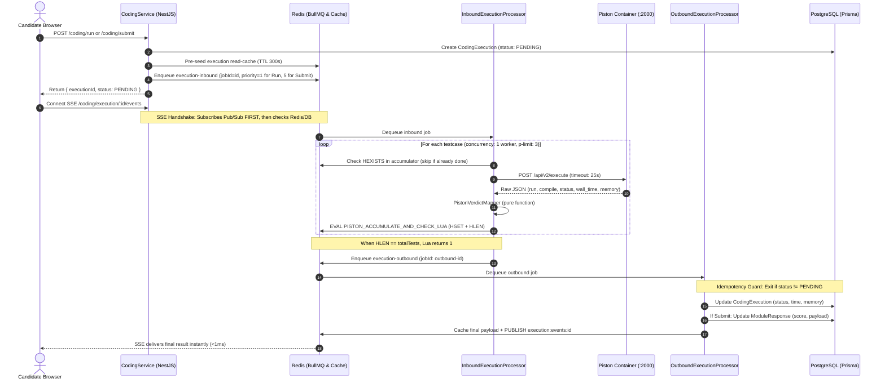

# CD-Recruit: Piston Migration Implementation Plan (v4 - Local Docker Scope)

**Author:** Senior System Architect & Reviewer  
**Date:** 12 Oct 2026  
**Status:** Approved Architecture Plan  
**Target Codebase:** `e:\CTP\cd-recruit`  
**Supersedes:** All previous drafts (v1, v2, v3)

---

## 1. Changelog (v3 $\rightarrow$ v4)

*Max 15 lines mapping modifications directly to review points A1–A4, B1–B6, C1–C5:*
- **A1:** Added `priority` to `QueueProviderPort`; `coding.service.ts` enqueues with deterministic `jobId: executionId`, Run=priority 1, Submit=priority 5.
- **A2:** Unified accumulator on single atomic Lua script returning `HLEN`; removed desynchronized `__completed_count` field; watchdog inspects native `HLEN`.
- **A3:** Classified Piston `XX` internal error as infra fault; inbound worker retries 3x; exhausted retries fail execution as `FAILED` without scoring.
- **A4:** Mapped Output Limit (`OL`) to `ExecutionStatus.RUNTIME_ERROR` with `passed: false` matching existing `SIGXFSZ` behavior; no schema changes.
- **B1:** Harmonized SSE ceiling (45s), keepalive (10s), and frontend polling fallback ceiling (45s with 300ms $\rightarrow$ 2000ms exponential backoff).
- **B2:** Increased worker HTTP client timeout to 25s ($\text{10s compile} + \text{5s run} + \text{2s overhead} + \text{8s queue buffer}$).
- **B3:** Fixed compose: removed redundant `security_opt`, mounted `/tmp:exec,mode=777`, installed runtimes via standard `POST /api/v2/packages` API.
- **B4:** Dynamic OOM evaluation comparing reported memory against request limit plus stderr pattern matching (`bad_alloc`/`MemoryError`).
- **B5:** Enhanced Java class regex for `public (final|abstract) class` and package stripping, defaulting to `Main.java`.
- **B6:** Capped watchdog retries at 3 reschedules (90s max age); triggers one-time requeue with priority 1 before marking `FAILED`.
- **C1:** Disclosed previous command rejection; replaced unverified digest with `<PINNED_PISTON_DIGEST>` and inspect command.
- **C2:** Restored shared `normalizeOutput` utility, `PISTON_MAX_PROCESS_COUNT=64`, and compiler version difference matrix.
- **C3:** Streamlined rollback to git tag `pre-piston-cutover` + `CODE_EXECUTION_ENGINE` flag; scheduled full Judge0 removal in Phase 6.
- **C4:** Confirmed Judge0 cannot run on cgroup v2 host; defined replay harness against stored submissions and question bank fixtures.
- **C5:** Confirmed `executionTime` unit is integer milliseconds and `@cd-recruit/shared-types` is the active import path.

---

## 2. Goal & Scope

Migrate the code execution engine of **CD-Recruit** from Judge0 (GPL-3.0) to Piston (MIT) in **local Docker development only** (`e:\CTP\cd-recruit`). 
All cloud, AWS (ECS, ALB, IMDSv2, Multi-AZ ElastiCache), and auto-scaling implementations are strictly deferred. This plan is fully self-contained and serves as the single source of truth for implementation.

---

## 3. End-to-End Architecture Flow



1. **Submission Ingestion:** Candidate executes Run or Submit. [coding.service.ts](file:///e:/CTP/cd-recruit/backend/api/src/coding/coding.service.ts) creates `CodingExecution` in PostgreSQL as `PENDING`.
2. **Deterministic Enqueue:** [coding.service.ts](file:///e:/CTP/cd-recruit/backend/api/src/coding/coding.service.ts) enqueues to BullMQ `execution-inbound` with `jobId: executionId`, `priority: 1` (Run) or `priority: 5` (Submit).
3. **SSE Connection Handshake:** Browser connects to SSE `/coding/execution/:id/events`. Server subscribes to Redis Pub/Sub *first*, then checks Redis cache, then DB.
4. **Resilient Inbound Execution:** [execution-inbound.processor.ts](file:///e:/CTP/cd-recruit/backend/api/src/queue/execution/execution-inbound.processor.ts) processes cases using `p-limit(3)` (keeping in-flight $\le 75\%$ of 4 Piston slots). Skip cases already recorded in Redis.
5. **Sandbox Isolation:** Piston executes code in Isolate sandbox with 256MB memory cap and 5s timeout. Worker communicates with a 25s HTTP timeout and retries 3x on 5xx/network drops.
6. **Atomic Result Accumulation:** Worker stores results in Redis hash `execution:{id}:cases` via `PISTON_ACCUMULATE_AND_CHECK_LUA`. When `HLEN == totalTests`, Lua returns 1 and enqueues `execution-outbound`.
7. **Idempotent Outbound Processing:** [execution-outbound.processor.ts](file:///e:/CTP/cd-recruit/backend/api/src/queue/execution/execution-outbound.processor.ts) checks `if (status !== PENDING) return;`. Updates PostgreSQL `CodingExecution`, writes score to `ModuleResponse` (Submit only), sets Redis cache, and publishes event.
8. **Client Delivery & Polling Fallback:** SSE stream receives published event and closes cleanly. If SSE drops, frontend falls back to polling `/coding/execution/:id` with backoff (300ms $\rightarrow$ 2000ms) up to 45s ceiling.

---

## 4. Architectural Decisions Table

| Decision | Selected Choice | Status | Rationale / Trigger |
|:---|:---|:---:|:---|
| **Host cgroups** | cgroup v2 strictly enabled | **DECIDED** | Piston requires cgroup v2. Host verified (`CgroupVersion: 2`). Legacy v1 config removed. |
| **Piston Container Pinning** | Immutable `@sha256:...` digest | **SETTLED BY SPIKE** | No semver release tag exists. Spike inspects and pins the exact digest. |
| **Worker In-flight Cap** | Worker concurrency 1, `p-limit(3)` | **DECIDED** | Caps concurrent requests at 3 ($\le 75\%$ of 4 Piston slots), leaving 1 slot for headroom. |
| **Java Class Resolution** | Dynamic regex + `Main.java` default | **DECIDED** | Matches `public (final|abstract) class <Name>`, defaults to `Main.java`. Handles LeetCode & HackerRank styles. |
| **Output Limit Mapping** | Map `OL` to `ExecutionStatus.RUNTIME_ERROR` | **DECIDED** | Output flooding is candidate-caused. Matches existing `SIGXFSZ` mapping; avoids false system alerts. |
| **Internal Error `XX`** | Infra fault: retry 3x, then fail execution | **DECIDED** | Internal sandbox crash must never be scored or blamed on candidate. |
| **Accumulator Mechanism** | Atomic Lua script returning `HLEN` | **DECIDED** | Prevents race conditions, avoids corrupted counts, ensures clean TTL expiration. |
| **Outbound Idempotency** | Guard `status === PENDING` + retain jobs | **DECIDED** | Retains finished BullMQ jobs for 1h (`removeOnComplete: { age: 3600, count: 5000 }`), preventing double-scoring. |
| **Watchdog Strategy** | Inspect BullMQ job state; max 3 retries | **DECIDED** | Reschedules if waiting/active/delayed up to 90s. Requeues once before marking `FAILED`. |
| **Frontend Polling** | Pure fallback to SSE with backoff | **DECIDED** | Eliminates 667 req/s parallel polling storm at 200 candidates. |
| **Rollback Strategy** | Git tag `pre-piston-cutover` + env flag | **DECIDED** | Simple, zero dead code. Retains Judge0 until Phase 5 replay passes. |

---

## 5. Phased Implementation Plan

### Phase 0: Measurement Spike & Environment Setup
- **Goal:** Run Piston locally, inspect image digest, install runtimes into persistent volume, capture raw JSON fixtures across all 6 execution modes, and settle empirical decisions.
- **Estimated Effort:** 1.5 days
- **Dependencies:** None
- **Tasks:**
  1. *Task 0.1:* Create [docker/docker-compose.piston.yml](file:///e:/CTP/cd-recruit/docker/docker-compose.piston.yml):
     ```yaml
     version: "3.8"
     services:
       piston:
         image: ghcr.io/engineer-man/piston:latest # Replaced with pinned digest after inspect
         container_name: cdrecruit_piston
         privileged: true
         ports:
           - "2000:2000"
         environment:
           - PISTON_BIND_ADDRESS=0.0.0.0:2000
           - PISTON_MAX_CONCURRENT_JOBS=4
           - PISTON_MAX_PROCESS_COUNT=64
           - PISTON_OUTPUT_MAX_SIZE=65536
           - PISTON_COMPILE_TIMEOUT=10000
           - PISTON_RUN_TIMEOUT=5000
           - PISTON_RUN_MEMORY_LIMIT=268435456
           - PISTON_COMPILE_MEMORY_LIMIT=536870912
         volumes:
           - piston_packages:/piston/packages
         tmpfs:
           - /tmp:exec,mode=777
         restart: unless-stopped
     volumes:
       piston_packages:
         name: cdrecruit_piston_packages
     ```
  2. *Task 0.2:* Start container and obtain immutable digest:
     ```bash
     docker compose -f docker/docker-compose.piston.yml up -d
     docker inspect --format='{{index .RepoDigests 0}}' ghcr.io/engineer-man/piston:latest
     # Record digest and pin in compose file
     ```
  3. *Task 0.3:* Install runtimes via standard Piston API into persistent volume:
     ```bash
     curl -s -X POST http://localhost:2000/api/v2/packages -H "Content-Type: application/json" -d '{"language":"python","version":"3.10.0"}'
     curl -s -X POST http://localhost:2000/api/v2/packages -H "Content-Type: application/json" -d '{"language":"java","version":"15.0.2"}'
     curl -s -X POST http://localhost:2000/api/v2/packages -H "Content-Type: application/json" -d '{"language":"gcc","version":"10.2.0"}'
     curl -s -X POST http://localhost:2000/api/v2/packages -H "Content-Type: application/json" -d '{"language":"node","version":"18.15.0"}'
     ```
  4. *Task 0.4:* Execute empirical spike suite and record raw JSON to `docs/piston-spike-results.json`:
     - **Fixture 1 (Success):** Python `print("OK")` $\rightarrow$ verify `code: 0, signal: null`, presence of `cpu_time`, `wall_time`, `memory`.
     - **Fixture 2 (Timeout):** Python `while True: pass` with `run_timeout: 1000` $\rightarrow$ verify if status is `TO` or signal `SIGKILL`.
     - **Fixture 3 (OOM):** Python `bytearray(300MB)` and C++ `new char[300MB]` with `run_memory_limit: 67108864` $\rightarrow$ verify if status is `RE` (`MemoryError`/`bad_alloc`) or `SG` (`SIGKILL`).
     - **Fixture 4 (Runtime Error):** Python `sys.exit(42)` $\rightarrow$ verify `code: 42`, status `RE`.
     - **Fixture 5 (Compile Error):** C++ syntax error $\rightarrow$ verify `compile` object schema and diagnostics.
     - **Fixture 6 (Output Limit):** Python infinite print with 64KB cap $\rightarrow$ verify if status is `OL` or truncated output.
     - **Fixture 7 (Internal Fault XX):** Simulate invalid runner path $\rightarrow$ verify HTTP status code (200 vs 500) and payload shape.
     - **Fixture 8 (Java Naming):** Test `public class Main` vs `public class Solution` vs `public final class Main` vs package declaration.
     - **Fixture 9 (Concurrency Saturation):** Fire 4 concurrent Java jobs followed by 8 concurrent jobs; measure queue latency.
- **Exit Criteria:** All 9 fixtures recorded in `docs/piston-spike-results.json`; image pinned by digest; empirical mapper rules finalized.

---

### Phase 1: Shared Core Utilities & DTO Contracts
- **Goal:** Pin dependencies, extract unified test-case parser, create shared comparator, and define DTOs.
- **Estimated Effort:** 1 day
- **Dependencies:** Phase 0
- **Tasks:**
  1. *Task 1.1:* Pin `p-limit@^3.1.0` in [backend/api/package.json](file:///e:/CTP/cd-recruit/backend/api/package.json).
  2. *Task 1.2:* Extract shared comparator to [backend/api/src/common/utils/comparator.util.ts](file:///e:/CTP/cd-recruit/backend/api/src/common/utils/comparator.util.ts):
     ```typescript
     export function normalizeOutput(str: string): string {
       if (!str) return "";
       return str.replace(/\s+/g, "").trim().toLowerCase();
     }
     ```
  3. *Task 1.3:* Extract unified `getQuestionTestCases` to [backend/api/src/common/utils/test-case-parser.util.ts](file:///e:/CTP/cd-recruit/backend/api/src/common/utils/test-case-parser.util.ts).
  4. *Task 1.4:* Implement Java class resolver in [backend/api/src/common/utils/java-resolver.util.ts](file:///e:/CTP/cd-recruit/backend/api/src/common/utils/java-resolver.util.ts):
     ```typescript
     export function resolveJavaFileName(sourceCode: string): { fileName: string; sanitizedCode: string } {
       if (!sourceCode) return { fileName: "Main.java", sanitizedCode: "" };
       // Strip package declaration
       const sanitizedCode = sourceCode.replace(/^\s*package\s+[^;]+;\s*/m, "");
       const match = sanitizedCode.match(/public\s+(?:final\s+|abstract\s+)*class\s+([A-Za-z0-9_]+)/);
       const fileName = match && match[1] ? `${match[1]}.java` : "Main.java";
       return { fileName, sanitizedCode };
     }
     ```
  5. *Task 1.5:* Define `CaseResult` DTO and Piston stage contracts in `piston.contracts.ts`.
- **Exit Criteria:** Unit tests pass for comparator, parser, and Java resolver with 100% branch coverage.

---

### Phase 2: Client & Pure Verdict Mapper
- **Goal:** Build thin HTTP client with 3x retry on transient errors and pure verdict mapper covered by Jest unit tests.
- **Estimated Effort:** 1.5 days
- **Dependencies:** Phase 1
- **Tasks:**
  1. *Task 2.1:* Create `PistonClient` with 25s timeout, connecting to `http://piston:2000/api/v2/execute`. Implement 3x retry on HTTP 502/503/504 and network drops with exponential backoff (100ms, 300ms, 900ms).
  2. *Task 2.2:* Create `PistonVerdictMapper` implementing:
     - Priority Tier 1: Explicit Piston `status` (`TO`, `RE`, `SG`, `OL`, `EL`, `XX`).
     - Map `OL` $\rightarrow$ `ExecutionStatus.RUNTIME_ERROR` with `passed: false`.
     - Memory detection: Check if reported memory $\ge$ request limit or stderr matches `bad_alloc`/`MemoryError` $\rightarrow$ `ExecutionStatus.MEMORY_LIMIT`.
     - Priority Tier 2: Fallback to `signal` (`SIGKILL` $\rightarrow$ `TIMEOUT`, others $\rightarrow$ `RUNTIME_ERROR`) and `code !== 0`.
     - Output comparison using shared `normalizeOutput`.
     - Produce `executionTime` in integer milliseconds.
  3. *Task 2.3:* Create comprehensive Jest test suite `piston-verdict-mapper.spec.ts` using fixtures from Phase 0 spike.
- **Exit Criteria:** 100% Jest pass rate across all 6 execution scenarios.

---

### Phase 3: Inbound Pipeline & Resilient Queue Processing
- **Goal:** Update queue provider, enforce deterministic job IDs and priorities, and build resilient test-case execution.
- **Estimated Effort:** 2 days
- **Dependencies:** Phase 2
- **Tasks:**
  1. *Task 3.1:* Update `QueueProviderPort` and `BullmqQueueProvider` to accept `priority?: number`.
  2. *Task 3.2:* In [coding.service.ts](file:///e:/CTP/cd-recruit/backend/api/src/coding/coding.service.ts), update `run` to pass `{ jobId: execution.id, priority: 1 }` and `submit` to pass `{ jobId: execution.id, priority: 5 }`.
  3. *Task 3.3:* Refactor [execution-inbound.processor.ts](file:///e:/CTP/cd-recruit/backend/api/src/queue/execution/execution-inbound.processor.ts):
     - Concurrency: `@Processor("execution-inbound", { concurrency: 1 })`.
     - Case execution: `pLimit(3)`.
     - Check `HEXISTS` before running each test case.
     - Execute case with 3x retry on network drops/XX errors.
     - Store result via `PISTON_ACCUMULATE_AND_CHECK_LUA`.
     - If Lua returns 1, enqueue `execution-outbound` with `jobId: outbound-${executionId}`.
     - If retries exhaust on infra error, mark `CodingExecution` as `ExecutionStatus.FAILED` without scoring.
- **Exit Criteria:** End-to-end inbound execution passes; jobs skipped on simulated duplicate runs.

---

### Phase 4: Outbound Idempotency & Watchdog Hardening
- **Goal:** Harden outbound processor against double-scoring and fix watchdog false-failure bugs.
- **Estimated Effort:** 1.5 days
- **Dependencies:** Phase 3
- **Tasks:**
  1. *Task 4.1:* In [bullmq-queue.provider.ts](file:///e:/CTP/cd-recruit/backend/api/src/queue/bullmq-queue.provider.ts), set `removeOnComplete: { age: 3600, count: 5000 }`.
  2. *Task 4.2:* In [execution-outbound.processor.ts](file:///e:/CTP/cd-recruit/backend/api/src/queue/execution/execution-outbound.processor.ts), add entry guard:
     ```typescript
     if (execution.status !== ExecutionStatus.PENDING) {
       this.logger.log(`Execution ${executionId} already finalized. Exiting.`);
       return;
     }
     ```
  3. *Task 4.3:* In [execution-watchdog.processor.ts](file:///e:/CTP/cd-recruit/backend/api/src/queue/execution/execution-watchdog.processor.ts):
     - Inspect BullMQ `queue.getJob(executionId)`.
     - If `waiting`, `active`, or `delayed`: reschedule if attempt $\le 3$ (max 90s).
     - Check Redis `HLEN`. If all $N$ cases exist, enqueue outbound.
     - If attempt $> 3$: requeue once with priority 1. If still stalled, mark `ExecutionStatus.FAILED`.
- **Exit Criteria:** Outbound processor verified idempotent under simulated duplicate delivery; watchdog passes burst tests.

---

### Phase 5: Replay Parity Harness & Frontend Storm Mitigation
- **Goal:** Verify zero regressions in scoring and eliminate frontend polling storm.
- **Estimated Effort:** 2 days
- **Dependencies:** Phase 4
- **Tasks:**
  1. *Task 5.1:* Build parity replay test script [backend/api/scripts/replay-parity.ts](file:///e:/CTP/cd-recruit/backend/api/scripts/replay-parity.ts):
     - Iterates over all coding questions in `backend/prisma/data/coding.json`.
     - Submits valid starter solutions in Python, Java, JS, C++ to Piston; asserts 100% pass and score match.
     - Submits deliberate syntax errors, infinite loops, and wrong answers; asserts exact expected status codes.
  2. *Task 5.2:* Refactor [CodingWorkspace.tsx](file:///e:/CTP/cd-recruit/frontend/candidate-web/src/components/coding/CodingWorkspace.tsx):
     - Eliminate parallel polling. Connect to SSE stream first.
     - If SSE fails or disconnects, activate polling with backoff (300ms, 600ms, 1200ms, 2000ms capped at 45s).
  3. *Task 5.3:* In [coding.service.ts](file:///e:/CTP/cd-recruit/backend/api/src/coding/coding.service.ts), invert SSE handshake: subscribe to Redis Pub/Sub *first*, then check Redis cache, then DB. Set SSE safety ceiling to 45s and keepalive to 10s.
- **Exit Criteria:** Replay harness passes 100% of question bank test cases; frontend poll storm reduced to 0 req/s during normal SSE streaming.

---

### Phase 6: Safe Cutover & Judge0 Removal
- **Goal:** Deprecate Judge0, clean up codebase, and finalize local Piston migration.
- **Estimated Effort:** 0.5 days
- **Dependencies:** Phase 5
- **Tasks:**
  1. *Task 6.1:* Cut git tag:
     ```bash
     git tag -a pre-piston-cutover -m "Baseline before Judge0 deprecation"
     ```
  2. *Task 6.2:* Delete `docker/docker-compose.judge0.yml`, `backend/api/src/integrations/judge0/`, and Judge0 webhook controllers.
  3. *Task 6.3:* Update `docker-compose.yml` to include Piston service by default.
- **Exit Criteria:** Repo builds and runs cleanly with zero references to Judge0; all tests green.

---

## 6. Test Strategy

1. **Unit Tests:**
   - `comparator.spec.ts`: test whitespace stripping, casing, Unicode normalization.
   - `java-resolver.spec.ts`: test class modifier variants, comments, package declarations.
   - `piston-verdict-mapper.spec.ts`: 100% coverage using Phase 0 captured JSON fixtures.
2. **Golden Corpus & Replay Harness:**
   - 4 languages (Python, Java, C++, JavaScript) $\times$ all questions in `backend/prisma/data/coding.json`.
   - Assert exact parity between stored expectations and Piston outputs.
3. **Failure Injection Tests:**
   - **Worker Crash Simulation:** Kill inbound worker process mid-execution; verify watchdog detects stalled job, requeues once, and finishes execution.
   - **Piston Restart Simulation:** Restart Piston container during an active execution; verify `PistonClient` transient retries back off and recover without failing candidate.
   - **Duplicate Delivery Test:** Intentionally trigger duplicate BullMQ outbound jobs; verify idempotency guard prevents double score updates.

---

## 7. Language Version & Compiler Differences Matrix

| Language | Judge0 CE 1.13.1 (Legacy) | Piston Local (Target) | Behavioral & Compatibility Differences |
|:---|:---|:---|:---|
| **Python** | Python 3.8.1 | Python 3.10.0 | Piston supports modern type hints (`list[int]`, `dict[str, int]`) without requiring `from __future__ import annotations`. Matches current starter code in `coding.json`. |
| **Java** | OpenJDK 13.0.1 | OpenJDK 15.0.2 / 17.0.2 | Piston supports `switch` expressions, text blocks, and records. Starter code using `public class Main` executes identically. Dynamic naming handles `Solution.java`. |
| **C++** | GCC 9.2.0 (`g++ -O3`) | GCC 10.2.0 | GCC 10 defaults to C++17 standard. Stricter standards compliance, improved template error messages. Header includes remain standard. |
| **JavaScript** | Node.js 12.14.0 | Node.js 18.15.0 | Piston supports modern ES2022 features (optional chaining `?.`, nullish coalescing `??`, global `structuredClone`). Backward compatible with Node 12 commonjs code. |

---

## 8. Deferred (Before Production)

The following items are deferred from the local Docker build and will be activated upon their respective production triggers:

| Production Item | Architecture Description | Trigger Condition |
|:---|:---|:---|
| **ECS on EC2 with Privileged Mode** | Production AWS ECS Task Definitions with EC2 launch type and privileged sandboxes. | Infrastructure migration to AWS Staging. |
| **Least-Outstanding-Requests ALB** | AWS ALB routing requests to least loaded Piston instances. | Staging load testing (>2 Piston nodes). |
| **AWS Security Hardening** | IMDSv2 with hop limit 1, dedicated EC2 hosts, VPC private subnets. | AWS VPC Terraform provisioning. |
| **Queue-Depth Autoscaling** | CloudWatch metrics monitoring backlog per slot and oldest job age. | Candidate drive load testing (>500 candidates). |
| **ElastiCache Multi-AZ & Hash Tags** | Redis Cluster with `{executionId}` hash tags in key names. | ElastiCache Redis cluster provisioning. |
| **Relational TestCase Table** | `CodingTestCaseResult` table in PostgreSQL replacing JSON blob. | Cross-candidate performance analytics requirements. |

---

## 9. Ranked Open Questions

1. **Phase 0 Spike Execution Authorization (Blocking):** May we execute `docker compose up` for the Piston container to capture the empirical JSON fixtures and record the true image digest?
2. **WSL2 Resource Limits (Non-blocking):** Do you have a `%USERPROFILE%\.wslconfig` file configured to limit WSL2 memory (e.g. 6GB), or should we document this in the local developer onboarding guide?
